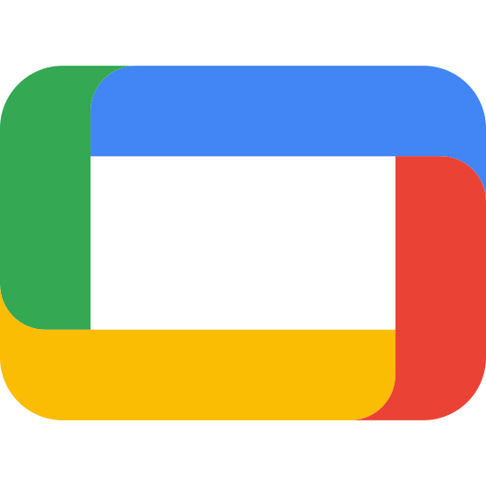

# Bobine

<p align="center">
  
</p>

<p align="center">
  <b>La régie vidéo open source, auto-hébergée et 100 % hors ligne pour salles de sport, studios de fitness et espaces de cours collectifs : cours planifiés, borne adhérents à la demande, pupitre coach et radio 24/7.</b>
</p>

<p align="center">
  <a href="https://bobine.fit/fr"><b>Site officiel</b></a> &nbsp;·&nbsp;
  <a href="https://bobine.fit/fr/telechargement"><b>Télécharger</b></a> &nbsp;·&nbsp;
  <a href="https://bobine.fit/fr/documentation"><b>Documentation utilisateur</b></a> &nbsp;·&nbsp;
  <a href="README.md"><b>English</b></a> &nbsp;·&nbsp;
  <a href="docs/ARCHITECTURE.md"><b>Architecture technique</b></a>
</p>

<p align="center">
  <a href="https://github.com/FantasmaGlad/Bobine/actions/workflows/ci.yml"></a>
  <a href="https://github.com/FantasmaGlad/Bobine/releases/latest"></a>
  <a href="LICENSE"></a>
  
  
  <a href="https://packages.bobine.fit/fr/"></a>
</p>

---

## Pourquoi Bobine ?

Les salles de cours collectifs et studios de cycling diffusent quotidiennement des cours vidéo sur grand écran ou vidéoprojecteur. Les solutions propriétaires imposent des abonnements mensuels par écran, un catalogue fermé et une connexion internet permanente.

**Bobine offre la même expérience en salle — gratuitement, sans abonnement et en toute autonomie :**

- **Vous êtes propriétaire** — vos vidéos, votre planning, l'identité visuelle de votre club et votre matériel. Aucun compte requis, aucune redevance mensuelle.
- **100 % hors ligne** — une fois installé, la salle n'a besoin d'aucune connexion internet pour lancer les cours planifiés, la borne adhérents ou la radio d'ambiance.
- **Compatible avec votre matériel** — s'installe en quelques secondes sur Windows, macOS, Linux, tablette Android, Google Book, boîtier Android TV ou mini PC dédié.
- **Autonome 24/7** — démarre tout seul à la mise sous tension et reprend automatiquement la séance en cours après une coupure de courant.

---

## Téléchargement & Installation

Application native pour ordinateurs, tablettes, téléviseurs et mini PC. Version Stable 5.1.1 ci-dessous ; tous les canaux et fichiers sur [**bobine.fit/fr/telechargement**](https://bobine.fit/fr/telechargement).

| Plateforme | Téléchargement | Prérequis |
| :--- | :--- | :--- |
|  **Windows** 10 et 11 | [x64](https://github.com/FantasmaGlad/Bobine/releases/download/V5.1.1/Bobine-Setup-5.1.1.exe) · [ARM64](https://github.com/FantasmaGlad/Bobine/releases/download/V5.1.1/Bobine-Setup-5.1.1-arm64.exe) | installeur `.exe`, Snapdragon pris en charge |
|  **macOS** | [Apple Silicon](https://github.com/FantasmaGlad/Bobine/releases/download/V5.1.1/Bobine-5.1.1.dmg) | M1 ou plus récent, `.dmg` |
|  **Debian, Ubuntu** | [APT](https://packages.bobine.fit/debian/) · [amd64](https://github.com/FantasmaGlad/Bobine/releases/download/V5.1.1/bobine_5.1.1_amd64.deb) · [arm64](https://github.com/FantasmaGlad/Bobine/releases/download/V5.1.1/bobine_5.1.1_arm64.deb) | glibc 2.38+ (Debian 13, Ubuntu 24.04) |
|  **Fedora, RHEL** | [DNF](https://packages.bobine.fit/fedora/) · [x86_64](https://github.com/FantasmaGlad/Bobine/releases/download/V5.1.1/bobine-5.1.1-1.x86_64.rpm) · [aarch64](https://github.com/FantasmaGlad/Bobine/releases/download/V5.1.1/bobine-5.1.1-1.aarch64.rpm) | glibc 2.38+ |
|  **Arch Linux** | [pacman](https://packages.bobine.fit/arch/) · [x86_64](https://github.com/FantasmaGlad/Bobine/releases/download/V5.1.1/bobine-5.1.1-1-x86_64.pkg.tar.zst) · [aarch64](https://github.com/FantasmaGlad/Bobine/releases/download/V5.1.1/bobine-5.1.1-1-aarch64.pkg.tar.zst) | glibc 2.38+ |
|  **Android** | [APK](https://github.com/FantasmaGlad/Bobine/releases/download/V5.1.1/Bobine-5.1.1.apk) | Android 14+, ARM64 |
|  **Android TV, Google TV** | [APK TV](https://github.com/FantasmaGlad/Bobine/releases/download/V5.1.1/Bobine-TV-5.1.1.apk) | ARM 32 et 64 bits |
|  **Tor (.onion)** | [site](http://bobinedaoki42tt33rxacmtaab2gxvxb2orqgcyhvowv3aggxhruvrid.onion/) · [paquets](http://rzvwjat5pidtxtwzcsvew7yc5ugfjvzz432ecpn3s5mlch4cs7vvmqad.onion/) | Tor Browser ou tor |

Mêmes paquets sur les dérivées (glibc 2.38+) :  Linux Mint ·  Pop!_OS ·  Zorin OS ·  Raspberry Pi OS ·  Nobara ·  RHEL 10+ ·  AlmaLinux 10+ ·  Rocky Linux 10+ ·  EndeavourOS ·  CachyOS ·  Manjaro

### Mini PC dédié

Transforme un mini PC (Debian 13, x64 ou ARM64) en lecteur Bobine dédié : il démarre directement sur le kiosque plein écran de sa sortie HDMI et reprend seul après une coupure de courant.

- **Depuis votre ordinateur, avec l'assistant d'installation** : il trouve le mini PC sur votre réseau, s'y connecte en SSH et installe tout avec une barre de progression. Assistant pour Linux : [x64](https://github.com/FantasmaGlad/Bobine/releases/download/V5.1.1/bobine-assistant) · [ARM64](https://github.com/FantasmaGlad/Bobine/releases/download/V5.1.1/bobine-assistant-arm64).
- **Directement sur le mini PC**, dans un terminal ([install.sh](https://github.com/FantasmaGlad/Bobine/releases/download/V5.1.1/install.sh)) :

  ```bash
  curl -fsSL https://bobine.fit/install.sh | bash
  ```

- **Script récupéré par Tor** sur le miroir onion (l'installation passe ensuite par le réseau habituel) :

  ```bash
  onion=http://bobinedaoki42tt33rxacmtaab2gxvxb2orqgcyhvowv3aggxhruvrid.onion
  curl --socks5-hostname 127.0.0.1:9050 -fsSL "$onion/install.sh" | bash
  ```

Prérequis : Debian 13 minimale avec SSH activé, sur le même réseau que votre ordinateur.

### Installation en une commande

 Windows (PowerShell) : installe la Stable après contrôle de la signature de `SHA256SUMS` et de son empreinte SHA-256, sans gpg.

```powershell
irm https://bobine.fit/install.ps1 | iex
```

Sur Windows PowerShell 5.1 avec un .NET antérieur à 4.7, exécutez `[Net.ServicePointManager]::SecurityProtocol = [Net.SecurityProtocolType]::Tls12` avant `irm` ; le script ne peut pas changer la version TLS de la requête qui le télécharge.

Autre canal (le pipe ne transmet pas les paramètres) :

```powershell
& ([scriptblock]::Create((irm https://bobine.fit/install.ps1))) -Channel beta
```

Par Tor (PowerShell 7.2+, Tor Browser ouvert ; `-TorPort 9050` pour le service tor) :

```powershell
$u = 'https://github.com/FantasmaGlad/Bobine/releases/latest/download/install.ps1'
$script = irm $u -Proxy socks5://127.0.0.1:9150
& ([scriptblock]::Create($script)) -Tor
```

 macOS (Homebrew) :

```bash
brew install --cask fantasmaglad/bobine/bobine
```

Par Tor :

```bash
ALL_PROXY=socks5h://127.0.0.1:9050 brew install --cask fantasmaglad/bobine/bobine
```

 Linux : dépôts signés, instructions sur [packages.bobine.fit](https://packages.bobine.fit). Par Tor, dépôts et clé de signature par le miroir onion :

```bash
onion=http://bobinedaoki42tt33rxacmtaab2gxvxb2orqgcyhvowv3aggxhruvrid.onion
curl --socks5-hostname 127.0.0.1:9050 -fsSL "$onion/install-tor.sh" | bash
```

 Par Tor, GitHub et Homebrew voient une sortie Tor et non votre adresse.

---

## Fonctionnalités clés

- **Planning hebdomadaire automatisé** — Programmez la grille horaire de vos salles ; les cours démarrent automatiquement à l'heure prévue sur le bon écran.
- **Borne adhérents à la demande (`/kiosk` & `/cinema`)** — Permettez aux membres de parcourir le catalogue par discipline et de lancer une séance en libre-service (écran tactile, télécommande TV, manette ou souris), avec enchaînement fluide sans écran noir et notation sur 5 étoiles en fin de séance.
- **Pupitre Studio Coach (`/grid` & `/coach`)** — Reliez un ordinateur portable ou une tablette Android en HDMI à l'écran de la salle : l'écran tactile sert de console de pilotage (sélection, chapitres, sous-titres, mode audio coach) tandis que le grand écran diffuse uniquement le cours en plein écran.
- **Télécommande mobile** — Ouvrez `http://bobine.local:1903` depuis n'importe quel smartphone connecté au Wi-Fi du club pour mettre en pause, avancer, choisir les sous-titres ou lancer un cours sans installer d'application.
- **Radio d'ambiance 24/7 & Rappels vocaux (`/radio`)** — Lecteur musical continu avec fondu enchaîné, égaliseur 5 bandes, playlists et diffusion automatique d'annonces vocales programmées (*« Pensez à ranger vos poids »*, etc.).
- **Deux sorties d'écran et de radio indépendantes** — Pilotez simultanément un écran câblé (HDMI) et un écran réseau avec deux programmes distincts.
- **Statistiques de fréquentation (`/metrics`)** — Suivez en local l'assiduité des cours, les notes des adhérents, les heures d'affluence sur 24 h et l'état du matériel.
- **9 thèmes de couleurs, chacun en clair et en sombre** — mode automatique selon l'appareil, contrastes vérifiés, sans dégradé de fond ; adaptés aux espaces d'accueil lumineux comme aux salles de cycling immersives.

---

## Prise en main rapide

1. **Installez et lancez Bobine** sur votre ordinateur, tablette ou mini PC.
2. **Ouvrez l'interface** depuis n'importe quel navigateur connecté au même réseau Wi-Fi ou Ethernet :
   ```text
   http://bobine.local:1903
   ```
   *(Ou `http://127.0.0.1:1903` directement sur la machine hôte ; sans le port sur le mini PC dédié. Toutes les adresses de l'appareil sont dans Réglages → Documentation.)*
3. **Importez vos premières vidéos** par glisser-déposer dans l'onglet **Bibliothèque** (les musiques vont dans l'onglet **Piste Audio Radio**), puis lancez une séance ou configurez votre **Planning**.

Toutes les interfaces fonctionnent immédiatement sur **Mozilla Firefox**, **Google Chrome**, **Microsoft Edge**, **Apple Safari**, **Brave** et **Tor Browser**, sans aucune installation sur les appareils clients.

---

## Canaux de mise à jour

Bobine propose trois canaux de mise à jour, modifiables à tout moment dans **Réglages → Mises à jour logicielles** :

| Canal | Cadence | Public visé | Liens |
| :--- | :--- | :--- | :--- |
| **Stable** | Versions officielles taguées (`V5.1.1`) | Choix par défaut recommandé pour l'exploitation en salle | [Dernière Stable](https://github.com/FantasmaGlad/Bobine/releases/latest) |
| **Bêta** | Lots d'accès anticipé sélectionnés | Découverte des prochaines nouveautés avant leur sortie Stable | [Release Bêta](https://github.com/FantasmaGlad/Bobine/releases/tag/beta) |
| **Canary** | Reconstruite à chaque commit sur `main` | Utilisateurs avancés souhaitant tester immédiatement les derniers changements | [Release Canary](https://github.com/FantasmaGlad/Bobine/releases/tag/canary) |

---

## Documentation & Guides matériel

- **Guide utilisateur & FAQ** : [bobine.fit/fr/documentation](https://bobine.fit/fr/documentation)
- **Compatibilité matérielle** *(mini PC, PC portables, tablettes, box TV)* : [bobine.fit/fr/telechargement](https://bobine.fit/fr/telechargement)
- **Portail des paquets Linux** *(instructions APT, DNF, Pacman)* : [packages.bobine.fit/fr/](https://packages.bobine.fit/fr/)
- **Architecture technique & Référence API** : [docs/ARCHITECTURE.md](docs/ARCHITECTURE.md)

---

## Sécurité & Licence

- **Sécurité** : Signalez toute vulnérabilité en privé via [GitHub Security Advisories](https://github.com/FantasmaGlad/Bobine/security/advisories/new) ou à [security@bobine.fit](mailto:security@bobine.fit) (empreinte OpenPGP `23CA D324 C507 FB0F 97E6 AECA 6E4C 020E F8BD FEB2`, détails sur [security.bobine.fit/fr/](https://security.bobine.fit/fr/) et [docs/fr/SECURITY.md](docs/fr/SECURITY.md)).
- **Contribuer** : Les signalements de bugs et contributions sont bienvenus — voir [docs/fr/CONTRIBUTING.md](docs/fr/CONTRIBUTING.md) et [docs/fr/CODE_OF_CONDUCT.md](docs/fr/CODE_OF_CONDUCT.md).
- **Licence** : Logiciel libre et gratuit distribué sous licence **GNU Affero General Public License v3.0 ([AGPL-3.0](LICENSE))**.

<sub>Dépôts liés : [BobineWeb](https://github.com/FantasmaGlad/BobineWeb) (site) · [bobine-packages](https://github.com/FantasmaGlad/bobine-packages) (dépôts de paquets Linux) · [homebrew-bobine](https://github.com/FantasmaGlad/homebrew-bobine) (tap Homebrew) · Politique de sécurité : [security.bobine.fit](https://security.bobine.fit/fr/), [`/.well-known/security.txt`](https://bobine.fit/.well-known/security.txt)</sub>
