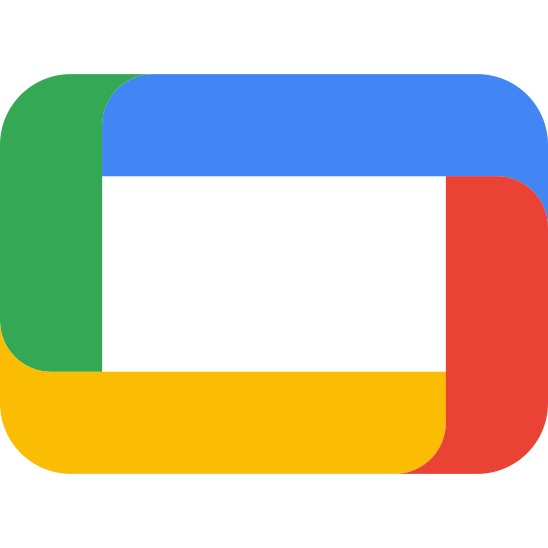

# Bobine

<p align="center">
  
</p>

<p align="center">
  <b>The open-source, self-hosted and 100% offline video playout, member kiosk, coach console, and 24/7 radio system for fitness clubs, gyms, and sports studios.</b>
</p>

<p align="center">
  <a href="https://bobine.fit"><b>Official Website</b></a> &nbsp;·&nbsp;
  <a href="https://bobine.fit/en/download"><b>Downloads</b></a> &nbsp;·&nbsp;
  <a href="https://bobine.fit/en/documentation"><b>User Documentation</b></a> &nbsp;·&nbsp;
  <a href="https://bobine.fit/en/hardware/aliexpress"><b>Recommended Hardware</b></a> &nbsp;·&nbsp;
  <a href="README.fr.md"><b>Français</b></a> &nbsp;·&nbsp;
  <a href="docs/ARCHITECTURE.en.md"><b>Technical Architecture</b></a>
</p>

<p align="center">
  <a href="https://github.com/FantasmaGlad/Bobine/actions/workflows/ci.yml"></a>
  <a href="https://github.com/FantasmaGlad/Bobine/releases/latest"></a>
  <a href="LICENSE"></a>
  
  
  <a href="https://packages.bobine.fit"></a>
</p>

---

## Why Bobine?

Group-fitness rooms and cycling studios run pre-recorded video classes ("virtual classes") on large screens or projectors. Proprietary solutions like Les Mills Cinema, Wexer Virtual, or Fitness On Demand require monthly subscriptions per screen, closed catalogs, and a permanent internet connection.

**Bobine gives your studio the same cinema-grade experience — free of charge, without any subscription, and under your full control:**

- **You own everything** — your videos, your schedule, your club branding, and your hardware. No account, no license fee, no vendor lock-in.
- **100% Offline** — once installed, your studio needs no internet connection to play scheduled classes, run the member kiosk, or stream background radio.
- **Runs on the hardware you already have** — installs in seconds on Windows, macOS, Linux, Android tablets, Google Books, Android TV boxes, or a refurbished mini PC.
- **Unattended 24/7 reliability** — starts automatically when powered on and resumes playback after a power cut without human intervention.

---

## Download & Install

Install Bobine as a native application on your tablet, computer, or mini PC (or visit [**bobine.fit/en/download**](https://bobine.fit/en/download)):

| Platform | Format | Architecture | Direct Download / Command | Target Profile & Key Features |
| :--- | :---: | :---: | :---: | :--- |
|  **Windows 11 & 10** | `.exe`<br>*(Installer)* | x86-64 & ARM64<br>*(Snapdragon)* | [**Bobine-Setup-5.0.7.exe (x86-64)**](https://github.com/FantasmaGlad/Bobine/releases/download/V5.0.7/Bobine-Setup-5.0.7.exe)<br>[**Bobine-Setup-5.0.7-arm64.exe (ARM64)**](https://github.com/FantasmaGlad/Bobine/releases/download/V5.0.7/Bobine-Setup-5.0.7-arm64.exe) | **Windows 11/10 Desktop PCs & Snapdragon ARM Laptops**<br>Native x86-64 and ARM64 installer (Snapdragon X Elite / X Plus), system tray companion, clamshell mode |
|  **macOS** *(Apple Silicon)* | `.dmg`<br>*(Disk Image)* | ARM64<br>*(Apple Silicon)* | [**Bobine-5.0.7.dmg**](https://github.com/FantasmaGlad/Bobine/releases/download/V5.0.7/Bobine-5.0.7.dmg) | **MacBook, Mac mini & iMac (M1–M4)**<br>Drag-and-drop `.dmg`, native Apple Silicon hardware acceleration, menu bar companion |
|  **Debian & Ubuntu** | `.deb`<br>APT | amd64 & arm64 | [**APT Repository**](https://packages.bobine.fit/debian/)<br>[**bobine_5.0.7_amd64.deb**](https://github.com/FantasmaGlad/Bobine/releases/download/V5.0.7/bobine_5.0.7_amd64.deb)<br>[**bobine_5.0.7_arm64.deb**](https://github.com/FantasmaGlad/Bobine/releases/download/V5.0.7/bobine_5.0.7_arm64.deb) | **Debian 13+, Ubuntu 24.04+, Linux Mint, Pop!_OS, Zorin OS**<br>Native `.deb` packages via [packages.bobine.fit/debian/](https://packages.bobine.fit/debian/), automated apt updates |
|  **Fedora & RHEL** | `.rpm`<br>DNF | x86_64 & aarch64 | [**DNF Repository**](https://packages.bobine.fit/fedora/)<br>[**bobine-5.0.7-1.x86_64.rpm**](https://github.com/FantasmaGlad/Bobine/releases/download/V5.0.7/bobine-5.0.7-1.x86_64.rpm)<br>[**bobine-5.0.7-1.aarch64.rpm**](https://github.com/FantasmaGlad/Bobine/releases/download/V5.0.7/bobine-5.0.7-1.aarch64.rpm) | **Fedora 39–41, Nobara, RHEL, AlmaLinux, Rocky Linux**<br>Signed RPM repository via [packages.bobine.fit/fedora/](https://packages.bobine.fit/fedora/), fast DNF installation |
|  **Arch Linux** | `.pkg.tar.zst`<br>pacman | x86_64 & aarch64 | [**Pacman Repository**](https://packages.bobine.fit/arch/)<br>[**bobine-5.0.7-1-x86_64.pkg.tar.zst**](https://github.com/FantasmaGlad/Bobine/releases/download/V5.0.7/bobine-5.0.7-1-x86_64.pkg.tar.zst)<br>[**bobine-5.0.7-1-aarch64.pkg.tar.zst**](https://github.com/FantasmaGlad/Bobine/releases/download/V5.0.7/bobine-5.0.7-1-aarch64.pkg.tar.zst) | **Arch Linux, EndeavourOS, CachyOS, Manjaro**<br>Signed pacman repository via [packages.bobine.fit/arch/](https://packages.bobine.fit/arch/), continuous rolling updates |
|  **Android & Google Book** | `.apk`<br>*(Native App)* | ARM64<br>*(arm64-v8a)* | [**Bobine-5.0.7.apk**](https://github.com/FantasmaGlad/Bobine/releases/download/V5.0.7/Bobine-5.0.7.apk) | **Android Tablets, Google Books & ARM Kiosks**<br>Touch coach desk (`/grid`) + clean fullscreen HDMI cinema (`/cinema`), Qualcomm Snapdragon 8 Gen 2 / 8 Gen 3 / 8 Elite |
|  **Android TV & Google TV** | `.apk`<br>*(TV App)* | ARM 32 & 64-bit<br>*(v7a & v8a)* | [**Bobine-TV-5.0.7.apk**](https://github.com/FantasmaGlad/Bobine/releases/download/V5.0.7/Bobine-TV-5.0.7.apk) | **Smart TVs, Projectors & Streaming Boxes**<br>Leanback TV launcher, TV remote D-Pad navigation, offline cinema kiosk |
|  **Dedicated Mini PC** *(Debian 13)* | Shell Script<br>*(Automated)* | x86-64 & ARM64 | `curl -fsSL https://bobine.fit/install.sh \| bash`<br>[**bobine-assistant (x86-64)**](https://github.com/FantasmaGlad/Bobine/releases/download/V5.0.7/bobine-assistant)<br>[**bobine-assistant-arm64 (ARM64)**](https://github.com/FantasmaGlad/Bobine/releases/download/V5.0.7/bobine-assistant-arm64) | **Autonomous 24/7 Playout Appliance**<br>Turns any low-cost mini PC into an autonomous kiosk with auto-login, HDMI-CEC screen automation, and network recovery |
|  **Tor Network (.onion)** | APT Repo & Mirror<br>*(Tor Network)* | x86-64 & ARM64 | `curl -fsSL https://bobine.fit/install-tor.sh \| bash`<br>[**Tor Mirror (.onion)**](http://bobinedaoki42tt33rxacmtaab2gxvxb2orqgcyhvowv3aggxhruvrid.onion/)<br>[**APT Repo (.onion)**](http://rzvwjat5pidtxtwzcsvew7yc5ugfjvzz432ecpn3s5mlch4cs7vvmqad.onion/) | **Anonymous Installation (.onion)**<br>Install and receive signed updates anonymously without exposing the gym's public IP address |

---

## Key Features

- **Weekly Class Timetable** — Schedule your group classes across the week; workouts start automatically on time on the right screen.
- **Interactive Member Kiosk (`/kiosk` & `/cinema`)** — Let members browse your catalog by category and start a class on demand using a touch screen, TV remote, gamepad, or mouse, with gapless transitions and 5-star session ratings.
- **Studio Coach Desk (`/grid` & `/coach`)** — Connect a laptop or Android tablet to your room's HDMI display: the coach controls classes, chapters, subtitles, and audio from the touch screen while members only see clean fullscreen video on the projector.
- **Smartphone Remote Control** — Scan a local QR code from any phone on the studio Wi-Fi to pause, seek, switch subtitles, or launch a workout without installing an app.
- **24/7 Club Radio & Voice Reminders (`/radio`)** — Built-in music player with automatic crossfade, 5-band equalizer, playlists, and scheduled spoken announcements (e.g., *"Please re-rack your weights"*).
- **Two Independent Display & Radio Outputs** — Drive a wired HDMI screen and a secondary network screen simultaneously with separate content.
- **Attendance Metrics (`/metrics`)** — Track class completion rates, 5-star member feedback, peak studio hours, and device health locally.
- **16 Color Themes** — Light and dark high-contrast themes (including the Apple-inspired *Charbon* palette) adaptable to bright reception areas or dark cycling rooms.

---

## Quick Start

1. **Install and launch Bobine** on your computer, tablet, or mini PC.
2. **Open the interface** from any browser on the same Wi-Fi / Ethernet network:
   ```text
   http://bobine.local
   ```
   *(Or `http://127.0.0.1:8000` directly on the host machine).*
3. **Import your first videos or music tracks** by drag-and-drop in the **Library** tab, then launch a class or set up your weekly **Schedule**.

All web interfaces work out of the box on **Mozilla Firefox**, **Google Chrome**, **Microsoft Edge**, **Apple Safari**, **Brave**, and **Tor Browser** with zero client installation.

---

## Update Channels

Bobine offers three update channels, switchable anytime in **Settings → Software Updates**:

| Channel | Cadence | Who it is for | Links |
| :--- | :--- | :--- | :--- |
| **Stable** | Tagged version releases (`V5.0.7`) | Recommended default for production clubs and studios | [Latest Stable](https://github.com/FantasmaGlad/Bobine/releases/latest) |
| **Beta** | Curated preview batches | Early adopters wanting upcoming features before Stable | [Beta Release](https://github.com/FantasmaGlad/Bobine/releases/tag/beta) |
| **Canary** | Rebuilt on every commit to `main` | Power users and testers wanting the latest changes immediately | [Canary Release](https://github.com/FantasmaGlad/Bobine/releases/tag/canary) |

---

## Documentation & Hardware Guides

- **User Guide & FAQ**: [bobine.fit/en/documentation](https://bobine.fit/en/documentation)
- **Independent Hardware Guide** *(mini PCs, tablets, TV boxes, HDMI adapters)*: [bobine.fit/en/hardware/aliexpress](https://bobine.fit/en/hardware/aliexpress)
- **Linux Package Portal** *(APT, DNF, Pacman instructions)*: [packages.bobine.fit](https://packages.bobine.fit)
- **Technical Architecture & API Reference**: [docs/ARCHITECTURE.en.md](docs/ARCHITECTURE.en.md)

---

## Security & License

- **Security**: Report vulnerabilities privately via [GitHub Security Advisories](https://github.com/FantasmaGlad/Bobine/security/advisories/new) or [security@bobine.fit](mailto:security@bobine.fit) (OpenPGP fingerprint `23CA D324 C507 FB0F 97E6 AECA 6E4C 020E F8BD FEB2`, details on [security.bobine.fit](https://security.bobine.fit) and [SECURITY.md](SECURITY.md)).
- **Contributing**: Bug reports and pull requests are welcome — see [CONTRIBUTING.md](CONTRIBUTING.md) and [CODE_OF_CONDUCT.md](CODE_OF_CONDUCT.md).
- **License**: Free and open-source software licensed under the **GNU Affero General Public License v3.0 ([AGPL-3.0](LICENSE))**.
