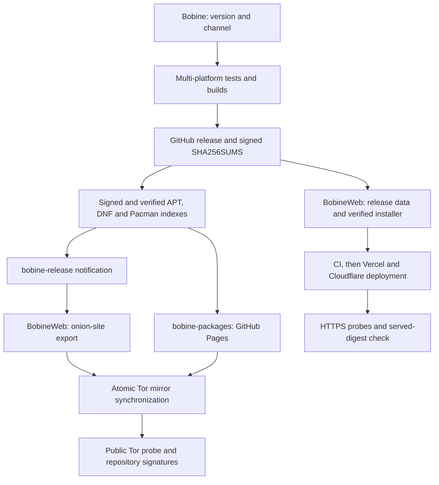

<p align="center">
  
</p>

# Bobine — Technical Architecture & Developer Reference

> **Bilingual document**: this file must be kept in sync with its French version ([`ARCHITECTURE.md`](ARCHITECTURE.md)) — last synchronized: 2026-10-24.

> Technical reference. For a user-oriented presentation (what Bobine is for, guided installation, getting started), see the **[README](../README.md)** (`README.fr.md` for French).

Playback, scheduling and control of class videos in a gym, on a dedicated mini PC, desktop workstation or tablet. Single-process FastAPI server + SQLite, Chromium X11 kiosk, Next.js admin interface and mobile remote control.

This document is written for anyone who wants to **understand, operate, modify or deploy** the Bobine system: it describes the architecture as it actually stands (not an intention), the network contract, the data model, and the operating configuration on a dedicated mini PC.

---

## Table of Contents

1. [Stack & Getting Started](#1-stack--getting-started)
2. [General Architecture](#2-general-architecture)
3. [Data Model & SQLite Persistence](#3-data-model--sqlite-persistence)
3bis. [Import Pipeline, Multi-OS Hardware Acceleration & Reactive Cancellation](#3bis-import-pipeline-multi-os-hardware-acceleration--reactive-cancellation)
3ter. [Universal Multi-OS Hardware Telemetry & Attendance Metrics](#3ter-universal-multi-os-hardware-telemetry--attendance-metrics)
4. [Broadcast Channels & Playback Manager](#4-broadcast-channels--playback-manager)
5. [Radio Module](#5-radio-module)
5bis. [Devices (audio, Bluetooth, Wi-Fi)](#5bis-devices-audio-bluetooth-wi-fi)
5ter. [External storage](#5ter-external-storage-usb-drives-disks-sd-cards-phones)
6. [Audio Coach Mode & Animated Backgrounds Hub](#6-audio-coach-mode--animated-backgrounds-hub)
7. [Install Script & systemd Services](#7-install-script--systemd-services)
8. [HTTP API & WebSocket Reference](#8-http-api--websocket-reference)
9. [Operations & Network Discovery (Wyse)](#9-operations--network-discovery-wyse)
10. [Interface Matrix & Multi-Platform Compatibility](#10-interface-matrix--multi-platform-compatibility)
10bis. [Per-channel icons](#10bis-per-channel-icons-stable-beta-canary)
11. [License](#11-license)

---

## 1. Stack & Getting Started

### Technical Stack

- **Backend**: Python 3.11+, [FastAPI](https://fastapi.tiangolo.com/) + `uvicorn` (single-process, see §2), [SQLAlchemy](https://www.sqlalchemy.org/), SQLite (`data/database.db`), `APScheduler` (scheduling), `watchdog` (import folder monitoring), `ffmpeg` with **multi-OS hardware acceleration** (`h264_mediacodec` on Android, `h264_videotoolbox` on macOS Apple Silicon/Intel, `h264_vaapi` on Linux with Intel QuickSync or AMD Mesa drivers, `h264_qsv` on Windows with an Intel QuickSync driver, universal fallback to `libx264`), Web Audio API (radio crossfade, browser-side). Strict policy of preserving 2K/4K streams in full, with no downsampling.
- **Frontend**: [Next.js](https://nextjs.org/) 16 (App Router, static export served by the backend in production), React 19, TypeScript, vanilla CSS (global styles + design tokens, **16 hot-swappable color themes** via `:root[data-theme=…]`, including the mineral "Charbon" / "Charbon Sombre" pair certified WCAG AA/AAA, Apple Glassmorphism design system with 28px specular blur, tactile haptic micro-interactions and dynamic high-contrast borders, mutually exclusive sidebar accordion navigation and asymmetric Bento grid for direct actions), PWA (`manifest.json`), WebSockets, native HTML5 drag-and-drop, Web Audio API.
- **Operations & Kiosk**: Debian 13 (Trixie), Chromium in kiosk mode (X11 / `xinit`), `systemd` (backend, kiosk, audio guard and watchdog services), `avahi-daemon` (mDNS discovery).
- **Android Portability (`android/`)**: native Android application (Kotlin + embedded CPython via [Chaquopy](https://chaquopy.com/)), `minSdk 34` / `targetSdk 36` (Android 14-16, API 36 / Xiaomi Pad 8). Hardware dual-display via `DisplayManager` and `Presentation` (touch screen on `/grid` with no sidebar, external HDMI output via a USB-C dock on `/cinema` with a "Waiting for a class" idle screen), persistent `ForegroundService`, ARM64 NDK r28c binaries (native Bionic `ffmpeg`/`ffprobe`, 16 KB page size) with `av1_mediacodec` hardware decoding and ultra-fast `h264_mediacodec` encoding.
- **Installation & tooling**: `install.sh` (idempotent **Bash**: dynamic hardware detection, APT remediation, `--as-user`, machine-readable `--progress=json` output, §7); **graphical installation assistant** (`assistant/`, a **Tauri / Rust** desktop app, `/24` scan of every local network interface and SSH orchestration — see [`assistant/README.md`](../assistant/README.md)).

**Repository languages**: **Python** (FastAPI backend), **TypeScript/React** (Next.js frontend), **Kotlin** (Android app), **Bash** (`install.sh`), **Rust** (core of the installation assistant). **Continuous Integration** (GitHub Actions, `.github/workflows/ci.yml`) on every push/PR: frontend build, Firefox smoke tests (geckodriver), backend syntax check and `pytest` (Python 3.11, 3.12 and 3.13), `cargo clippy` + `cargo test` for the assistant, the devices component (`devices/`) and the native audio component (`media/`, four platforms, plus a license check), Android APK build and signing, `install.sh` sanity checks (syntax + step-counter consistency), then the Windows, Linux (`.deb`) and macOS packages. Frontend tests (`npm test`) and type checking (`npx tsc --noEmit`) run locally: CI only builds the frontend.

### Local Development

**Prerequisites**: Node.js ≥ 20, Python ≥ 3.11.

```bash
# 1. Backend (FastAPI) — port 8001 in dev (see note below)
cd backend
python3 -m venv .venv && source .venv/bin/activate
pip install -r requirements.txt
uvicorn app.main:app --reload --host 0.0.0.0 --port 8001

# 2. Frontend (Next.js)
cd frontend
npm install
npm run dev             # available at http://localhost:3000
```

> **Dev quirk (port)**: served by `next dev` on `:3000`, the frontend routes its API/WebSocket calls to `localhost:8001` (see `getApiUrl`/`getWsUrl`) — hence the backend running on **8001** in development. An alternative without this offset, useful for checking the real rendering: `cd frontend && npm run build` (static export into `frontend/out`) then run the backend on `:8000` — it serves `frontend/out` itself at `/` (same origin as `/api`), so you can simply browse to `http://localhost:8000/<route>/`.

**Quick validation before committing**:

```bash
# Python syntax check (AST)
backend/.venv/bin/python -c "import ast; ast.parse(open('backend/app/main.py').read())"

# Backend tests
cd backend && python -m pytest -q

# Frontend type check and tests (TypeScript)
cd frontend && npx tsc --noEmit && npm test

# Native audio component (Rust) — same checks as CI
cd media && cargo fmt --check && cargo clippy --locked --all-targets -- -D warnings && cargo test --locked

# Installation assistant core tests (Rust) — same checks as CI
cd assistant && cargo test --workspace
```

### Configuration (`config.toml`)

Configuration is loaded in the following priority order:
1. Environment variables prefixed `BOBINE_` (highest priority).
2. `/etc/bobine/config.toml` (production, written by `install.sh`).
3. `config.toml` at the repository root (development).

| Key | Default | Role |
|---|---|---|
| `database.database_url` | `sqlite:///data/database.db` | SQLite connection URL |
| `media.media_dir` | `data/videos` | Storage for imported videos |
| `media.watch_dir` | `data/watched` | Folder watched for automatic import |
| `server.host` / `port` | `0.0.0.0:8000` | Backend HTTP listen address |
| `playback.wait_time_between_courses` | `0` | Inter-course delay (s) |
| `playback.volume_default` | `100` | Default volume (0-100) |

> **Upload temp files**: on startup the backend forces `tempfile.tempdir` to `data/tmp` (next to the media), instead of `/tmp`. On the Wyse, `/tmp` is an in-RAM tmpfs (~3.8 GB) that a large video/audio import would saturate (`OSError: No space left on device`, surfaced client-side as "There was an error parsing the body") even though the media disk has dozens of GB free.

---

## 2. General Architecture

```
┌─────────────┐      HTTP / WebSockets      ┌─────────────────────────────────┐
│  Frontend   │ --------------------------->│        Backend FastAPI          │
│  Next.js    │                             │    (uvicorn, single-process)    │
│ (Kiosk /    │<--------------------------- │  app/routers/* → playback_mgr   │
│  Admin /    │                             └─────────────────────────────────┘
│ Mobile Remote)│                                    │
└─────────────┘                                    │
                                                   v
                                          ┌──────────────┐
                                          │    SQLite    │
                                          │ (database.db)│
                                          └──────────────┘
```

The backend runs as a single `uvicorn` process (`--workers 1`). Playback state (position, playlist, schedule) lives directly in this process's memory and is broadcast to connected clients over WebSocket; no external state bus is needed to stay in sync.

> **History (before moving to a single process)**: the backend used to run with 4 `uvicorn` workers under the same master process, and Redis served as a shared state bus (playback position, tick locks, schedule synchronization) and an inter-worker Pub/Sub channel — since each worker ran its own copy of the `lifespan` and the `AsyncIOScheduler`, any side-effecting action (radio auto-start, triggering a schedule) had to be protected by a distributed lock so it would only happen once. Moving to a single process removes this entire class of problems by construction: there is now only one copy of each piece of state, and no more race between workers to arbitrate.

### Backend Layout (`backend/app/`)

- `main.py`: FastAPI application entry point, route initialization, startup events (`boot_state.py`) and the static asset server.
- `playback_manager.py`: Multi-channel (cabled/network) playback engine (`PLAYING`, `PAUSED`, `IDLE` state management, timing and resume).
- `radio_manager.py`: Playback engine for the Radio channel (§5) — state INDEPENDENT from `playback_manager.py` (track playlist, not video/course), same WebSocket connection.
- `scheduler_manager.py`: `APScheduler`-based manager for time-based scheduling (recurrences, conflict detection, offsets, radio windows).
- `models.py`: SQLAlchemy ORM declarations.
- `config.py`: Dynamic configuration manager.
- `routers/`: HTTP endpoints grouped by domain (`videos`, `backgrounds`, `playlists`, `audio`, `audio_playlists`, `schedule`, `playback`, `settings`, `logs`, `import_jobs`, `radio`, `radio_playlists`, `radio_announcements`, `devices`, `storage`, `chapters`, `metrics`, `updates`, `uploads`, `display`, `diagnostics`); `devices/`: driver interface and the Linux, sidecar and Android drivers, PIN and service (§5bis).

---

## 3. Data Model & SQLite Persistence

The data schema is managed by **SQLAlchemy**. There is **no active Alembic** in this project (the `alembic/versions/` folder does not exist: only `alembic.ini`, `alembic/env.py` and `alembic/README` are present): tables are created by `Base.metadata.create_all()` at startup, and adding columns to existing tables goes through idempotent micro-migrations in `database.py::_migrate_add_missing_columns`. Storage is a single SQLite file (`data/database.db`).

### Main Entities

- `videos` / `backgrounds`: Media metadata (duration, resolution, codec, description/synopsis, fps, bitrate, audio channels and audio codec, thumbnails generated into `data/thumbnails`).
- `video_subtitles`: Multilingual synchronized subtitles associated with video courses (`video_id`, `language_code`, `language_label`, `file_path`, `format`), stored in standardized WebVTT (`data/subtitles/`) with automatic conversion of imported `.srt` files.
- `playlists` & `playlist_items`: Ordered video course playlists.
- `audio_courses` & `audio_tracks`: Imported audio courses and their associated tracks.
- `audio_playlists` & `audio_playlist_items`: Mixed audio-coach editions with a visual background assigned per track.
- `schedules` & `schedule_overrides`: Recurring or one-off schedules, with occurrence-exception handling (cancellation, replacement).
- `playback_state`: Playback state persisted per channel (*Cabled* and *Network*), including the saved interrupted action for automatic resume.
- `playback_sessions`: Attendance/listening sessions per channel and launch type, watched duration, total duration and completion status (`completed = True` if progress ≥ 90%).
- `course_ratings`: 5-star satisfaction ratings (score 1 to 5) collected on the coach desk `/grid` or the big screen `/cinema`, with UTC timestamp and channel.
- `settings`: Key/value settings hot-editable from the admin interface.
- `activity_log`: Log of the system's functional and technical events.
- `radio_tracks`, `radio_tags`, `radio_playlists` & `radio_playlist_items`: Music library and playlists for the Radio module (§5) — a subsystem independent from video courses/audio coach.
- `radio_announcements` & `radio_announcement_rules`: Courtesy reminders (announcements) and their trigger rules.

---

### 3.1 Android profile: Pydantic v1 compatibility and folder watching

Two backend dependencies have no usable distribution on Android (Chaquopy), so the Android profile uses different versions and fallbacks without forking the code:

- **Pydantic v1 instead of v2.** Pydantic v2 relies on `pydantic-core`, a native extension with no Android distribution. The APK bundles `pydantic==1.10.26` with `fastapi==0.99.1` (Starlette 0.27); the other profiles use Pydantic v2. The code must stay valid under both: `app/utils/_pydantic_compat.py` provides a `computed_field` equivalent for v1, `app/config.py` falls back to the `BaseSettings` built into Pydantic v1 when `pydantic_settings` is missing, and the response-schema `Config` classes carry both `from_attributes = True` (v2) and `orm_mode = True` (v1, silently ignored by v2).
- **Folder watching by periodic polling.** The `watchdog` package has no Android distribution. `app/utils/watcher.py` imports `watchdog` when available and otherwise `app/utils/_polling_observer.py`, which lists each watched folder every 2 seconds (`os.listdir`) and reports new entries. It implements a subset of the `watchdog` API (enough for folder import, which is not latency-sensitive).

Code comments that refer to "ARCHITECTURE.md §3.1" point to this subsection. Any change touching these two points must be checked with Pydantic v1 (Android profile) and v2 (other profiles). Two v2-only constructs prevent the Android server from starting and are rejected by `backend/tests/test_pydantic_v1_compat.py`: `Field(max_length=…)` on a list (use `list_max_items` from `_pydantic_compat.py`) and calling `.model_dump()` or `.model_validate()` directly (go through `getattr(obj, "model_dump", None) or obj.dict`, as `routers/settings.py` does).

The `backend-android-compat` CI job installs the FastAPI/Pydantic versions declared in Gradle on Python 3.11 and 3.13, imports `app.main` and exercises the storage endpoints using the Starlette 0.27-compatible `TestClient` (`httpx==0.24.1`). It checks selection decoding, partial settings, HTTP 422 list limits and the OpenAPI schema. `android-startup` builds the mobile/TV debug variants with `-PbobineEmulator=true` and installs them in an x86_64 API 35 emulator: the actual Chaquopy service must serve `/api/health` (working SQLite), `/api/settings` and the bundled frontend. These checks gate `ci-ok` and all three release channels without signing secrets. Distribution ARM APKs retain their separate build/signature checks; the x86_64 emulator does not replace testing on real ARM devices. Run `scripts/ci/smoke-android-apk.sh mobile|tv [path.apk]` to repeat the startup check on a disposable emulator only.

## 3bis. Import Pipeline, Multi-OS Hardware Acceleration & Reactive Cancellation

Bobine has a unified media processing/ingestion pipeline covering 4 distinct import flows: **course videos** (`/api/videos/upload` or the `data/watched` folder), **animated backgrounds** (`/api/backgrounds/upload` or the `data/backgrounds_watched` folder), **audio coach courses** (`/api/audio/upload` or the `data/audio_watched` folder), and **radio tracks** (`/api/radio/upload` or the `data/radio_watched` folder).

### 1. Centralized Queue & Real-Time Telemetry (`import_jobs.py`)

Every import triggered by a web upload or by the file watcher (`watchdog` / `PollingObserver`) generates a single job tracked in `app/utils/import_jobs.py`:
- **Successive states**: `uploading` → `normalizing` (or `transcoding`) → `thumbnail` → `done` (or `error` / `cancelled`).
- **Continuous FFmpeg telemetry**: invoked with `-progress pipe:1 -nostats`. A dedicated background thread continuously consumes `stderr` to prevent any buffer deadlock. Progress extraction reads the conversion speed (`speed`, e.g. `4.2x`), the completion percentage (`progress_percent`) and the estimated remaining time (`eta_seconds`) live.
- **API inspection**: `GET /api/import-jobs` exposes the ordered list of active and recently finished jobs with detailed progress, for the admin interface's polling.

### 2. Full Multi-OS Hardware Acceleration (`video_utils.py`)

The normalization engine uses a full 3-tier automatic hardware-acceleration pipeline (Full Hardware direct-VRAM → Hybrid GPU → CPU fallback) adapted dynamically to the system profile (`get_deployment_profile()`) and the graphics silicon:
- **Linux Desktop & Wyse Appliance (Intel QuickSync N100/N200/Core Ultra/Celeron / AMD Radeon VA-API)**: Tier 1 Full HW via automatic DRM render-node detection (`_find_vaapi_device()`), direct decoding into VA-API surfaces (`-hwaccel vaapi -hwaccel_output_format vaapi`), GPU formatting `scale_vaapi=format=nv12` and hardware `h264_vaapi` encoding. Processing stays 100% inside VRAM with no RAM-PCIe transit, cutting CPU load by more than 93% (eliminating the 30W spikes). If a stream isn't supported, automatic fallback to Tier 2 Hybrid (`-vf "format=nv12,hwupload"`).
- **Android & Google Books (Qualcomm Snapdragon 8 Gen 2 / 8 Gen 3 / 8 Elite / 8s Gen 3 / 7+ Gen 3, MediaTek Dimensity / Kompanio, Google Tensor G2–G4)**: Proactive hardware decoding paced with `-operating_rate 1000 -c:v <codec>_mediacodec` (AV1, HEVC, VP9, H.264) and native hardware encoding `h264_mediacodec` (`-pix_fmt nv12 -b:v <bitrate>`). Speed observed on a Xiaomi Pad 8: **4.2x to 5.1x** real time.
- **macOS (Apple Silicon M1, M2, M3, M4 Pro/Max)**: Direct hardware decoding `-hwaccel videotoolbox` and hardware encoding `h264_videotoolbox` (`-q:v 65 -pix_fmt yuv420p`), ultra-fast conversion without stressing the CPU cores.
- **Windows (Intel QuickSync, AMD Radeon & Qualcomm Snapdragon X Elite / X Plus ARM64)**: Hardware decoding `-hwaccel qsv -hwaccel_output_format qsv` and `h264_qsv` encoding (`-preset fast`).
- **Universal fallback (Tier 3)**: if hardware acceleration fails or is unavailable (e.g. a headless server with no GPU), transparent automatic fallback to `libx264 -preset veryfast` with no task interruption.
- **Tightened keyframe interval**: every normalized video (regardless of encoder) gets `-g 60` (`-keyint_min 60` on the software fallback), i.e. one keyframe roughly every 2s at 30 fps — this guarantees reliable fast-forward/rewind and prevents an admin seek to an off-keyframe position from leaving the decoder stuck (see §4, "Recovering from a stuck video decoder").

### 3. Golden Rule: Full Preservation of Source Quality (Zero Degradation)

Bobine strictly respects source media fidelity:
- **No destructive downsampling**: native 2K (1440p) and 4K (2160p) resolutions are never reduced to 1080p.
- **Adaptive high-fidelity target bitrates** (`_get_target_bitrate`):
  - **4K UHD (≥ 2160p)**: 28 Mbps (max bitrate 35 Mbps)
  - **2K QHD (≥ 1440p)**: 14 Mbps (max bitrate 18 Mbps)
  - **1080p FHD (≥ 1080p)**: 6 Mbps (max bitrate 8 Mbps)
  - **720p HD**: 3.5 Mbps (max bitrate 4.5 Mbps)

### 4. Reactive Cancellation & Atomic Cleanup

- **Immediate stop**: clicking the close button in the floating upload panel issues a `DELETE /api/import-jobs/{job_id}` call.
- **Process interruption**: `cancel_job()` flags the atomic cancellation, sends `SIGTERM` (then a safety `SIGKILL` after 1.5s) to the registered FFmpeg subprocess, and cancels the thread-pool `Future`.
- **Full purge**: the interruption raises `JobCancelledError`, causing immediate deletion of partial destination files (`dest_path`, temporary thumbnails) with no database write at all.
- **Preventive startup cleanup**: on launch, the backend scans the media directories to remove orphaned temporary leftovers from an abrupt power loss.

### 5. Pre-Start Duration Estimate & Queue (`encode_speed_stats.py`)

The FFmpeg telemetry from §1 (`progress_percent`, `eta_seconds`, `speed`) only exists once re-encoding has actually started — the preceding steps (queue wait, file analysis, copy) used to display only an "in progress" indicator with no duration. Two estimates now complete this telemetry:
- **Initial per-task estimate** (`estimated_seconds`): set as soon as file analysis finishes (before FFmpeg is launched), computed from the source video's duration divided by an average speed (`x` real time) historically observed for the current (hardware encoder, 4K/2K/1080p resolution tier) pair. This moving average is persisted in the `settings` table (key `encode_speed_stats:<encoder>:<tier>`) and refined after every successful re-encode; until a sample exists, a conservative default is used per encoder. Purely indicative, it is overwritten by `eta_seconds` as soon as real FFmpeg progress starts.
- **Cumulative queue estimate** (`queue_eta_seconds`): for a given task, the sum of the estimated remaining time (live ETA if already re-encoding, otherwise the initial estimate) of every unfinished task ahead of it, plus its own remaining time. Computed in `list_jobs()`, alongside `queue_position` — an estimate, not a guarantee.

Both fields are exposed by `GET /api/import-jobs` and displayed in the floating upload panel (`UploadManager.tsx`): `~X min (estimate)` during analysis/copy, then `(N ahead, ~X min total)` while a task waits its turn.

---

### 6. Native audio component (`bobine-media`, experimental, off by default)

A small Rust executable (`media/`, JSON-RPC over stdin/stdout, no port, read-only) that reads the tags, duration and cover art of **new** radio tracks and audio courses without starting ffprobe/ffmpeg for each file. Formats read: MP3 (Xing/Info index, VBRI, or constant bitrate without index), FLAC, WAV (with INFO), M4A, Ogg Vorbis, Opus, AIFF; everything else, and any file outside the subset proven identical to ffprobe (same fields, duration within 50 ms), goes through ffprobe/ffmpeg + Pillow as before. Native covers (raw JPEG/PNG bytes) are shaped by Pillow; their equivalence with the ffmpeg path is **defined** (same dimensions, PSNR ≥ 33 dB, mean error ≤ 4) because ffmpeg re-encodes the image: see `media/README.md`. No existing data is modified or regenerated.

- **Activation**: the `media_native` setting (Settings → "Native audio component (experimental)", `"false"` by default, the only way on Android); the `BOBINE_MEDIA_NATIVE` variable (`1` forces on, `0` forces off) takes priority (`app/utils/media_native.py`). `GET /api/settings/media-native` returns the real state: `disabled`, `active` (the component answers `hello`), `fallback` (present but unusable) or `absent`.
- **Delivery**: next to `BobineBackend` in the `.deb` packages (amd64, arm64) and on Windows, in `Contents/MacOS` on macOS, as `libbobine_media.so` (`nativeLibraryDir`) in the Android APKs; the headless appliance installed from git does not ship it. A package without the component stays complete.
- **Safety**: any failure (missing, protocol error, timeout, format or image outside the subset) falls back to the historical path; no media is ever lost.

## 3ter. Universal Multi-OS Hardware Telemetry & Attendance Metrics

### 1. Universal Hardware Supervision (`hardware_info.py`)

Bobine embeds a low-level hardware introspection module (`backend/app/utils/hardware_info.py`) exposed by `GET /api/settings/system` and consumed by the Settings panel (`/settings`) and the dashboard (`/metrics`). To guarantee an accurate, professional presentation (no raw technical codes, no generic `aarch64` architecture strings or vague labels), the module resolves full commercial names and audits the real physical components across the 5 execution profiles:

- **Processor (CPU)**:
  - *Android ARM64*: reads the AOSP system properties `ro.soc.model` (e.g. `Snapdragon 8 Elite`, `Dimensity 9300`) and falls back to `ro.board.platform` or `/proc/cpuinfo`.
  - *Linux Desktop & Wyse Headless*: extracts the commercial model from `/proc/cpuinfo` (`model name`), regex-cleaning superfluous suffixes (`(R)`, `(TM)`, redundant frequencies).
  - *macOS Desktop*: calls `sysctl -n machdep.cpu.brand_string` (e.g. `Apple M3 Pro`, `Intel Core i7`).
  - *Windows Desktop*: direct query into the Windows Registry `HKLM\HARDWARE\DESCRIPTION\System\CentralProcessor\0\ProcessorNameString` (very fast, no process spawn).
- **Graphics Chip (GPU)**:
  - *Android ARM64*: identifies the Adreno chip via the Qualcomm graphics driver's sysfs nodes `/sys/class/kgsl/kgsl-3d0/gpu_model` (e.g. `Qualcomm Adreno 825`), or Mali nodes for MediaTek SoCs.
  - *Linux Desktop & Wyse Headless*: walks the DRM sysfs tree `/sys/class/drm/card*/device/` and resolves the name via `udevadm` or `lspci` extraction (Intel UHD/Iris Xe, AMD Radeon Graphics, Nvidia GeForce) with empty-parentheses cleanup.
  - *macOS Desktop*: queries `system_profiler SPDisplaysDataType`.
  - *Windows Desktop*: non-blocking PowerShell query `Get-CimInstance Win32_VideoController` with a strict timeout (1.5s).
- **Memory (RAM)**:
  - Reports total and used capacity (in GB and %), plus manufacturer metadata: brand/maker (Samsung, Micron, SK Hynix, Crucial, Corsair), memory technology (LPDDR5X, LPDDR5, DDR5, DDR4, LPDDR4X) and maximum clock frequency (e.g. 8533 MT/s, 6400 MHz).
  - *Android*: diagnosed via `/proc/meminfo`, platform properties and memory sysfs.
  - *Linux / Wyse*: non-root SMBIOS inspection via `udevadm info -p /devices/virtual/dmi/id` or `dmidecode -t memory` if available.
  - *macOS*: `system_profiler SPMemoryDataType`.
  - *Windows*: WMI query `Win32_PhysicalMemory` (Manufacturer, SMBIOSMemoryType, Speed).
- **Primary Storage**:
  - Commercial identification of the system disk (e.g. `Samsung SSD 990 PRO 2TB`, `Western Digital WD Black SN850X`, `256 GB UFS 4.0 Flash Storage` on Android).
  - Total/free space and usage percentage via `shutil.disk_usage()` (or `StatFs` on Android).
  - *Linux / Wyse*: sysfs nodes `/sys/block/<disk>/device/model` and `lsblk`.
  - *Android*: inspects the eMMC / UFS bus type (`/sys/block/sda/device/model` or `mmcblk0`).
- **Electrical Power in Watts (W) & Cumulative Energy (Wh)**:
  - Live instantaneous measurement of overall power draw:
  - *Linux x86 / Wyse*: reads the Intel/AMD RAPL (Running Average Power Limit) interface under `/sys/class/powercap/intel-rapl/intel-rapl:0/energy_uj` with 100 ms differential sampling.
  - *Laptops / Tablets / Macs on battery*: instantaneous `P = U * I` computation via battery sensors (sysfs `/sys/class/power_supply/`, `AppleSmartBattery` on macOS via `ioreg`).
  - *On mains power (battery maintained, AC charger)*:
    - On a Linux laptop: hardware APU/GPU/SoC sensors (`hwmon` `amdgpu` or RAPL) are prioritized over the `BAT1` battery probe (which would report a false 0.05 W leakage current once the battery is full).
    - On Android (Chaquopy): detects the plugged-in state (`plugged > 0` or `CHARGING`/`FULL` status). At a steady 100%, since the chemical current at the battery terminals is 0 µA, the real active power is computed from the SoC's thermal/energy profile and the instantaneous CPU load scaling (3.2W baseline + dynamic CPU scaling).
    - On macOS: detected via `ioreg -rc AppleSmartBattery` (direct `Watts` or `ExternalConnected`).
    - On Windows: queries AC state via `Get-CimInstance Win32_Battery`.
  - *Cumulative Energy & Average Power*: continuous trapezoidal integration of instantaneous power over time (`cumulative_energy_wh = ∫ P dt`), exposed in Watt-hours (Wh) alongside the average power (`average_power_watts`).
- **CPU and GPU Temperatures (°C)**:
  - Reads hardware thermal sensors under `/sys/class/thermal/thermal_zone*` and `/sys/class/hwmon/`.
  - On Android, specifically targets the CPU and Adreno GPU zones `/sys/class/kgsl/kgsl-3d0/temp`.
- **Uptime & Runtime**:
  - Operating-system uptime and Bobine server continuous runtime (since the FastAPI instance was initialized).

### 2. Attendance Metrics Engine, System Telemetry & Retention (`/metrics`)

- **Modular Interface Decoupling (`/metrics`)**:
  - The Metrics section is split into two distinct, ergonomic spaces:
    - **Courses & Attendance (`/metrics/courses`)**: session KPIs, completion rate, watch duration, 24h hourly attendance histogram and rankings of the most-watched and best-rated courses.
    - **System & Hardware (`/metrics/system`)**: live machine monitoring (CPU, RAM, Disk, CPU/GPU temperatures, electrical power in W, cumulative energy in Wh, server runtime and OS uptime).
  - **History Side Drawer (`TelemetryHistoryDrawer.tsx`)**:
    - Clicking any metric card directly opens an animated side drawer from the right with an interactive time-series chart (responsive SVG).
    - Quick time filters: **1 hour**, **6 hours**, **24 hours** and **7 days**.
    - Displays extremes (minimum, maximum, average) and a dynamic timestamp.
- **Dynamic, Extensible Database (`SystemMetricLog`)**:
  - SQLite table `system_metrics_logs` designed with an extensible EAV schema (`metric_type`, `value`, `unit`, `recorded_at`), accepting any future hardware probe (watts, cpu, ram, disk, temp_cpu, temp_gpu, etc.) without a heavy migration.
  - Automatic, non-blocking sampling orchestrated by `scheduler_manager.py`.
- **Configurable Retention & Automatic Purge (`logs_retention_days`)**:
  - Log and hardware-metric retention period configurable in Settings (`GET`/`PUT /api/settings`, field `logs_retention_days`, default: 7 days).
  - Periodic background task (`_cleanup_old_logs_and_metrics`) atomically purging records older than the configured threshold.
- **Session Collection (`playback_sessions`)**: tracks every video session played (course id, title, channel, manual/schedule trigger, watched duration, total duration, `completed` flag computed at ≥90%).
- **Satisfaction Ratings (`course_ratings`)**: collects 1-to-5-star feedback after playback:
  - Contextual display: on the coach desk (`/grid`) inside the finished course's container in dual-screen mode; on the big screen (`/cinema` HDMI) in headless mode.
  - Smooth, continuous 5-minute (300s) auto-close countdown bar, synced to the system clock.
  - Full color harmonization: rating stars, gauges and the power icon (bolt and Watt unit) synced to the active theme's CSS variable (`var(--accent-primary)`).
- **Analytics Dashboard (`GET /api/metrics/dashboard`)**:
  - 4 key indicators (average satisfaction /5, completion rate %, total broadcast duration in hours, number of sessions).
  - 24-hour attendance histogram (pure CSS Grid, automatic peak-hour detection).
  - Ranking of the most-played and best-rated courses.

---

## 4. Broadcast Channels & Playback Manager

The system drives two **strictly independent** video broadcast channels, plus a 3rd music channel (§5):

1. **Cabled Channel (`channel=cable`)**: The main display channel wired to the mini PC's physical video output (room screen / kiosk).
2. **Network Channel (`channel=network`)**: A secondary channel for network broadcast or auxiliary screens.
3. **Radio outputs (`radio_cable`, `radio_network`)**: continuous music, fully independent from the two video channels. **One engine per output** (`radio_manager.py`, modelled on the wired/network managers): the wired radio and the network radio each have their own playlist, queue, volume, reminders, schedule and sound settings. The former `radio` identifier is still accepted as input and means the network output. **The wired output can be switched to Radio on demand** (see below and §5); the network already has its radio station by URL.

Each screen displays `/kiosk` or `/cinema` depending on the output chosen by the admin (`/api/settings/display-output`, e.g. cable → `cinema`, network → `kiosk`). **The wired output also accepts `radio`** (the physical screen becomes a radio station, `/radio?channel=cable`): the video, background or audio course in progress is stopped, the wired radio engine resumes (or starts the default ambience), and going back to kiosk/cinema pauses it without losing its queue. The network refuses `radio`. `/kiosk` and `/cinema` of the wired channel follow this switch (the `?channel=` query is kept), including at startup; the wired radio page only leaves on a switch made live. While the wired screen is in Radio mode, video launches on the wired channel are refused (`command_rejected`, reason `radio_locked`). The cabled screen (`127.0.0.1`, detected via `isWiredDisplay()`) always follows its stored output; a screen's channel is explicit through `?channel=` (see "Channel Identity" below). **The studio desk `/grid` exclusively drives the cabled channel (HDMI)**: there is no `/grid` interface for the network channel (which is driven from `/dashboard-network`). **Empty library**: `/cinema` shows a full-screen idle screen (big logo + clock + "No course available") instead of a black screen; `/kiosk` has its own idle screen (clock + next course). **Course categories** are **free-form** labels (no more fixed RPM/Sprint/The Trip): typed input with suggestions from already-used categories, dynamic filtering and grouping.

**Universal controls: physical remotes, keyboards, mice, touch and gamepads** (see the `useKioskRemote` hook & HTML5 Gamepad API): all broadcast and control surfaces (`/cinema`, `/grid`, `/kiosk`, `/radio`) react consistently to every input device:
- **USB & Bluetooth remotes**: presentation dongles, media remotes and "air remotes" recognized as standard HID keyboards.
- **Gamepads**: Xbox, PlayStation (DualShock / DualSense), 8BitDo, Nintendo Switch Pro controllers and generic USB/BT gamepads, natively supported via the standard **HTML5 Gamepad API** (`navigator.getGamepads()`). D-Pad and left analog stick for navigation, A/Cross to launch/confirm, B/Circle to go back, X/Y/Start for Play/Pause, L1/R1 for time skip and L2/R2 for volume.
- **Touch & Mouse**: direct card activation on click/tap, tap-to-wake playback controls, interactive pause button and scrub bar.
- **2D Spatial Navigation (`moveDomFocus2D`)**: continuous geometric computation in the viewport to move the card-selection cursor card by card (up, down, left, right) with a dynamic light halo (`.kiosk-remote-focus`).

### Resume After Interruption (Resilience Rule)

When an automatic schedule (`scheduler`) needs to start while a manual playback is in progress:
1. `playback_manager` interrupts the manual playback and saves the exact position and media id into `playback_state`.
2. The scheduled course runs.
3. At the end of the schedule, the interface automatically offers to **resume to the exact second** the interrupted course.

### Playback Recovery & Smoothness (`/kiosk`, `/cinema`)

On some hardware decoders (MediaCodec on Android, VA-API on Linux/Wyse), a hot seek to an off-keyframe position could leave the video pipeline out of sync or stuck on the last decoded frame while the audio track kept advancing. Several complementary, coordinated safeguards cover this case in `/kiosk` and `/cinema`:
1. **Protected seeks and pause/seeked sync**: every assignment of `currentTime` goes through `seekWhenReady()`. If the element is currently playing, it is temporarily paused to freeze the audio clock before the time jump, then resumed only once the `seeked` event fires (with a 1200 ms safety timeout). This guarantees the audio never gets ahead of the video GOP reconstruction.
2. **Anti-reentrancy guard**: forbids triggering a new seek while `el.seeking` is active, preventing perpetual overwriting of the decoder buffer.
3. **Post-seek grace period (3,500 ms)**: on mirror kiosks (network or multi-screen), periodic `position_tick` realignments are ignored for 3.5 seconds after a seek, to let buffers and display stabilize.
4. **Soft stall detection with no jitter**: aggressive watchdogs are replaced by a non-destructive check for prolonged freezes (> 7.5 consecutive seconds with no clock progress outside loading/seek), triggering a clean `.play()` relaunch with no jarring artificial pause/seek cycle.
5. **Debounce protection (1.5s) and monotonic time smoothing on `/grid`**: eliminates accidental double commands when launching a course, and displays a steady second-by-second playback time with no backward jump caused by network packet jitter.

### Channel Identity & Server-Driven Playback Clock (4.0)

**Explicit channel identity** (`frontend/src/lib/displayChannel.ts`, a single rule shared by `/kiosk` and `/cinema`): the `?channel=cable|network` URL parameter wins; without it `/kiosk` stays cabled (historical decision: a TV on a LAN IP is still a cabled screen) and `/cinema` infers its channel from the hostname (`127.0.0.1` = cabled). The kiosk ↔ cinema redirect now **preserves** `?channel=` — before 4.0 it dropped it, which reclassified a network screen opened on the server machine as "cabled". A "Network" screen on the server machine is therefore opened through `/kiosk?channel=network` (link in the Network dashboard and in Settings). The kiosk identifier is generated **per page load** (no more `localStorage` shared between tabs, which made several local tabs all "primary").

**Server-driven playback clock** (`backend/app/utils/playback_clock.py`, `PlaybackManager`): a course position is a function of time, `position(t) = anchor_position + (t − anchor_instant) × rate`, no longer the last value reported by a kiosk. Every broadcast state carries the anchor `clock = { pos, at_ms, rate, running }`; `at_ms` may be **in the future** (synchronized start: 400 ms on load, 150 ms for play/seek) **only when at least two** display screens are on the channel; with a single screen there is no delay (immediate response). The anchor also carries an `epoch`, incremented on every command (start, pause, seek, rate, stop). Consequences: the position advances **with no kiosk connected**; the position tick drops from 4 Hz to a **1 Hz heartbeat**; `report_position` is only used for attendance tracking; `video_ended` is **idempotent** (carries `video_id`: every screen sends it) and the server ends an overdue course itself (duration + 3 s).

**Screen-side following** (`lib/playbackClock.ts`, `lib/useVideoClockFollower.ts`): the screen estimates its offset from the server clock through `time_sync` (round trips on the existing WebSocket, median of the lowest-RTT samples), then drives its `<video>` to the target position — **before the start instant**: paused at the right position, `play()` at the exact instant; **while playing**: drift < 80 ms ignored, beyond that `playbackRate` is adjusted by ±5 % (**no `seek`**, so the hardware decoder is not reset), a single `seek` if drift exceeds 2 s (1.5 s grace, 4 s minimum between seeks). An **explicit command** (`epoch` change: remote, `/grid`, schedule) is applied immediately — seek from 0.3 s of gap, no grace period or anti-loop guard: two +10 s remote seeks in a row each run at once. Accuracy target: **< 100 ms** between Network-channel screens. Measured latencies (real browser and backend, locally): course load ≈ 150 ms, pause 1 ms, play 2-4 ms, seek 6-8 ms.

**Channel-filtered broadcast**: each client subscribes (`subscribe`); the server only sends channel-scoped events (`state_change`, `cinema_state`, `cinema_command`) to its subscribers. Global events (`display_output`, `settings_change`, `display_mode_change`, `force_reload`, `update_progress`) are never filtered; a client with no subscription (old cached bundle) receives everything.

### Plug-and-Play HDMI Projection (4.0)

The **cabled display mode is no longer a frozen preference**: each platform reports the number of external screens actually connected (`PUT /api/display/state`, idempotent, replayable), the backend derives the effective mode (`dual_screen` as soon as an external screen exists, otherwise `headless`) and broadcasts it (`display_mode_change`). The `display_mode_setting` setting defaults to `auto`; `dual_screen`/`headless` force the mode. The hardware report is kept **in memory** (an instantaneous fact, never persisted) and re-sent periodically.

| Profile | Detection | Action |
|---|---|---|
| **Android** | `DisplayListener` (add, remove, **change**), private displays excluded | `Presentation` → `/cinema/?channel=cable`; priority activity token (`MainActivity.activeActivity`) and `TYPE_APPLICATION_OVERLAY` fallback (`SYSTEM_ALERT_WINDOW`) to rule out any `BadTokenException`; 15 fast retries then one try every 5 s **with no give-up**; state reported at start, on every change, then every 60 s |
| **Windows** | `EnumDisplayMonitors` (ctypes), 2 s stabilized polling | Native `bobine-projector.exe` window (WebView2) if available; falls back to an Edge/Chrome kiosk with a dedicated profile, `--new-window`, `--window-position` and `--start-fullscreen` |
| **Linux Desktop** | `xrandr --listmonitors` (X11 / XWayland) | Native `bobine-projector` window (WebKitGTK) if available; falls back to a Chromium kiosk with a dedicated profile, `--new-window`, `--start-fullscreen` and, under Wayland, `--ozone-platform=x11` |
| **macOS** | `system_profiler SPDisplaysDataType` | Native `bobine-projector` window (`projector/`, WKWebView) which picks the external screen itself; falls back to the default browser if absent |
| **Wyse Appliance** | udev DRM rule → `bobine-display-hotplug` (sysfs, 3 s debounce) | `try-restart bobine-kiosk` only when the set of connected outputs changes; reuses the boot-time `xrandr` logic; **reports no external screen** (its output IS the standalone display) |

Desktop implementation: `backend/app/desktop/displays.py` (enumeration, `DisplayWatcher`, `ProjectorWindow`, `DisplayOrchestrator`, multi-OS lookup `find_native_projector`, tested without a display).
Active output: in `backend/app/routers/settings.py`, the default value of the cabled channel is automatically derived to `"cinema"` as soon as the effective hardware mode is `"dual_screen"`, preventing the untimely redirect of `/cinema` to `/kiosk` when an extended screen is plugged in.

### Gapless A/B Deck Video Engine (`/cinema`) & 5-Star Rating

- **A/B Deck Gapless Video Engine**: on Chromium and Android WebView, assigning a new `video.src` destroys the hardware decoding pipeline and produces a 200-600 ms black screen. Bobine now mounts **two permanent `<video>` elements in the DOM** (`deckARef` and `deckBRef`) inside a `.cinema-deck-container`. The Active Deck plays live (`opacity: 1`, `zIndex: 2`), while the next course or the idle screen is preloaded behind the scenes on the Standby Deck (`opacity: 0`, `zIndex: 1`, `preload="auto"`). As soon as `canplay` fires, a hardware CSS crossfade (`opacity 0.4s ease`) happens with zero flicker or black flash.
- **5-Star Rating System**: at the natural end of a course, or once 95% progress is crossed, the control widget on `/grid` (coach desk) or the cinematic end-of-course screen on `/cinema` (big screen) offers a touch/physical 5-star rating card (Google Icons `star` / `star_outline`). Controllable via media remote, gamepad, mouse or touch, with a 5-minute (300s) auto-close countdown. Ratings are persisted to SQLite (`course_ratings`).
- **Playback & Attendance Sessions**: every video broadcast is tracked in the `playback_sessions` table with the channel, trigger type, exact watched duration and the `completed` flag (true if ≥ 90% of the course was watched), feeding the `/metrics` dashboard.

### Zero-Scroll Course Studio Modal (`/library`) & Synchronized Subtitles

- **Zero-Scroll Studio Modal**: Course editing in the library (`/library`) takes place in a 2-column Studio canvas with zero vertical window scroll (`.course-studio-modal`). The left column embeds a 16:9 interactive player with subtitle preview, thumbnail picker, technical specs in a Bento grid (resolution, codec, fps, bitrate, disk paths) and system actions (manual normalization, deletion). The right column consolidates title, program and release metadata, the multi-line synopsis, and the synchronized subtitles manager.
- **Subtitles Pipeline & Manager (`app/utils/subtitles.py`)**: Native support for `.srt` and `.vtt` subtitle files. Automatic language code detection from filenames (`course.fr.srt` $\to$ French), automatic conversion from SRT to standardized WebVTT (comma/period timestamp normalization, UTF-8, `WEBVTT` header) and delivery through `GET /api/videos/{id}/subtitles/{sub_id}/vtt` with open CORS headers (`Access-Control-Allow-Origin: *`).
- **Synchronized Subtitles in Cinema & Kiosk**: Subtitle rendering via `<track kind="subtitles">` elements across both Deck A and Deck B video players. Netflix-style subtitle selector popover in the cinema control bar (`.cinema-subtitle-popover`) and high-legibility typographic styling (`video::cue` with translucent dark background and rounded edges).
- **Subtitles: track URL and admin-side selection**: the API returns `vtt_url` already prefixed with `/api`; `frontend/src/lib/subtitles.ts` (`subtitleSrc`) strips that prefix before `getApiUrl`, otherwise the track pointed to `/api/api/...` and stayed empty (`readyState 3`). Each `<track>` mode is forced (`applySubtitleMode`) because the `default` attribute is unreliable on a `<video>` reused from one class to the next. The `set_subtitle` WebSocket command (`{track_id | "off"}`) stores the choice in the playback state (`subtitle`), broadcast to the screens; the dashboard and the mobile remote use it to pick the track shown on `/kiosk` and `/cinema`.
- **Class chapters (`app/utils/chapters.py`, `routers/chapters.py`)**: `video_chapters` table (start, end, title, 200 chapters maximum, 120-character titles). `GET/PUT /api/videos/{id}/chapters` read and replace the list; `POST .../chapters/import` accepts JSON (`{"chapters": [{"start", "end"?, "title"}]}` or a bare list, optionally localised title), chapter-type WebVTT or "05:00 Title" text (format recognised from the content); `POST .../chapters/from-file` extracts the chapters embedded in the file with FFprobe; `GET .../chapters/export` returns the import JSON. A parse error is returned with the offending line and changes nothing. UI side: `ChapterEditor` (library), `ChapterTicks` (progress marks), `ChapterList` (jump), `ChapterToast` (banner on chapter change on `/kiosk` and `/cinema`).
- **Presented network address (`app/utils/network.py`)**: `primary_lan_ip()` enumerates the active interfaces, discards virtual ones (VPN, containers, virtual machines, mobile data) and prefers a private Wi-Fi then Ethernet address; the previous method (UDP socket towards 8.8.8.8) returned the default-route interface, hence the VPN address. On Android the native layer reads the Wi-Fi/Ethernet address through `ConnectivityManager` and hands it over in the `BOBINE_LAN_IP` environment variable. `GET /api/settings` exposes `network.local_ip` and `network.local_ips`; the mDNS announcement uses the same choice.
- **Android: start with the device and updates**: `BootReceiver` (`BOOT_COMPLETED`, `QUICKBOOT_POWERON`, `MY_PACKAGE_REPLACED`) restarts the foreground service when Settings → "Device startup" is on (`BobineNative` JavaScript bridge). Launching the screen from the background remains subject to Android restrictions ("Display over other apps" permission, reset at every reboot on some Android TV boxes). The Google Play build (`play` build type, `BuildConfig.STORE_BUILD`) removes `REQUEST_INSTALL_PACKAGES` and disables the built-in update (`ProfileHandler.is_store_managed()`, `/api/updates/check` returns `store_managed`). `UpdateManager` checks `canRequestPackageInstalls()` before downloading and opens the "unknown sources" setting when needed. The splash and the status bar take the colours of the chosen theme, and the splash shows the logo of the update channel (Stable, Beta, Canary): the UI pushes them to the native bridge (`setThemeColors`, `setUpdateChannel`, server-provided value only) and startup reads them back synchronously, without waiting for the embedded backend (`SplashChannel`, shared by the touch screen and the HDMI output; the `/api/settings` query is now only used for the very first launch).
- **Phone interface**: `responsive.css` gathers the mobile rules (full-screen sheet studio, tables as cards, settings tabs). `Sheet` and `ResponsiveSelect` replace drop-down lists with searchable sheets on narrow screens (native picker on desktop); `MobileRemote` carries the "Now playing" widget and the "Launch a class" sheet (Classes / Playlists / Backgrounds tabs, preview with thumbnail and duration).
- **Netflix-Style Pause Overlay**: When playback is paused on the big screen (`/cinema`), the interface displays a cinematic 2-column landscape overlay: course thumbnail with play overlay and clock on the left; full metadata badges, course title, and smooth-scrolling multi-line synopsis on the right.
- **Android Native Splash Screen**: To hide the transient 1-2s HTTP connection error while the embedded FastAPI backend starts up or when initializing the HDMI secondary output (`BobinePresentation`), a native splash screen with the Bobine logo and spinner masks the web view until `onPageFinished` successfully resolves, ensuring a seamless visual startup.

---

## 5. Radio Module

A "Spotify-like" music subsystem **fully independent** from video courses/audio coach (dedicated `radio` channel, `radio_*` tables, `radio_manager.py` state manager) — library, playlists, continuous playback, crossfade and voice reminders.

- **Two independent radio outputs (5.0.1)**: `/radio?channel=cable` (wired output, played by the physical screen when it is switched to Radio) and `/radio?channel=network` (network output, any device); a bare `/radio` remains an alias of the network output (single rule in `lib/displayChannel.ts`, no hostname heuristic). Each output has its own engine, its own WebSocket primary role and its own events (`channel` = `radio_cable` or `radio_network`). The music library, playlists and reminder pool stay **unique**; specific to each output: playback state, default ambience (`radio_default_playlist_id_<output>` setting, else the `is_default` playlist, else the whole library), auto-start (the wired engine only starts if the wired screen is on Radio), reminder rules (`target` column: `radio_cable`, `radio_network` or `both`) and schedule (four lanes: wired, network, wired radio, network radio; former `radio` rows migrate to `radio_network`). A wired radio schedule while the screen is not on Radio loads its playlist paused, without switching the screen. The remote (`RadioRemotePanel`) is a single component mounted in `/radio-remote` (Wired / Network tabs), in the "Wired Output" page in Radio mode and in `/grid` (compact variant). The player arms itself when the browser allows autoplay (`AudioContext` probe, feature detection): essential on wired outputs where nobody can click.
- **Sound management (5.0.1)**: 5-band graphic equalizer (60 Hz, 230 Hz, 910 Hz, 3.6 kHz, 14 kHz, ±12 dB), bass boost (0 to +12 dB), loudness, overload protection (limiter, only active when the settings raise the sound) and three presets (Bass Boost, Voice Boost, Soften; flat sound is the Reset button, not a preset). Processing is done **in the player** (`lib/radioSoundGraph.ts`: a single 9-node Web Audio chain for all the music, automatic anti-clipping preamp, smoothed changes); voice reminders bypass it. The server (`utils/radio_sound.py`) clamps without errors, persists per output (`radio_sound_<output>` in `settings`) and broadcasts the settings in the engine state (`sound` field, `radio_set_sound` WebSocket command, `GET/PUT /api/radio/sound?channel=`). UI: `RadioSoundPanel` (inside the radio remote, hence also the Wired Output page in radio mode and `/grid`).
- **"Up next" queue (5.0.1)**: `RadioQueueList` shows cover, title, artist, style (`genre`, carried in each track's state) and duration, with drag-and-drop through pointer events (mouse, touch, pen) and keyboard arrows. The `radio_move_in_queue` WebSocket command (`from_index`, `to_index`) reorders only upcoming tracks (`RadioPlaybackManager.move_in_order`: the current track and the history never move). Dropdowns (`ResponsiveSelect`) are rich (preview, detail, duration, built-in search) and every search field goes through `lib/searchText.ts` (case and accents ignored, words in any order) with autocomplete (`SearchBox`).
- **Surfaces**: `/radio` (the dedicated station's screen — display + controls, opened manually in a browser, no systemd kiosk service), the admin "Radio" tab (remote control on `/radio-remote`), "Radio Audio Track" (library on `/radio-library`), "Reminders" (announcements on `/radio-announcements`), and a 3rd "Radio" tab on the Schedule page (`/schedule/?channel=radio`). The `/radio` screen is kept minimal because it is driven with the remote's arrows (left / right: previous / next track, up / down: volume): cover, title, progress, previous / play-pause / next and volume. Shuffle and repeat stay in the web remote (`/radio-remote`, `RadioRemotePanel`), the manual trigger of a reminder on the reminders page (`/radio-announcements`). Outside of playback (idle screen + "Start radio" overlay), the station displays a **full-screen big logo** (opaque theme background); unlocking the station **does not start any music** unless a radio is actually active (`idle` state), to avoid desyncing the admin interface.
- **Library**: import of every audio format (automatic transcoding of what the browser can't play), extracted (ID3) or manual cover art, browsing by artist/album/tags. The admin "Radio Audio Track" screen (`/radio-library`) is an **overview**: a filter sidebar (playlists / tags / genres / artists), a multi-select grid with bulk actions (tagging, adding to a playlist), editable tag chips, a drag-and-drop playlist editor.
- **Playback**: continuous, queue, shuffle, repeat (track/playlist), **crossfade** (Web Audio API — two `<audio>` elements routed through a `MediaElementAudioSourceNode → GainNode → destination` graph, fade started client-side ahead of server confirmation).
- **Reminders**: courtesy announcements with a description, trigger rules (every N tracks / every X minutes / at fixed times / manual), inserted either at the end of the current track or via an immediate fade ("duck" — reuses the same Web Audio graph as the crossfade). Every reminder is **loudness-normalized on import** (`ffmpeg loudnorm` EBU R128, 2 passes, -10 LUFS target) so it's heard at least as loud as the music. Dedicated admin screen (`/radio-announcements`): import, activation, rules, manual trigger.
- **24/7 & Scheduling**: a playlist marked as default (`is_default`) loops continuously; auto-start on boot (`radio_autostart_on_boot`). **With no default playlist, the fallback plays the entire library shuffled and looped** (a virtual "Whole Library" playlist, `playlist_id=None`, recomposed on every launch so it's always up to date with the library): the radio is never silent at startup without needing a playlist to be created; setting an `is_default` playlist reclaims priority. The Schedule feature can layer recurring time windows on top of this (24/7 option) that, at the end of the window, revert to the default ambiance — or, failing that, to this same library fallback rather than silence.
- **Config** (`radio_dir`, `radio_covers_dir`, `radio_announcements_dir`, `radio_watch_dir`, `radio_volume_default`, `radio_crossfade_seconds`, `radio_announcement_duck_level`, `radio_announcement_fade_ms`, `radio_autostart_on_boot`): see `config.py` — folders unified under `${REPO_DIR}/data` by `install.sh` like the rest of the media.

---

## 5bis. Devices (audio, Bluetooth, Wi-Fi)

`/devices` tab (5.0.2): management of the playing machine's devices, **off by default**.

- **Driver interface** (`backend/app/devices/base.py`, `DeviceDriver`): audio, Bluetooth, Wi-Fi and system settings behind **declared capabilities** (`audio_list`, `bluetooth_pair`, `wifi_connect`…). The UI only shows what the OS allows; no OS error becomes a 500 (`DeviceError`: stable code + message, or `{"supported": false, "reason"}`).
- **Drivers** (`registry.py` picks by deployment profile): `linux.py` (PipeWire through `pw-dump`/`wpctl`, BlueZ over D-Bus with `dbus-fast` and a pairing agent, NetworkManager through `nmcli` — passwords on standard input, never as an argument); `sidecar.py` + Rust crate `devices/` (`bobine-devices`, Windows and macOS: versioned JSON-RPC 2.0 over stdin/stdout, method allow-list, validated parameters, no port, started on demand, restarted after a crash); `android.py` + `DeviceBridge.kt` (audio outputs, Bluetooth, read-only Wi-Fi without SSID, links to Android settings). Tool-output parsers are pure and tested (`linux_parse.py`, `devices/src/parse.rs`).
- **"Validated on hardware" guard**: Linux is validated for reading on real hardware; Windows and macOS stay blocked ("not supported") until `BOBINE_DEVICES_EXPERIMENTAL=1` is set.
- **Security** (`security.py`): the local screen is trusted (127.0.0.1/::1 or an address of the machine); any other device enters a **6-digit PIN** (scrypt + salt, `settings.devices_pin_hash`, never returned by the API nor logged, excluded from backups), exchanged for an `HttpOnly; SameSite=Strict` cookie signed with HMAC, bound to the IP, sliding (15 min). 5 attempts per IP then a 1 to 15 min lockout. The PIN can only be set and the feature enabled from the local screen, or from another device by proving the pairing code shown on that screen (below); reset without the old PIN from the local screen or `install.sh --reset-devices-pin`.
- **Pairing by code** (local screen without a browser, e.g. Android TV): `PairingCodeStore` (`security.py`) issues a 6-digit code (`secrets.randbelow`), valid for 10 minutes, single use, compared in constant time and invalidated after 10 failed attempts across all clients (on top of the per-IP limiter). `POST /api/devices/pairing/generate` (local screen only) issues it; `GET /pairing/status` has no side effect and only returns the code to the local screen; `POST /pairing/verify` (`{code}`) tells at once whether the code is right without consuming it (same attempt limits: the error shows before the PIN is chosen); `POST /pairing/claim` (`{code, pin}`) sets the PIN, enables the feature and opens the session. First setup only: once a PIN exists, `generate` and `claim` answer 409 `pin_already_set` (the PIN is changed from the local screen). UI: `PairingCodeDisplay` on the local screen ("Generate the pairing code" button; the code is never issued automatically, it shows in a pop-up at the top right with the address to open and the timer, until it expires), `PairingClaimFlow` on the remote device.
- **Audio output detail** (5.0.2): a click opens a drawer (`AudioDetailSheet`) — level, left/right **balance** (PipeWire: `pw-cli set-param … Props channelVolumes`, cubic volumes, master level kept), per-channel **test sound** (WAV generated in memory, `pw-play --target`, capped, one at a time), **analysis** (`pw-dump`: state, channels, rate, format, latency, card, Bluetooth codec), **profile** (`wpctl set-profile`), custom name and hiding (`settings.devices_audio_meta`, shared by every platform). Capabilities `audio_details`, `audio_balance`, `audio_test_tone`, `audio_profile`; routes `GET /audio/details`, `POST /audio/balance|test|profile`, `PUT /audio/meta`. Android: basic analysis only.
- **Overview** (5.0.2): `GET /api/devices/topology` builds a graph (`devices/topology.py`, pure and tested) — machine at the center, audio outputs, Bluetooth devices, Wi-Fi, Ethernet (psutil, virtual interfaces excluded), Bobine screens and remotes. A client's link medium is deduced from its address (the machine itself, the Wi-Fi subnet, the Ethernet subnet, otherwise local network). Server side, `identify` accepts `page` for kiosks and a `viewer` role (cinema, grid, dashboard, coach) kept in a separate `ws_manager` registry (`client_snapshot`) with **no effect** on the primary role or on events. UI side: deterministic orbital layout (`lib/deviceMap.ts`, no simulation), SVG with pan, zoom (wheel, pinch), hover and a detail panel with a shortcut to the device's tab (`focus`).
- **PIN and interactions** (5.0.2): six-bubble entry (`PinEntry`, pure logic `lib/pinEntry.ts`), two-step definition by a single component (`PinSetupFlow`, shared by the Security section, local activation and remote pairing); motion tokens `--ease-*`, `.glass-interactive` class (halo driven by `usePointerGlow`, fine pointer only, off in remote mode and reduced motion), `SegmentedTabs` with a sliding indicator. Toolbars wrap by content. Android: `ArcSpinnerView` spinner in the theme colors (`BobineNative.setThemeAccent`).
- **Android TV remote and volume**: on a television only (`MainActivity.isTvDevice()`), `MainActivity` relays the Back key to the interface as an `Escape` keyboard event (phones and tablets keep the system behaviour). **Volume is left to the television**: some models (Xiaomi) set the sound and show their own gauge before the app sees the key, so relaying it changed the sound twice; Bobine neither consumes nor relays the volume keys on Android TV. `useKioskRemote` also recognises Android `keyCode`s (`ANDROID_TV_KEYCODES` table, volume included for keyboards and dongles). With a keyboard, gamepad or dongle, the volume of the page's videos and tracks is set by `lib/volumeHud.ts` (`VOLUME_STEP`, `adjustMediaVolume`, `useVolumeHud`) and displayed by `VolumeOsd`, without blur while a video plays. On `/cinema`, Back scrolls to the hero, then opens the standby screen.
- **Glass and style tokens** (`globals.css`): all glass goes through tokens — blur scale `--blur-xs…2xl` multiplied by `--blur-scale`, `--saturate-soft|rich`, `--glass-surface|card|floating-*`, scrims `--scrim*`, neutrals `--ink` and `--specular` for shadows and highlights (via `color-mix`). `prefers-reduced-transparency` sets blur to 0 and replaces glass surfaces with the theme's solid surfaces. Writing rule: `-webkit-backdrop-filter` BEFORE `backdrop-filter` (the minifier keeps only the last of two identical declarations; in the opposite order Chrome, Edge and Firefox get no blur). **Legibility**: `--text-dim` is tuned theme by theme to reach AA contrast on the three surfaces, and `--accent-error-text` (a mix of `--accent-error` and the theme's text) replaces the raw error accent for any error text. **Adaptive glass quality** (`lib/glassQuality.ts`, `lib/useGlassGovernor.ts`, mounted by `AppSettingsContext`): the `--blur-scale` is no longer fixed. In "Automatic" mode the governor measures frame times while scrolling and drops one step (full 1, reduced 0.5, no blur 0) when the 75th percentile exceeds 24 ms over 45 frames; the chosen step is remembered in the browser (`bobine.glass.step`) and never rises on its own. "Full", "Reduced" and "No blur" are an explicit choice (Settings → Appearance → "Glass quality", `bobine.glass.mode`); the system "reduce transparency" setting still takes priority. Guards: `frontend/tests/glassTokens.test.ts` (no hardcoded value, no undefined variable, prefix order, no hardcoded status color), `frontend/tests/themeContrast.test.ts` (AA contrast of the 16 themes computed on the real tokens: text, error text, primary button, floating glass, ring and gauge), `frontend/tests/glassQuality.test.ts` (governor steps) and `frontend/tests/volumeHud.test.ts` (volume step and mute). Measurement: a still page costs nothing, scrolling lists of blurred cards costs GPU time (60 cards: about +5 points of occupancy and +1 W on a recent integrated GPU at 1080p).

- **Content and danger (5.0.6)**: the eight dark themes use `--bg-content`, `--bg-content-mesh` and `--content-text-dim` in `.page-content` and `.mobile-page-content`; sidebar tokens and the eight light backgrounds remain unchanged. Graphite tones down its steel accent in the mesh. The danger section uses opaque `--danger-*` surfaces, red headings and borders, actions at least 44 px tall and a dedicated focus ring; confirmations and permissions still use the existing APIs. Tests compute mesh extremes composited with glass and its saturation filter: main text ≥7:1 and secondary text ≥4.5:1 on the eight changed dark content surfaces, danger text ≥4.5:1 and controls ≥3:1 across all 16 themes. These targeted measurements do not constitute a general WCAG certification. See the [review summary](reviews/5.0.6-themes.md).
- **Wi-Fi**: a new network's password is only accepted from the local screen; every connection or power-off arms an **automatic return to the previous network within 60 s** unless confirmed (`POST /api/devices/wifi/confirm`); a device reached through that same Wi-Fi must first acknowledge the warning (`acknowledge_disconnect`).
- **Real time**: the `devices_changed` WebSocket event (`{scope: audio|bluetooth|wifi}`) carries **no data**; clients re-read the state over REST, behind the PIN. A watch loop (8 s, only while a client listens) detects outside changes.
- **Android**: permissions limited to `BLUETOOTH_CONNECT`, `BLUETOOTH_SCAN` (`neverForLocation`) and `ACCESS_WIFI_STATE`, no location; the "Nearby devices" request is only shown on an explicit user action.
- **Google Play** (`play` build): *Settings → Updates* goes through the In-App Updates API (`PlayUpdateProvider`, loaded by reflection from `StoreUpdates`: the free build contains no Google library); routes `POST /api/updates/store/{start,complete,open}`; `GET /api/settings` exposes `store_managed`.

---

## 5ter. External storage (USB drives, disks, SD cards, phones)

`/storage` page (desktop Linux and appliance; Android, Windows and macOS get an explicit null driver, the format advisor still works). Same access as devices (§5bis): disabled by default, trusted local screen, PIN for the others (`bobine_storage_session` cookie with the same value, path `/api/storage`).

- **Hot-plug detection** (`backend/app/storage/`): `lsblk -J -b` inventory plus mount options from `/proc/self/mountinfo`, re-read on every udisks2 D-Bus signal (`dbus-fast`) with a polling fallback (5 s without signals, 20 s with). Never offered: disks carrying a system mount, fixed internal disks, volumes that contain (or sit inside) a Bobine data folder, squashfs/swap/RAID/LVM; encrypted volumes are reported, not usable. Every action re-validates the drive against the current inventory: the client never sends a device path.
- **Unprivileged mounting**: `udisksctl` (polkit, never `sudo`). Read-only by default, `noatime,nodiratime,noexec` options; `sync` and `discard` are never requested. Safe removal: `sync`, unmount, power off. States: ready, busy, removing, unplugged; a sudden pull-out is reported as such.
- **Explorer**: drive-relative paths only (no `..`, no absolute path), symlinks followed only when they stay inside the volume, bounded and paginated walk, no media decoding while browsing.
- **Two uses**: *Import* copies into the internal temporary folder (size and SHA-256 verification, resume after interruption, cancellation, free-space check) then goes through the existing importers; the source is never modified. *Use as extension* registers the drive by its **filesystem UUID** and indexes its media (`storage_id` + `rel_path` on `videos`, `audio_tracks`, `radio_tracks`) without copying: direct playback, database, thumbnails and caches stay on internal storage. A missing drive makes its media *unavailable* (never deleted): `503 storage_unavailable` on playback, items skipped by playlists, schedule and radio; when plugged back (same UUID, other mount point) paths are remapped.
- **Longevity**: per-drive settings, visible and switchable (read-only, `noatime`, `noexec`, spinning-disk standby, SMART monitoring), real status shown ("active", "unavailable: administrator rights required"...). TRIM and `hdparm` need administrator rights: Bobine reads the system `fstrim` timer instead of faking it. Counter of bytes written by Bobine and wear warnings; SMART report (`smartctl -j`, USB-SATA bridge retried) when the system allows it, otherwise "no SMART".
- **Portable devices** (MTP, PTP, AFC) through GVFS (`gio mount`): read-only, import only; without GVFS the install help is shown.
- **Format advisor** (`fsadvisor.py`, FR/EN text): according to Bobine's OS and the OSes that will plug the drive (ext4, NTFS, APFS/HFS+, exFAT, FAT32). It describes the procedure, it never formats.

## 6. Audio Coach Mode & Animated Backgrounds Hub

**Audio Coach** mode broadcasts audio courses (voice tracks / rhythmic music) over the room's sound system while projecting a dynamic, cinematic visual ambiance on the cabled (HDMI) screen.

- **Coach Control Console (`/coach`)**: A reactive, touch-friendly studio control console.
  - **On a landscape tablet and computer (>= 900px)**: An ergonomic, asymmetric two-column layout.
    - *Left column*: Track info, interactive progress bar, rest/exercise timer, oversized touch transport controls, a reactive volume slider, loop/chain buttons, and an integrated dropdown playlist with direct track jumping.
    - *Right column*: A **16:9 Stage Monitor** (live video feed from the room's HDMI output showing video, cover art or a sober cinematic glow, with live title and progress overlay) sitting above a **16:9 touch ambiance palette** for switching the live projected visual ambiance in one tap with no audio interruption.
  - **On a smartphone and compact screen (< 900px)**: A streamlined single-pane interface with retractable touch drawers (*bottom sheets*) for quickly selecting tracks and visual ambiances.
- **Automatic redirect to the control console**: As soon as Coach mode is enabled on the kiosk, any navigation to the cabled dashboard (`/dashboard-cable`) instantly and automatically redirects to `/coach`, ensuring frictionless coordination for any staff member or coach working from a mobile device or remote station.
- **Visual Ambiances Hub (`/backgrounds`)**: A centralized space dedicated to managing 16:9 visual ambiance loops. Gone is the old, unintuitive switcher: every card offers a dynamic video preview on hover, live broadcast badges ("On Cable", "On Network", "Coach Default"), a full immersive modal player, one-click immediate broadcast buttons outside a session, and the ability to assign the default ambiance (`default_coach_background_id`).
- **Visual Audio Selector (`/audio`)**: Assigning an ambiance in the audio library is done via an interactive 16:9 card opening a visual selection gallery with thumbnails, replacing the old text menu.
- **Chain Timer (`audio_chain_timer_seconds`)**: Configurable transition delay between two audio tracks (editable from `/api/settings`).
- **Persistence & Fallback**: Persistence of the `default_coach_background_id` setting in the SQLite `settings` table. Any audio course with no specific background assigned automatically inherits the configured default ambiance.

---

## 7. Install Script & systemd Services

Production installation is done via the idempotent shell script `install.sh` on Debian 13 (Trixie).

```bash
# Full installation on the target machine
sudo ./install.sh

# Or as a single command, with no local checkout (the script fetches the code itself)
curl -fsSL https://bobine.fit/install.sh | bash
```

When launched outside a Bobine checkout (`curl | bash` pipe, or a lone copied file), `install.sh` **bootstraps itself** (`bootstrap_standalone`): it asks for `sudo` on its own (without `sudo -E`, which needs a `SETENV` right), installs `git`/`curl` on a minimal system, clones the repository (partial `--filter=blob:none` clone) into `~<account>/Bobine` at the latest Stable — or the moving tag of the chosen channel (`beta`/`canary`) with `--channel=beta|canary` — then restarts from that checkout. The language and channel questions are asked on `/dev/tty` even when the script arrives through a pipe, and skipped when there is no terminal (CI, SSH without a PTY). Before any change, `preflight_network` fixes a drifted clock (a dead CMOS battery makes TLS certificates "not yet valid" and apt fail) and checks GitHub access with a precise message. apt calls wait for the `unattended-upgrades` lock (`DPkg::Lock::Timeout`) and retry (`Acquire::Retries`). Long steps show an animated indicator (last useful log line + elapsed time) on a real terminal; the final screen gives the LAN IP and a QR code (`qrencode`) to open the admin from a phone. If the channel checkout replaces `install.sh` with another version, it restarts once from the new one (`BOBINE_REEXEC` guard). CI runs the bootstrap in `--dry-run` through a pipe (historical regression: an unset `${BASH_SOURCE[0]}` under `set -u` crashed the command advertised in the README before any message).

### Installation Options (`sudo ./install.sh --help`)

| Option | Description |
|---|---|
| `--no-kiosk` | Install the backend only (no Chromium X11 / audio) |
| `--dry-run` | Preview actions without making changes |
| `--check` | Diagnose an existing installation |
| `--skip-packages` | Update the project (after deploying code, §9) without reinstalling `apt` packages |
| `--skip-build` | Do not rebuild the Next.js frontend |
| `--as-user LOGIN` | Target account when the script runs as **root directly** (a Debian machine **without sudo**, launched via `su -`) — see below |
| `--channel=stable\|beta\|canary` | Update channel (default `stable`) — see "Update Channel" below |
| `--progress=json` | **Machine-readable** output: one JSON line per event (`run_begin` / `step` `start\|ok\|skip\|error` / `run_end`) on **fd 3**, used to drive a progress bar (graphical assistant). The human-readable log is unchanged — see "Graphical Installation Assistant" below |
| `--uninstall [--purge] [--purge-data]` | Progressive system uninstall |

**Dynamic hardware detection**: the installer no longer assumes an Intel GPU. It detects the GPU (`lspci`) and CPU (`lscpu`) and installs the matching packages — **Intel**: `intel-media-va-driver-non-free` (fallback `i965-va-driver`); **AMD/Ryzen**: `mesa-va-drivers` + `firmware-amd-graphics`; **NVIDIA**: software decoding + a warning — plus **microcode** (`amd64-microcode`/`intel-microcode`) and Wi-Fi firmware if a wireless interface is present. Non-free packages requiring APT components that are absent (`non-free`, `non-free-firmware`, split since Debian 12) are handled by **enabling those components** as needed (a `.bobine.bak` backup of the sources).

**Audio**: `alsa-utils` (`amixer`/`aplay`/`alsactl`) and the `pipewire`/`pipewire-pulse`/`wireplumber`/`pulseaudio-utils` stack are installed systematically — without them, the WirePlumber configuration described below (automatic jack-plug switching, anti-whistle) and the `amixer`/`pactl` commands used by `kiosk-xinitrc`/`bobine-audio-mute.sh` would silently fail on a minimal (netinst) Debian. A **`capabilities`** step, at the end of installation (and replayable via `--check`), verifies that audio (`aplay -l`) and VA-API hardware decoding (`vainfo`, H.264 profile) actually work, rather than assuming the configuration was sufficient.

**System tuning** (the `tuning` step): CPU governor set to `performance` (`bobine-cpu-governor.service`, since the machine stays plugged into mains power continuously) and the systemd journal capped at 200 MB (`/etc/systemd/journald.conf.d/bobine.conf`) — screen sleep (X11 DPMS/screensaver) has already been disabled in `kiosk-xinitrc` since an earlier version.

**Privileges — two paths**: either `sudo ./install.sh` from a normal account (the script refuses to run as root with no target account); or, on a minimal Debian **with no sudo** (a root password set at install time, non-sudoer user), as **root directly** via `su - -c "\$PWD/install.sh --as-user <login> -y"`. The script then installs `sudo` and writes the restricted sudoers rule, so that the admin's "Sync" / "Uninstall" buttons work afterward. Commands run "as the user" (venv, pip, build) go through `sudo -u` if present, otherwise `runuser`.

### systemd Services Created

- `bobine-backend.service`: FastAPI Uvicorn API on port 8000 (single-process, `--workers 1`). `Restart=always`.
- `bobine-kiosk.service`: Full-screen Chromium kiosk mode on `xinit` (X11). `Restart=always`.
- `bobine-audio-guard.service`: AUDIO-only guard — a oneshot that mutes Master/Speaker/Headphone at boot and shutdown (silence outside the kiosk session), overridden by `kiosk-xinitrc` once it's ready. Watches nothing else.
- `bobine-watchdog.timer` + `bobine-watchdog.service`: HEALTH watchdog. The timer triggers `scripts/watchdog.sh` (`OnBootSec=90s`, then every 30s) which polls `GET /api/health` and **automatically restarts a dead component**: if `/api/health` doesn't respond 200 → restarts `bobine-backend`; if the kiosk service is enabled but no Chromium process exists → restarts `bobine-kiosk`. Complements `Restart=always` (which handles *process* death) for *logical* failures (backend alive but database locked, Chromium frozen, etc.).
- `bobine-redirect.service`: nftables redirect from port 80 to 8000.
- `bobine-cpu-governor.service`: a oneshot that sets the CPU governor to `performance` on every boot (the installer's `tuning` step).

**Health check** — `GET /api/health` returns `{"status": "ok"|"degraded", "components": {"database", "kiosk"}}`, with HTTP `200` if the database responds, `503` otherwise (the kiosk's state is indicative and doesn't affect the HTTP status code). This is the endpoint consumed by the watchdog above and by any external monitoring.

No dedicated service for the Radio channel (see §5): `/radio` is opened manually in a browser, on the same backend.

### Graphical Installation Assistant

A standalone graphical application (`assistant/`, built with **Tauri 2 / Rust**) runs on the **administrator's machine** (Windows, macOS or Linux), locates the mini PC on the LAN (a scan of every local network interface using its real netmask, from /24 to /22, with live results, the ARP table and the `bobine.local` name as reinforcement), connects to it over SSH, audits the hardware, then **drives `install.sh`** with a progress bar and a live view of the installation logs. `install.sh` remains the **single source of truth** — the assistant **orchestrates** it, it doesn't reimplement anything. Full details and build instructions: [`assistant/README.md`](../assistant/README.md).

The network scan shows **every** device that responds (not just Bobine targets) — hostname, IP, OS hint, open ports — so that a user preparing a headless deployment can recognize their kiosk among the rest of the network. `install.sh` is embedded in the assistant at build time and uploaded to the target (`bash /tmp/…`): no repository, `git` or `curl` is needed on the kiosk beforehand, and the host can be entered by name (`bobine.local`). The script's real exit code is checked and a failure is shown with "Retry" and "Copy log". SSH authentication accepts, in addition to a password, a private key explicitly imported via a native file picker (`tauri-plugin-dialog`).

### Update Channel (Stable / Beta / Canary)

Three channels, chosen at install time (`install.sh --channel=stable|beta|canary`, or in the Tauri assistant's wizard) and changeable at any time from Settings → Updates (the "Update channel" selector):

- **Stable** (default): `GET /api/updates/check` queries `/repos/.../releases/latest` — this structurally excludes pre-releases on the GitHub API side, so this channel can never receive one, even in case of an application bug. Every stable version has its own `Vx.y.z` tag and its own GitHub Releases entry (normal history).
- **Canary**: queries `/repos/.../releases/tags/canary` — a **single, mobile** tag, republished in place on **every push to `main`**, with zero curation (the latest commit, untested). This is the former `beta` channel (rolling), renamed on 2026-10-16.
- **Beta**: queries `/repos/.../releases/tags/beta` — the same single, mobile tag mechanism, but republished **only on a manual trigger** by the maintainer (never on a plain push): a chosen batch of features/fixes, more tested than Canary.

For both Beta and Canary, update detection compares the installed **commit** against the commit targeted by the channel's tag (`target_commitish`) — there is no version number that advances with every build on either channel. An equal or newer stable version always supersedes the beta/canary being followed.

The choice is persisted (the `update_channel` setting in the database for the backend; `/etc/bobine/update-channel` for `install.sh`, not read back by the backend — two independent sources of truth) and also drives the headless profile's `apply_update()` (the "Update" button): `git checkout <tag>` rather than `git pull --ff-only`, which allows a genuine rollback (downgrade) to an earlier tag — and correctly follows a mobile tag (`git fetch --tags --force`).

On the publishing side (`.github/workflows/ci.yml`): the `version` job computes both the version number (single source of truth: the `VERSION` file at the repository root) and the **channel**, structurally separate from there on:
- pushing a strict `Vx.y.z` tag → `release-stable` (a new GitHub Releases entry, `prerelease: false`, notes drawn from `docs/releases/<TAG>.md`, which must exist);
- a direct push to `main` (outside of a tag), or a manual trigger (`workflow_dispatch`, the *publish_canary* checkbox, from any ref — useful for republishing with no new commit) → `release-canary` (force-moves the `canary` tag onto the current commit, updates the single Canary release in place — never deleted, so downloads never return 404 — with auto-generated notes (a changelog since the last stable tag). A guard refuses to publish a build older than the published one, or a commit that is no longer the tip of `main`, so re-running an old run cannot roll the channel back. Canary thus follows `main` continuously, never falling behind;
- a manual trigger ONLY (`workflow_dispatch`, the *publish_beta* checkbox) → `release-beta`, the same mechanism as `release-canary` on the `beta` tag, never on a plain push.

Beta/Canary artifact filenames are **fixed** (`Bobine-Setup-beta.exe`/`Bobine-Setup-canary.exe`, `Bobine-beta.dmg`/`Bobine-canary.dmg`, `bobine_beta_amd64.deb`/`bobine_canary_amd64.deb`) — never a version number or a `~` character in them (GitHub Releases silently rewrites `~` to `.` in downloaded asset names). The *internal* version number (shown in the app, the `Version:` field of the Debian package) stays precise: `VERSION`/`COMMIT` are bundled into every package (the same PyInstaller `datas` as `config.toml`) and read at runtime by `app.utils.version` — including on packaged profiles (Windows/macOS/Linux desktop), which have no `.git` to consult otherwise.

#### Update Pipeline Hardening

- **Going back to Stable**: when the local build is a Beta/Canary (version `x.y.z-beta`/`x.y.z-canary`, or a headless checkout sitting exactly on the `beta`/`canary` tag), choosing the Stable channel offers the latest Stable even if it is numerically lower — `GET /api/updates/check` then returns `is_downgrade: true` and Settings shows "Go back to the Stable version". The daily schedule **never** applies a rollback: only the button does.
- **Querying GitHub**: responses cached per channel with an `ETag` (a conditional `304` does not consume the network's shared rate limit), a fallback to the last known response during the short window where CI deletes then recreates the `beta`/`canary` release, and distinct error codes (`offline`, `rate_limited`, `not_found_*`) instead of a generic "offline". `?refresh=1` bypasses the de-duplication window (explicit click, channel change).
- **Asset selection**: per profile (extension) and, on Android, per variant (`Bobine-<v>.apk` phone/tablet vs `Bobine-TV-<v>.apk`, two distinct `applicationId`s). A SHA-256 digest is mandatory (fail-closed) on every non-git profile, Android included.
- **Download**: `.part` file, three attempts, free-space check, atomic rename only after the digest is verified.
- **State after a restart**: a service that restarts itself to apply the update cannot write "done". `update_orchestrator` records the `version|commit` fingerprint before the update and, at the next startup, concludes "done" if it changed and "failed" otherwise (`load_persisted_state_at_startup`). No `force_reload` is broadcast at the start of the pipeline: clients reload themselves through the `boot_id` change.
- **Headless**: automatic rollback (`git checkout` of the previous ref) if the dependency install or the frontend build fails; longer timeouts for a Dell Wyse 5070.
- **Android**: `AndroidHandler` gets its context via `Python.getPlatform().getApplication()` (`PyApplication.context` does not exist — the root cause of "Unable to trigger the Android update"). `UpdateManager.kt` downloads, verifies the digest, checks package/signature/`versionCode` (Android forbids any downgrade without uninstalling: an explicit message instead of "app not installed"), then offers the install through a notification that carries the install intent directly. It no longer downloads anything spontaneously at app launch.

### Restricted sudo Authorization & Uninstall from the Interface

`install.sh` writes `/etc/sudoers.d/bobine`, authorizing **without a password, and only**, two actions triggered from the admin:

- **restarting** the services (`systemctl restart`) — the "Sync Screens" button (Settings → Maintenance): every connected screen **clears its browser cache** then reloads (re-downloading the new assets), and the backend + kiosk are restarted. Used after a media update or when something is stuck;
- the **uninstall** wrapper `/usr/local/sbin/bobine-uninstall` — the "Uninstall" button (Settings → **Danger Zone**). The wrapper detaches the reset via `systemd-run` (to survive the backend service stopping) then runs `install.sh --uninstall --purge --purge-data -y`: stops/removes the services + `/etc` config + the app + the venv + **all data** (shared `apt` packages are kept). The UI requires retyping the phrase "UNINSTALL"; outside an installed machine (a dev workstation), the endpoint refuses cleanly.

---

## 8. HTTP API & WebSocket Reference

### HTTP Endpoints (`/api`)

| Domain | Prefix | Description |
|---|---|---|
| **Videos** | `/api/videos` | Import, listing, detail, normalization, deletion and distinct categories (`/videos/programs`) |
| **Subtitles & Chapters** | `/api/videos/{id}/subtitles`, `/api/videos/{id}/chapters` | `.srt`/`.vtt` tracks (served by `GET .../subtitles/{sub_id}/vtt`); chapters (`GET/PUT`, `POST .../import`, `POST .../from-file`, `GET .../export`) |
| **Video Playlists** | `/api/playlists` | Video playlist management (CRUD, replay) |
| **Animated Backgrounds** | `/api/backgrounds` | Management of the visual loop library |
| **Audio Coach** | `/api/audio` | Audio course import (MP3/ZIP), track management |
| **Audio Playlists** | `/api/audio-playlists` | Mixed audio-coach playlists with backgrounds |
| **Schedule** | `/api/schedule` | Schedulers, occurrences and exceptions |
| **Playback** | `/api/playback` | Playback control (play, pause, seek, stop, resume) |
| **Displays** | `/api/display` | `GET/PUT /display/state`: number of external screens reported by each platform and the effective cabled display mode (see "Plug-and-Play HDMI Projection") |
| **Settings** | `/api/settings` | Dynamic configuration (playback/theme/language/`deployment_profile`/`update_channel`), video output, storage space (`/settings/storage`), screen sync (`POST /settings/system/reset` — clears caches + reload + restarts services), universal ZIP backup & restore (`/settings/system/backup`, `/settings/system/restore`), and factory reset or machine uninstall (`POST /settings/system/reset-data`, `POST /settings/system/uninstall`, confirmation phrase required), real state of the native audio component (`GET /settings/media-native`: `disabled`, `active`, `fallback` or `absent`, §3bis) |
| **Updates** | `/api/updates` | `GET /updates/check` — queries GitHub Releases according to the current update channel (Stable/Beta/Canary, see §7) and deployment profile for the matching asset; `POST /updates/apply` — triggers `git checkout <tag>` + restart (headless profile only, 400 otherwise) |
| **Imports** | `/api/import-jobs` | Import task queue (`GET /api/import-jobs` with percentage, ETA in seconds and speed) and reactive cancellation (`DELETE /api/import-jobs/{id}` with FFmpeg stop and purge) |
| **Uploads** | `/api/uploads` | Resumable chunked upload: `POST` (name, size, fingerprint → `upload_id`, offset), `GET /{id}` (resume), `PATCH /{id}` (`Upload-Offset` header, binary body), `DELETE /{id}`; the usual import then receives `upload_id` instead of the file |
| **Import diagnostics** | `/api/diagnostics` | `GET /diagnostics/import`: ffmpeg/ffprobe binaries, temporary, staging and media folders, executors, suspicious tasks and findings (Settings → Import diagnostics) |
| **Logs** | `/api/logs` | Viewing and downloading system logs |
| **Devices** | `/api/devices` | `GET /status` (public: enabled, PIN set, access, capabilities once granted); `POST /session` / `DELETE /session` (PIN → cookie); local only: `POST /admin/enable`, `POST/DELETE /admin/pin`, `POST /pairing/generate`; public (first setup): `GET /pairing/status`, `POST /pairing/verify` (checks the code at once without consuming it), `POST /pairing/claim`; behind access: `/audio` (`/default`, `/volume`), `/bluetooth` (`/power`, `/scan`, `/pair`, `/pairing/respond`, `/connect`, `/disconnect`, `/forget`, `/permission`), `/wifi` (`/scan`, `/power`, `/connect`, `/confirm`, `/forget`), `POST /system-settings` |
| **Radio — Library** | `/api/radio` | Tracks (CRUD, artists/albums/tags), radio playlists, output state (`/api/radio/state?channel=radio_cable\|radio_network`), sound (`/api/radio/sound?channel=`), per-output default ambience (`/api/radio/default-playlist`) |
| **Radio — Reminders** | `/api/radio/announcements`, `/api/radio/announcement-rules` | Announcements (import + description), trigger rules, manual trigger |
| **Metrics & Attendance** | `/api/metrics` | Club-wide analytics (`GET /metrics/dashboard` with period/channel filters, satisfaction/completion/24h attendance KPIs, course ranking and hardware telemetry) and 5-star ratings (`POST /metrics/ratings`, `GET /metrics/ratings`) |

### WebSockets

- **Client → server commands added in 4.0**: `subscribe` (`{channels: [...]}`, subscription to channel-scoped events), `time_sync` (`{t0}`, direct reply `{event: "time_sync", t0, server_ms}` used to estimate clock offset). Every `state_change` carries the `clock` anchor.
- `devices_changed` (`{scope}`): data-free global event announcing an audio, Bluetooth or Wi-Fi change (§5bis).
- `/ws/playback`: Real-time broadcast of playback state per channel — cabled, network **and radio** (`channel=radio_cable` or `radio_network`; the former `radio` is still accepted as input, same connection, `radio_*` command vocabulary specific to the music channel) — *position*, *duration*, *current media*, inter-course countdown. Also broadcasts `library_change` (a video import/modification/deletion — upload, watched folder, or title edit): `/grid`, `/cinema` and `/library` reload their list without waiting for their periodic poll.

---

## 9. Operations & Network Discovery (Wyse)

On the local network, the production Wyse machine (`bobine-prod.local` / Dell Wyse 5070) gets its IP address via **DHCP**.

### Embedded mDNS discovery (`bobine.local`)

`backend/app/utils/mdns.py` publishes `bobine.local` through the `zeroconf` library on every
profile except: the headless appliance (`avahi-daemon`, configured by `install.sh`, already
handles it) and a Linux desktop where a native `avahi-daemon` is detected as active
(`_avahi_daemon_active()`, presence of the `/var/run/avahi-daemon/socket` socket — common, a usual
dependency of CUPS/NetworkManager): publishing as well would create a name conflict silently
resolved as `bobine-2.local` (RFC 6762).

A background loop (`_run_loop`), not a single registration at startup:
- **Periodic re-announcement** (5 min, `_REANNOUNCE_INTERVAL_SECONDS`): if the local IP changed
  since the last announcement (DHCP, Wi-Fi reconnection), `zc.update_service(...)` rather than a
  `ServiceInfo` frozen on the IP of the very first registration.
- **Retries with growing delays** after a failure (`_RETRY_DELAYS_SECONDS`, 2 s to 60 s) —
  never a definitive silent give-up until the backend restarts.
- **Real state exposed** by `get_status()` (`"ok"`/`"failed"`/`"disabled"`/`"external"`/
  `"unavailable"`/`"pending"`), relayed in `GET /api/settings` → `network.mdns_status` and shown
  (warning icon) in Settings → Network Access if `bobine.local` does not answer — before this
  field, the mDNS URL was a static string displayed as working even after a publication failure.

Android: `BobineForegroundService.kt` must hold a `WifiManager.MulticastLock` so that multicast
packets (mDNS included) are delivered to the application process — a
`ConnectivityManager.NetworkCallback` re-acquires it on every `onAvailable` (network change,
reconnection) rather than a single acquisition in `onCreate()`, some radio drivers resetting the
multicast filtering on reconnection.

### Network Discovery Protocol (If the IP Changes)

1. **Test the current address or the mDNS name** (the IP below is a documentation example — replace it with the site's real address):
   ```bash
   curl -s --connect-timeout 2 http://192.0.2.10:8000/api/settings
   curl -s --connect-timeout 2 http://bobine-prod.local:8000/api/settings
   ```
2. **Automatic Nmap subnet scan** (if the IP isn't reachable):
   ```bash
   SUBNET=$(ip route | grep default | awk '{print $3}' | cut -d. -f1-3).0/24
   nmap -p 8000 --open "$SUBNET" -oG - | grep "8000/open"
   ```

### Remote Operations Commands (SSH)

```bash
# Check the status of the systemd services on the Wyse
ssh fanta@<WYSE_IP> "systemctl status bobine-backend bobine-kiosk"
```

### Deploying to the Wyse

**Warning: `git pull` does NOT work on the Wyse**: its network blocks GitHub entirely (both ports 22 and 443 to github.com). The `/home/fanta/Bobine` repository on the Wyse **is not a git clone** — deployment is done by copying (`rsync`) from a dev machine on the same local network, never by `git pull` on the target machine itself.

```bash
# 1. From the dev machine, on the same LAN as the Wyse — always with
#    --dry-run first, to check that no "deleting" line touches data/:
rsync -a --delete --dry-run \
  --exclude='.git/' --exclude='data/' --exclude='backend/data/' --exclude='backend/.venv/' \
  --exclude='frontend/node_modules/' --exclude='frontend/.next/' --exclude='frontend/out/' \
  --exclude='__pycache__/' --exclude='*.pyc' --exclude='*.db*' --exclude='*.log' \
  --exclude='backend/.pytest_cache/' --exclude='VideoTest/' \
  ./ fanta@<WYSE_IP>:/home/fanta/Bobine/
# (then without --dry-run once verified)

# 2. On the Wyse: if the deployment adds/changes media folders, config.toml
#    settings, or systemd services, rerun the installer
#    (idempotent, never touches data/ outside --uninstall --purge-data):
ssh fanta@<WYSE_IP> "cd /home/fanta/Bobine && sudo ./install.sh --skip-packages -y"
# For a CODE-ONLY change (no new folder/setting/service),
# a simple rebuild is enough instead of the step above:
#   ssh fanta@<WYSE_IP> "cd /home/fanta/Bobine/frontend && npm run build"

# 3. install.sh does NOT restart an already-active service: restart explicitly
#    to load the new code (these two commands are NOPASSWD):
ssh fanta@<WYSE_IP> "sudo -n systemctl restart bobine-backend.service && sudo -n systemctl restart bobine-kiosk.service"

# 4. Verify: API health, active services, data/ disk space unchanged
ssh fanta@<WYSE_IP> "curl -s localhost:8000/api/health; systemctl is-active bobine-backend bobine-kiosk; du -sh /home/fanta/Bobine/data"
```

Commits stay local until a machine with GitHub access (outside the Wyse's LAN) pushes them to `origin/main` — deployment never depends on that push.

---

## 10. Interface Matrix & Multi-Platform Compatibility

Bobine is built on a **single, unified frontend interface** built with Next.js 16 (App Router) and statically exported (`npm run build` → `frontend/out`). This interface is shared and embedded identically across **every deployment profile**.

### 10.1 Map of the Interface's 23 Routes (+ `/` redirecting to `/dashboard-cable`)

| Category | Route(s) | Description & Multi-OS Specifics |
|---|---|---|
| **Broadcast & Kiosk** | `/kiosk` | Automatic full-screen kiosk (scheduling, inter-course, instant start with no delay). Clock with `suppressHydrationWarning`, network sync (`/api/time`), and Netflix-style cinematic pause overlay with media thumbnail and normalized description. |
| | `/cinema` | An "Apple TV"-style selection showcase with centered glassmorphism hero, category rows, HID remote support and the **Gapless A/B Deck Video Engine** (dual decoder, no black screen). Netflix pause screen with interactive thumbnail, phrase-preserving scrollable description, and translucent subtitle track selector (.vtt / .srt) styled with the active theme. In dual-screen Studio Desk mode (`dual_screen`), the external screen shows a passive *"Waiting for a course"* idle screen while selection happens on the `/grid` touch console; in Headless mode (`headless`), the external screen shows the full interactive grid directly. 5-star rating on the end screen. |
| | `/grid` | A dedicated touch selection/control interface (Android tablets, laptops in Studio Desk mode). **Exclusively drives the cabled channel (HDMI)** (no network equivalent, administered via `/dashboard-network`). Supports touch, mouse, HID remote and gamepad navigation with debounce and monotonic time smoothing. Touch 5-star rating at the end of the course (see § 10.2 below). |
| **Control & Dashboards** | `/dashboard-cable`<br>`/dashboard-network` | Independent control dashboards for the Cabled and Network channels (direct trigger, resume, volume, one-click ambiance broadcast) equipped with an animated segmented Cable / Network switch bar (hover scale effect, specular selection glow). Automatic, transparent redirect from `/dashboard-cable` to `/coach` when Coach mode is active. |
| **Coach Control Console** | `/coach` | Responsive studio control console: two columns on a landscape tablet and desktop with an oversized touch player, timer, integrated dropdown playlist, a **16:9 Stage Monitor** (live HDMI feed from the room) and a **16:9 touch ambiance palette** with a live 1-tap switch. Compact single-pane version with touch drawers on mobile. |
| **Administration** | `/settings` | Configuration manager: 16 themes (including the mineral "Charbon" / "Charbon Sombre" pair, light and dark, WCAG AA/AAA certified), cabled display mode selector (dual-screen Studio Desk vs Headless), dynamic network refresh (15s polling + manual button), full monitoring (CPU, GPU, RAM, Storage, Power in W, Temperatures, Uptime), ZIP backup/restore. |
| | `/metrics`<br>`/metrics/courses`<br>`/metrics/system` | Analytics and attendance dashboard (Beta since 3.0.5): 4 key indicators (average 5-star satisfaction, ≥90% completion rate, broadcast volume in hours, number of sessions), a pure-CSS 24h hourly attendance histogram, ranking of favorite courses, real-time hardware telemetry, an EAV database and a history drawer (1h, 6h, 24h, 7d). |
| | `/library` | Video library with metadata, duration and universal custom thumbnail upload (`PUT /api/videos/{id}/thumbnail` via Pillow, no ffmpeg dependency). |
| | `/backgrounds` | Visual Ambiances Hub (Beta since 3.0.5): centralized management of 16:9 ambiance loops with hover video previews, direct broadcast to the Cabled and Network outputs, an immersive modal player and default-background configuration for coach courses. |
| | `/audio`<br>`/audio-playlists` | Audio-coach library and playlist manager with a modal 16:9 visual ambiance selector and dynamic assignment. |
| | `/playlists`<br>`/schedule`<br>`/logs` | Management of ordered lists, recurring time-based scheduling (APScheduler) and system log inspection. |
| | `/devices` | Devices: global map view, audio, per-radio-output routing, mixer console, Bluetooth and Wi-Fi of the machine, PIN access when remote, Security section reserved to the local screen (§5bis). |
| | `/storage` | External storage: hot-plug detection of USB drives, external disks, SD cards and phones (MTP/PTP), file explorer, direct import, library extension and preparation/formatting wizard (§5ter). |
| **Radio outputs** | `/radio?channel=cable`<br>`/radio?channel=network`<br>`/radio` (network alias)<br>`/radio-announcements`<br>`/radio-library`<br>`/radio-remote` | Independent continuous audio channel with Web Audio API music chaining, automatic ducking and courtesy voice reminders. |

---

### 10.2 Mounting & Integration per Deployment Profile

The FastAPI server (`backend/app/main.py`) dynamically mounts the static folder depending on the running profile, via the `RevalidateStaticFiles` class (injecting `Cache-Control: no-cache` to force ETag revalidation and avoid any heuristic HTTP-cache freeze):

| Profile | Target & Format | Frontend Location Served | Main UI Consumer |
|---|---|---|---|
| **Headless Appliance** | Dell Wyse / Mini PC (`install.sh`, Debian 13) | `frontend/out/` (relative to the repository) | Chromium X11 kiosk (`/kiosk` and/or `/cinema`) + a remote browser for admin |
| **Windows Desktop** | Windows 10/11 x86_64 & ARM64 Snapdragon (`.exe` Inno Setup) | `%ProgramFiles%\Bobine\frontend\out\` | Default web browser on launch + a taskbar notification icon (systray). Supports Studio Desk mode (dual screen) or Headless (clamshell). |
| **macOS Desktop** | macOS Apple Silicon M1–M4 (`.dmg` / `Bobine.app`) | `Bobine.app/Contents/Resources/frontend/out/` | Default web browser + a menu bar companion. Supports Studio Desk mode or closed-lid Clamshell. |
| **Linux Desktop** | Debian 13+/Ubuntu 24.04+/Mint (`.deb`), Fedora (`.rpm`), Arch/Manjaro/CachyOS (`.pkg.tar.zst`) on x86_64 & ARM64, glibc 2.38 or newer (`packages.bobine.fit`) | `/usr/lib/bobine/frontend/out/` | Default web browser + XDG systray. Supports Studio Desk mode or closed-lid Clamshell. |
| **Android Tablet / Android TV** | ARM64 tablets Snapdragon 8 Gen 2/3 / Dimensity / Tensor (`.apk`, Chaquopy, Python 3.13); 32/64-bit ARM Android TV boxes (`Bobine-TV-*.apk`, Python 3.11) | Embedded assets `pyStage/backend/frontend_out/` | Dual hardware WebView: local touch screen (`/grid` or home) + external HDMI display (`/cinema`) |

On the Android profile, data is split across **two storage roots** (`backend/app/config.py::_android_internal_root()`) — the SQLite database, thumbnails, logs, branding and radio cover art live on the app's **internal** storage (`context.filesDir`, native f2fs), while media (videos, backgrounds, audio, radio) stays on **external** storage (`context.getExternalFilesDir`, served over FUSE, visible from a file manager). An existing install is migrated automatically with no risk of data loss (copy, never a destructive move, with a `PRAGMA integrity_check` before use) on the first launch following an update — see `android/app/src/main/python/bobine_bootstrap.py`.
| **GUI Assistant** | Linux x86_64 (`bobine-assistant`, Tauri 2 / Rust) | `assistant/ui/` (bundled into the Rust binary) | Native GTK WebKit window for mDNS discovery, LAN scanning and SSH deployment |

**HTTP compression** (`backend/app/utils/http_compression.py`): the JSON/text of `/api/*` and the frontend's text files are served gzipped when the client accepts it (`frontend/out` 2.7 MB → 0.77 MB; a 5000-track JSON 1.04 MB → 30 KB). Never compressed: `/stream` flows, thumbnails, branding, WebSockets, `Range`/`HEAD` requests, responses already encoded or carrying an `ETag`/`Content-Disposition`, and loopback clients (local kiosk, Android WebView: no bytes to save). Static files keep their content-based ETag: the gzip variant carries the ETag `"<md5>-gzip"` (a distinct representation, `Vary: Accept-Encoding`), and a client holding the raw version in cache still gets a 304 while the content is unchanged.

**Standalone package dependencies.** PyInstaller builds exclude source reload (`watchfiles`), YAML configuration (`yaml`) and Alembic/Mako migration tools, which Bobine does not use at runtime. `dotenv` remains bundled because `pydantic-settings` imports it even without an `.env` file. Development dependencies remain available in the repository. Android no longer bundles Alembic/Mako; the micro-migrations in `app.database` are unchanged.

**Android TV variant and 32-bit ABIs.** Many Android TV boxes and sticks (Chromecast with Google TV, Xiaomi TV Stick/Box) have a 64-bit CPU but a 32-bit system: their ABI list is `armeabi-v7a` only, and an APK without a native `lib/armeabi-v7a` folder fails there with `INSTALL_FAILED_NO_MATCHING_ABIS`. Chaquopy only ships the `armeabi-v7a` runtime up to Python 3.11 (Maven Central: `target:3.13.9-0` only has `arm64-v8a` and `x86_64`). The `tv` flavor therefore embeds Python **3.11** with the `armeabi-v7a` and `arm64-v8a` ABIs (`chaquopy.productFlavors` in `android/app/build.gradle.kts`); the `mobile` flavor stays on Python 3.13 (`arm64-v8a`). The `x86_64` slice (development emulator, 7.1 MB without ffmpeg) is no longer shipped in release builds: it is added with `./gradlew assembleMobileDebug -PbobineEmulator=true` (or `assembleTvDebug`). This option disables release/Play variants; ordinary builds, including debug on ARM hardware, remain ARM-only. Things to know:

- The 3.11 runtime answers neither `platform.system() == "Android"` nor `sys.getandroidapilevel`: every Android check goes through `app.utils.android_runtime.is_android()` (`BOBINE_PLATFORM` marker set by `bobine_bootstrap.py`, zygote variables `ANDROID_ROOT`/`ANDROID_DATA`, CPython 3.12+ signals). Never test `platform.system()` or `getandroidapilevel` on their own.
- The backend must stay Python 3.11 compatible (no nested-quote f-strings, no later syntax or API): the CI `backend` job tests 3.11, 3.12 and 3.13.
- `ffmpeg`/`ffprobe` for armeabi-v7a are built from the official sources (`android/scripts/build_ffmpeg_armv7.sh`, NDK r28c, LGPL build with MediaCodec) because no 32-bit binary is published; CI caches them.
- `scripts/ci/verify-apk-abis.sh` checks each APK's ABIs and embedded binaries before publication.

### 10.3 Browser compatibility (Firefox / Gecko)

 Bobine supports the Firefox project: the admin interface and the players opened from other devices (`/radio`, `/kiosk`, `/cinema`, `/coach`) target Firefox (current, previous and ESR; desktop and Android) on equal footing with Chromium and WebKit engines.

- **Engineering rule**: feature detection only (never `navigator.userAgent`); no browser-specific code.
- **Verified on Firefox 157**: WebSocket, XHR/`FormData` upload, `Range` (206, suffix ranges), CORS, Web Audio, Gamepad, Wake Lock, `requestVideoFrameCallback`, `webkitdirectory`, Cache API. H.264 playback (up to 1080p60 at 60 Mbit/s) with no dropped frame; HEVC/AV1 depend on the OS and hardware.
- **Delivered in 4.0.3**: RFC 9110-compliant media streams (`HEAD`, `Range`, `If-Range`, `416`, `ETag` — `app/utils/media_response.py`; no `/api/*` path returns HTML any more); **resumable chunked upload** (`/api/uploads`, `app/utils/staged_uploads.py`, client `frontend/src/lib/chunkedUpload.ts`); extension-based drop filter; lowered `ffmpeg` priority on profiles where the browser shares the machine; **"plays everywhere" web version** (H.264 8-bit ≤ 1080p, `app/utils/web_profile.py`, `?accept=` negotiation on `/api/videos/{id}/stream`, original never modified); Settings → Browser compatibility.
- **Still open**: optional local HTTPS (Wake Lock and Gamepad need a secure context — a LAN `http://<ip>`); Windows/macOS/Android/ESR measurements.
- **Reported import crash/lag**: identified by the maintainer as a memory leak in another program on the PC, unrelated to Bobine (consistent with our measurements: nothing reproduced with 31 files / 1.5 GB, a 32 Mbit/s throttled link, 2 cores).
- Reproducible measurement bench: [`scripts/browser-bench/`](../scripts/browser-bench/README.md).

<br clear="left"/>

---

## 10bis. Per-channel icons (Stable, Beta, Canary)

Each release channel has its own icon (silver, blue or gold ribbon). Two separate mechanisms, detailed in [`Assets/Images/channel-icons/README.md`](../Assets/Images/channel-icons/README.md) (French):

- **Build channel**, derived from the `VERSION` suffix (`-beta`, `-canary`, otherwise Stable): Android launcher and app-drawer icon, Android TV banner, Windows executables and installer, macOS bundle, Linux launcher (`.deb`, `.rpm`, Arch). It changes when the channel's build is installed.
- **Selected channel** in Settings (`update_channel`), which defaults to the channel the app was installed from (a Canary install offers Canary updates): system tray (re-read every 15 seconds by `app/desktop/channel_icon.py`), web UI logo and favicon, Android splash screen. It changes live.

Single channel registry: `backend/app/release_channel.py`. Single icon source: `Assets/Images/channel-icons/`. Every derived file is produced by `scripts/generate_channel_icons.py`; `backend/tests/test_channel_icons_wiring.py` fails if a derived file is stale or a platform drifts.

---

## 11. License

Bobine is distributed under the **GNU AGPL-3.0** license (see [`LICENSE`](../LICENSE) at the repository root). Any way of making the software available, including via a network-accessible service, requires publishing the corresponding source code (including your modifications) under the same license.

### Preparing removable drives

On Linux, Storage offers a quick-format wizard: a plan bound to the disk identity, filesystem selection, the drive name typed back, explicit erasure confirmation and a mandatory administration PIN, including on the local screen. A PIN must be configured first. The server rejects internal or system drives, registered libraries, busy, encrypted and write-protected volumes. It checks identity again before writing and before cleanup after a failure. Formatting creates GPT and one aligned partition, then verifies the filesystem, label and new UUID, tests a small file and returns the volume to read-only mode. Quick formatting is not secure erasure.

The installer and Debian package install udisks2, exFAT/ext4/FAT32/NTFS tools and MTP components. The polkit rule delegates only the required actions on drives reported as removable by udisks2, to the single account selected during installation. System-drive operations and secure erasure are excluded. If the package cannot identify a unique account, an administrator can run `sudo /usr/lib/bobine/configure-storage-access configure <account>`. Other programs running as this Unix account receive the same removable-drive permissions. Uninstalling removes the rule. Without a desktop, GVFS/MTP needs a user D-Bus session and does not work with every phone. Other platforms explicitly report formatting as unsupported.

### Radio output routing and mixing

Devices provides a routing graph and a mixer for both radio outputs. Each output retains a stable destination, a configurable fallback (default output or silence), Music/Announcements/Master gains and mute controls, solos and equalizers. The player applies settings through Web Audio and reports the actual routing result. Meters only run while the mixer is viewed. On Linux, the PipeWire fallback moves only an unambiguous local browser stream and verifies the resulting connection. Unsupported capabilities are reported explicitly. The graph also supports keyboard/remote selection of a source followed by an output. Video audio is shown without a mixer strip and keeps the default output.

### Linux repository publication verification

`publish-linux-packages` is part of the same delivery pipeline as the Android, Windows, macOS and Linux builds. The amd64 and arm64 `.deb` build jobs install their output through APT. After repository generation, the verifier shared with the Tor mirror checks all 18 APT/DNF/Pacman, Stable/Beta/Canary and architecture combinations before publication.

It authenticates the expected key, signed metadata, indexes and binary SHA-256 checksums. Eight corrupted repository variants must be rejected. `latest.json` and `mirror-packages.json` are written only after all checks succeed. The verifier is checked out from an immutable BobineWeb revision reviewed in the workflow. Published content must remain below 950 million bytes.

APT metadata expires after 365 days for Stable and Beta and 30 days for Canary. Each publication refreshes its channel, and a weekly scheduled workflow (`refresh-package-repositories.yml`) re-exports and re-signs the Release files of all three channels without changing any package. A daily read-only probe (`probe-package-repositories.yml`) fails, and so emails the maintainer, when a suite has less than 7 days of validity left, a signature is wrong, a package does not answer, or a rolling channel's repository differs from its release. The final push to `gh-pages` rebases and retries if another writer pushed in the meantime. Pages deploys verified artifacts without Git history in the deployed content. Signature checks and container installation tests do not replace graphical hardware validation.

### Signed checksums for release files

Every release (Stable, Beta, Canary) ships `SHA256SUMS`, the list of SHA-256 checksums of all its files, and `SHA256SUMS.asc`, its detached signature made with the key that already signs the package repositories. `scripts/ci/sign-release-checksums.sh` produces the pair in an ephemeral keyring removed from the runner at the end of the job; `scripts/ci/verify-release-assets.sh` rejects a release in which an expected file is missing from the list or a checksum differs. To verify a download: `gpg --verify SHA256SUMS.asc SHA256SUMS`, then `sha256sum -c --ignore-missing SHA256SUMS`. This signature does not replace vendor code signing: the Windows and macOS installers are not signed by Microsoft nor notarized by Apple.


### Software and site publication flow



The `notify-web-release` job runs only after the Linux repositories have been published successfully, which in turn requires a release to have been created and the signature checks to have passed. It sends BobineWeb the `bobine-release` event, the channel and the published revision. The mirror is rebuilt from BobineWeb's main branch; event metadata is never used as a checkout reference or as a command. The Tor server fetches the publication branches and verifies the repositories before switching to the new generation. An error keeps the previous copy.

The cross-repository notification requires the `BOBINE_WEB_DISPATCH_TOKEN` secret in Bobine: a fine-grained token limited to the BobineWeb repository alone, with `Contents: write`, or an equivalent GitHub App installation token. The automatic token of the Bobine repository does not grant write access to BobineWeb. If the secret is not configured, the job emits an explicit warning and the daily mirror refresh stays active. A signing key, a package SSH key or a general account token must not be reused for this role.

The main site reads releases with revalidation. At each build, the Stable installer is fetched from the GitHub asset and its digest is verified; after publication, the probe compares the HTTP file actually served with its provenance. The daily check compares the announced Stable, the latest Stable release and `Bobine/VERSION`, and requires the expected Windows, Android, macOS, Debian, RPM and Arch assets. Probes validate their origin before any authenticated request. The vulnerability-reporting site follows a separate static publication, with checks of the public key, of `security.txt` and of its signature.

Tool versions, dependency constraints, native Canary/Beta/Stable ordering and the qualification procedure are documented in [BUILD_TOOLCHAINS.md](BUILD_TOOLCHAINS.md). Android and desktop Python dependency profiles remain separate.
