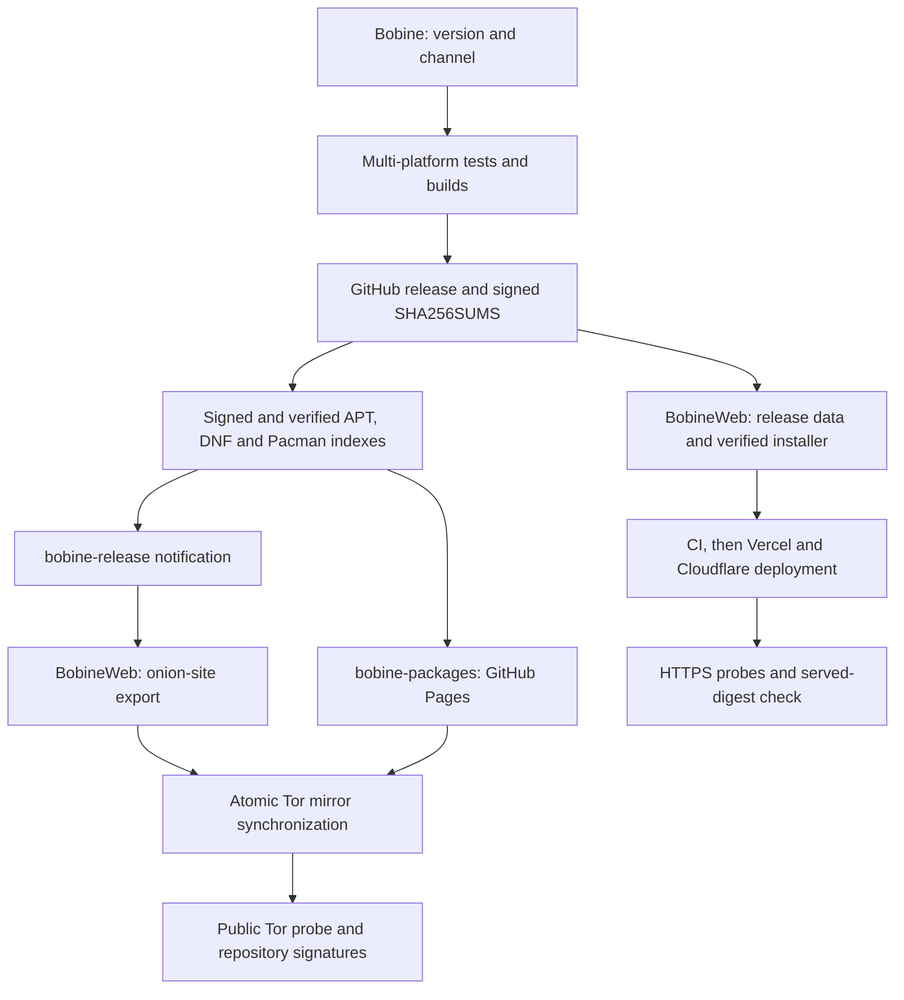

<p align="center">
  
</p>

# Bobine — Technical Architecture & Developer Reference

<p align="center">
  <a href="ARCHITECTURE.md">Français</a> · <a href="ARCHITECTURE.en.md">English</a>
</p>

> Technical reference. For a user-oriented presentation (what Bobine is for, guided installation, getting started), see the **[README](../README.md)** (`README.fr.md` for French).

Playback, scheduling and control of class videos in a gym, on a dedicated mini PC, desktop workstation or tablet. Single-process FastAPI server + SQLite, Chromium X11 kiosk, Next.js admin interface and mobile remote control.

---

## Table of Contents

1. [Stack & Getting Started](#1-stack--getting-started)
2. [General Architecture](#2-general-architecture)
3. [Data Model & SQLite Persistence](#3-data-model--sqlite-persistence)
3bis. [Import Pipeline, Multi-OS Hardware Acceleration & Reactive Cancellation](#3bis-import-pipeline-multi-os-hardware-acceleration--reactive-cancellation)
3ter. [Universal Multi-OS Hardware Telemetry & Attendance Metrics](#3ter-universal-multi-os-hardware-telemetry--attendance-metrics)
4. [Broadcast Channels & Playback Manager](#4-broadcast-channels--playback-manager)
5. [Radio Module](#5-radio-module)
5bis. [Devices (audio, Bluetooth, Wi-Fi)](#5bis-devices-audio-bluetooth-wi-fi)
5ter. [External storage](#5ter-external-storage-usb-drives-disks-sd-cards-phones)
6. [Audio Coach Mode & Animated Backgrounds Hub](#6-audio-coach-mode--animated-backgrounds-hub)
7. [Install Script & systemd Services](#7-install-script--systemd-services)
8. [HTTP API & WebSocket Reference](#8-http-api--websocket-reference)
9. [Operations & Network Discovery (Wyse)](#9-operations--network-discovery-wyse)
10. [Interface Matrix & Multi-Platform Compatibility](#10-interface-matrix--multi-platform-compatibility)
10bis. [Per-channel icons](#10bis-per-channel-icons-stable-beta-canary)
11. [License](#11-license)

---

## 1. Stack & Getting Started

### Technical Stack

- **Backend**: Python 3.11+, [FastAPI](https://fastapi.tiangolo.com/) + `uvicorn` (`--workers 1`), [SQLAlchemy](https://www.sqlalchemy.org/), SQLite (`data/database.db`), `APScheduler` (scheduling), `watchdog` (import folder monitoring), `ffmpeg` with multi-OS hardware acceleration (`h264_mediacodec` on Android, `h264_videotoolbox` on macOS, `h264_vaapi` on Linux, `h264_qsv` on Windows, `libx264` fallback). Full preservation of 2K/4K streams without downsampling.
- **Frontend**: [Next.js](https://nextjs.org/) 16 (App Router, static export served by the backend in production), React 19, TypeScript, vanilla CSS (16 hot-swappable color themes via `:root[data-theme=…]`, including "Charbon" / "Charbon Sombre", verified by WCAG AA contrast tests), PWA, WebSockets, Web Audio API.
- **Operations & Kiosk**: Debian 13 (Trixie), Chromium in kiosk mode (X11 / `xinit`), `systemd`, `avahi-daemon` (mDNS discovery).
- **Android Portability (`android/`)**: Kotlin + embedded CPython via [Chaquopy](https://chaquopy.com/), `minSdk 34` / `targetSdk 36` (`compileSdk 37`). Hardware dual-display via `DisplayManager` and `Presentation` (touch screen on `/grid` + HDMI output on `/cinema`), persistent `ForegroundService`, NDK r28c binaries (`ffmpeg`/`ffprobe`, 16 KB page alignment).
- **Installation & tooling**: `install.sh` (idempotent Bash, §7); graphical installation assistant (`assistant/`, Tauri 2 / Rust — see [`assistant/README.md`](../assistant/README.md)); native Rust crates `devices/` and `media/`.

### Local Development

**Prerequisites**: Node.js ≥ 20, Python ≥ 3.11.

```bash
# 1. Backend (FastAPI) — port 8001 in dev
cd backend && python3 -m venv .venv && source .venv/bin/activate
pip install -r requirements.txt
uvicorn app.main:app --reload --host 0.0.0.0 --port 8001

# 2. Frontend (Next.js)
cd frontend && npm install && npm run dev   # http://localhost:3000
```

> **Dev port**: `next dev` on `:3000` routes its API/WebSocket calls to `localhost:8001` (`getApiUrl`/`getWsUrl`). To test the integrated single-origin build: `cd frontend && npm run build`, then start the backend on `:8000` (which serves `frontend/out` at `/`).

**Validation before committing**:

```bash
cd backend && python -m pytest -q
cd frontend && npx tsc --noEmit && npm test
cd media && cargo fmt --check && cargo clippy --locked --all-targets -- -D warnings && cargo test --locked
cd assistant && cargo test --workspace
```

### Configuration (`config.toml`)

Priority order: (1) `BOBINE_*` environment variables, (2) `/etc/bobine/config.toml` (production), (3) `config.toml` at the repository root.

| Key | Default | Role |
|---|---|---|
| `database.database_url` | `sqlite:///data/database.db` | SQLite connection URL |
| `media.media_dir` / `watch_dir` | `data/videos` / `data/watched` | Video storage and watched auto-import folder |
| `server.host` / `port` | `0.0.0.0:8000` | Backend HTTP listen address (preferred `port`, see below) |
| `playback.wait_time_between_courses` | `0` | Inter-course delay (s) |
| `playback.volume_default` | `100` | Default volume (0-100) |

> **Upload temp files**: `tempfile.tempdir` is forced to `data/tmp` (on the media disk) instead of `/tmp` (a ~3.8 GB RAM tmpfs on mini PCs).

### Listen port and fallback

All launchers (`backend/run_backend.py`, `app/desktop/tray.py`, `bobine_bootstrap.py`, `install.sh`, `scripts/watchdog.sh`, Kotlin) resolve their port through `backend/app/utils/port.py`:

- **Preferred port**: `settings.port` (8000 by default).
- **Fallback (`resolve_port()`)**: if 8000 is busy, tries the next 10 ports, then an OS-assigned port.
- **Strict mode (`BOBINE_PORT_STRICT=1`)**: disables fallback (used by `bobine-backend.service` on the appliance where the nftables 80 → 8000 redirect requires a fixed port).
- **Runtime file (`backend-runtime.json`)**: atomically written at the data root (`port`, `pid`, `preferred_port`, `fallback`), read by the desktop tray, Android (`BackendEndpoint`), `watchdog.sh`, `GET /api/settings` (`network.port`) and the mDNS service record.

---

## 2. General Architecture

```
┌──────────────┐     HTTP / WebSockets     ┌─────────────────────────────────┐
│   Frontend   │ ------------------------> │         Backend FastAPI         │
│   Next.js    │ <------------------------ │    (uvicorn, single-process)    │
└──────────────┘                           └─────────────────────────────────┘
                                                            │
                                                            v
                                                   ┌─────────────────┐
                                                   │ SQLite (WAL db) │
                                                   └─────────────────┘
```

The backend runs as a single `uvicorn` process (`--workers 1`). Playback state (position, playlist, schedule) lives in memory and is broadcast over WebSocket with no external state bus.

### Backend Layout (`backend/app/`)

- `main.py`: FastAPI entry point, startup events (`boot_state.py`), static mounting (`RevalidateStaticFiles`) and HTTP compression (`http_compression.py`).
- `playback_manager.py`: Multi-channel video/audio-coach playback engine (`cable`, `network`), server-driven clock (`playback_clock.py`) and interruption resume.
- `radio_manager.py`: Independent engine for the two radio outputs (`radio_cable`, `radio_network`).
- `scheduler_manager.py`: `APScheduler` time-based scheduler and periodic log/metric retention cleanup.
- `models.py` & `database.py`: SQLAlchemy ORM models and idempotent startup micro-migrations (`_migrate_add_missing_columns`).
- `routers/`: HTTP endpoints grouped by domain (`videos`, `backgrounds`, `playlists`, `audio`, `audio_playlists`, `schedule`, `playback`, `settings`, `logs`, `import_jobs`, `radio`, `radio_playlists`, `radio_announcements`, `devices`, `storage`, `chapters`, `metrics`, `updates`, `uploads`, `display`, `diagnostics`).
- `devices/` & `storage/`: Cross-platform hardware drivers (Linux PipeWire/BlueZ/nmcli/udisks2, Windows/macOS Rust sidecar, Android Kotlin bridge) and PIN security (§5bis, §5ter).

---

## 3. Data Model & SQLite Persistence

Managed by **SQLAlchemy** (`Base.metadata.create_all()` at startup + idempotent column migrations in `database.py`; no active Alembic at runtime).

### Main Entities

- `videos` / `backgrounds`: Media metadata, synchronized subtitle tracks (`video_subtitles` in WebVTT) and course chapters (`video_chapters`).
- `playlists` / `playlist_items` & `audio_courses` / `audio_tracks` / `audio_playlists`: Ordered video playlists and audio-coach courses.
- `schedules` & `schedule_overrides`: Weekly or one-off schedules across 4 lanes (`cable`, `network`, `radio_cable`, `radio_network`).
- `playback_state` & `playback_sessions`: Per-channel persisted playback state and session attendance history (`completed = True` at ≥ 90%).
- `course_ratings` & `system_metrics_logs`: 5-star session ratings and EAV hardware telemetry (`watts`, `cpu`, `ram`, `temp_cpu`, etc.).
- `radio_tracks`, `radio_tags`, `radio_playlists`, `radio_announcements`, `radio_announcement_rules`: Music library and voice reminder rules.
- `settings` & `activity_log`: Hot-editable key/value settings and system event log.

### 3.1 Android profile: Pydantic v1 compatibility and folder watching

- **Pydantic v1 (`1.10.26`) on Android, Pydantic v2 elsewhere**: because `pydantic-core` has no Android Chaquopy wheel, the codebase shares `app/utils/_pydantic_compat.py` (`list_max_items`, `computed_field`, `orm_mode = True` + `from_attributes = True`). Forbidden constructs enforced by `backend/tests/test_pydantic_v1_compat.py`: `Field(max_length=…)` on a list and calling `.model_dump()` / `.model_validate()` directly.
- **Folder watching (`app/utils/watcher.py`)**: uses `watchdog` on desktop/appliance and falls back to `_polling_observer.py` (2 s polling) on Android.
- **CI gates**: `backend-android-compat` (Python 3.11/3.13 with Starlette 0.27) and `android-startup` (x86_64 API 35 emulator via `scripts/ci/smoke-android-apk.sh`) validate this contract on every PR.

---

## 3bis. Import Pipeline, Multi-OS Hardware Acceleration & Reactive Cancellation

Covers all 4 ingestion flows: videos (`/api/videos/upload`), backgrounds (`/api/backgrounds/upload`), audio coach (`/api/audio/upload`) and radio (`/api/radio/upload`), plus resumable chunked uploads (`/api/uploads`, `staged_uploads.py`).

### 1. Centralized Queue & Real-Time Telemetry (`import_jobs.py`)

Every import creates a tracked job (`uploading` → `normalizing` → `thumbnail` → `done` / `error` / `cancelled`). FFmpeg runs with `-progress pipe:1 -nostats`; `GET /api/import-jobs` exposes completion percentage, conversion `speed`, and `eta_seconds`.

### 2. Full Multi-OS Hardware Acceleration (`video_utils.py`)

Automatic 3-tier pipeline (1. Direct-VRAM Hardware → 2. Hybrid GPU → 3. CPU fallback `libx264 -preset veryfast`), with keyframe interval `-g 60` (~2 s) for reliable seeking:
- **Linux**: `h264_vaapi` via `/dev/dri/renderD*` (Intel QuickSync / AMD Mesa).
- **Android**: `<codec>_mediacodec` decode and `h264_mediacodec` encode.
- **macOS**: `h264_videotoolbox`.
- **Windows**: `h264_qsv`.

### 3. Golden Rule: Full Preservation of Source Quality (Zero Degradation)

No downsampling of 2K (1440p) or 4K (2160p) streams. Target bitrates (`_get_target_bitrate`): 4K = 28 Mbps (max 35), 2K = 14 Mbps (max 18), 1080p = 6 Mbps (max 8), 720p = 3.5 Mbps (max 4.5). For browsers unable to decode HEVC/AV1, an H.264 8-bit ≤ 1080p web variant is produced on demand (`web_profile.py`, `?accept=`) without touching the original file.

### 4. Reactive Cancellation & Atomic Cleanup

`DELETE /api/import-jobs/{job_id}` calls `cancel_job()`, sends `SIGTERM` then `SIGKILL` to the FFmpeg subprocess, and purges partial files with no database write. Orphaned temp files are cleaned on startup.

### 5. Pre-Start Duration Estimate & Queue (`encode_speed_stats.py`)

Before FFmpeg even starts, `estimated_seconds` and `queue_eta_seconds` are computed from a moving average speed persisted in `settings` per `(encoder, resolution tier)` pair.

### 6. Native audio component (`bobine-media`, experimental, off by default)

Rust executable (`media/`, JSON-RPC over stdin/stdout, read-only, see [`media/README.md`](../media/README.md)) reading tags, duration and cover art of new MP3, FLAC, WAV, M4A, Ogg Vorbis, Opus and AIFF files without spawning `ffprobe`/`ffmpeg`. Enabled via the `media_native` setting or `BOBINE_MEDIA_NATIVE=1` (`GET /api/settings/media-native`). Any unsupported file falls back to `ffprobe`/`ffmpeg` + Pillow.

---

## 3ter. Universal Multi-OS Hardware Telemetry & Attendance Metrics

### 1. Universal Hardware Supervision (`hardware_info.py`)

Exposed by `GET /api/settings/system` across all 5 execution profiles (Linux, Wyse, Windows, macOS, Android) with commercial model resolution:
- **CPU & GPU**: `/proc/cpuinfo` and DRM sysfs/`lspci` on Linux, Windows Registry and `Win32_VideoController` on Windows, `sysctl` and `system_profiler` on macOS, `ro.soc.model` and `/sys/class/kgsl/` on Android.
- **RAM & Storage**: capacity, manufacturer, memory type (DDR4/DDR5/LPDDR5X), clock speed, and SSD/UFS drive model.
- **Power (W), Energy (Wh) & Temperatures (°C)**: Intel/AMD RAPL (`intel-rapl`), `hwmon`/`power_supply` sensors, `AppleSmartBattery`, or Android SoC power scaling, with trapezoidal integration into Wh (`cumulative_energy_wh`) and CPU/GPU thermal zones.

### 2. Attendance Metrics Engine, System Telemetry & Retention (`/metrics`)

- **Two dedicated views**: `/metrics/courses` (average satisfaction /5, completion rate, broadcast hours, 24h histogram, top courses) and `/metrics/system` (live hardware cards + SVG history drawer `TelemetryHistoryDrawer.tsx` over 1h, 6h, 24h and 7d).
- **Retention (`logs_retention_days`)**: automatic background purge of logs and telemetry older than the configured threshold (default: 7 days).

---

## 4. Broadcast Channels & Playback Manager

Two independent video channels (`cable` on the physical HDMI output, `network` on remote browsers) and two radio outputs (`radio_cable`, `radio_network`).
- **Wired output (`/api/settings/display-output`)**: displays `/kiosk`, `/cinema`, or `/radio?channel=cable`. The `/grid` studio desk exclusively drives the wired channel.
- **Universal controls (`useKioskRemote`)**: USB/Bluetooth HID remotes, gamepads (HTML5 Gamepad API), mouse and touch with 2D spatial navigation (`moveDomFocus2D`).

### Resume After Interruption (Resilience Rule)

When a scheduled class starts during a manual session, `playback_manager` saves the active media and exact position into `playback_state` and offers to resume to the exact second once the scheduled slot ends.

### Playback Recovery & Smoothness (`/kiosk`, `/cinema`)

Coordinated safeguards: (1) `seekWhenReady()` pauses the audio clock until `seeked` fires (1.2 s safety timeout); (2) anti-reentrancy guard while `el.seeking` is true; (3) 3.5 s grace period after a seek on mirror kiosks; (4) soft stall detection (> 7.5 s freeze) triggering a clean `.play()`; (5) 1.5 s debounce on `/grid`.

### Channel Identity & Server-Driven Playback Clock (4.0)

- **Channel identity (`frontend/src/lib/displayChannel.ts`)**: `?channel=cable|network` takes precedence and is preserved across `/kiosk` ↔ `/cinema` redirects.
- **Server clock (`playback_clock.py`)**: broadcasts a `clock = { pos, at_ms, rate, running, epoch }` anchor with a 1 Hz heartbeat. Screens (`useVideoClockFollower.ts`) estimate their offset via `time_sync` and correct drift > 80 ms by smoothly adjusting `playbackRate` (±5%) without resetting the hardware decoder.

### Plug-and-Play HDMI Projection (4.0)

Each platform reports the number of connected external displays (`PUT /api/display/state`); the backend automatically derives `dual_screen` (`/grid` touch desk + `/cinema` projector) or `headless` (unless overridden by `display_mode_setting`).

| Profile | Detection | Action |
|---|---|---|
| **Android** | `DisplayListener` | Native `Presentation` on `/cinema/?channel=cable` |
| **Windows / Linux / macOS** | `EnumDisplayMonitors` / `xrandr` / `system_profiler` (`displays.py`) | Native `bobine-projector` binary (`projector/`, WebView2 / WebKitGTK / WKWebView) or dedicated fullscreen browser window |
| **Wyse Appliance** | udev DRM rule → `bobine-display-hotplug` | `try-restart bobine-kiosk` when connected outputs change |

### Gapless A/B Deck Video Engine (`/cinema`) & 5-Star Rating

- **A/B Deck Engine**: two permanent `<video>` elements (`deckARef`, `deckBRef`) preload the next course or idle loop in the background and crossfade via CSS (`0.4s`) on `canplay`, eliminating black screens.
- **5-Star Rating**: shown at ≥ 95% course completion on `/grid` (dual-screen mode) or `/cinema` (headless mode) with a 300 s auto-close timer.

### Zero-Scroll Course Studio Modal (`/library`) & Synchronized Subtitles

- **Course Studio (`/library`)**: 2-column zero-scroll modal with 16:9 player, thumbnail picker, chapters (`video_chapters`, JSON/VTT/text import/export or FFprobe extraction via `/api/videos/{id}/chapters`), and `.srt`/`.vtt` subtitles converted to WebVTT (`app/utils/subtitles.py`) and selectable live (`set_subtitle`).
- **LAN address (`app/utils/network.py`)**: `primary_lan_ip()` filters out virtual interfaces (VPN, containers) in favor of physical Wi-Fi or Ethernet.

---

## 5. Radio Module

Independent music subsystem (`radio_manager.py`, `radio_*` tables) with **two autonomous outputs**: `/radio?channel=cable` (wired output) and `/radio?channel=network` (`/radio` alias).
- **Web Audio API sound processing (`lib/radioSoundGraph.ts`)**: crossfade between tracks, 5-band graphic equalizer, bass boost, loudness, anti-clipping limiter, and 3 presets persisted per output (`GET/PUT /api/radio/sound?channel=`).
- **Voice reminders (`/radio-announcements`)**: normalized to `-10 LUFS` (`ffmpeg loudnorm` EBU R128) on import, triggered every N tracks, every X minutes, at fixed times or manually, with automatic music ducking.
- **24/7 continuity**: loops the output's default playlist or falls back to shuffling the entire library continuously.

---

## 5bis. Devices (audio, Bluetooth, Wi-Fi)

`/devices` tab (**disabled by default**):
- **Drivers (`backend/app/devices/`)**: `linux.py` (PipeWire `pw-dump`/`wpctl`, BlueZ D-Bus, NetworkManager `nmcli`), `sidecar.py` + Rust crate `devices/` (`bobine-devices` on Windows/macOS, experimental behind `BOBINE_DEVICES_EXPERIMENTAL=1`), `android.py` + `DeviceBridge.kt`.
- **Security & Pairing (`security.py`)**: the local screen (`127.0.0.1`) is trusted; any remote device must enter a **6-digit PIN** (scrypt + `HttpOnly; SameSite=Strict` cookie) or, during initial setup of a browserless screen (Android TV), claim the **single-use pairing code** shown on the local screen (`POST /api/devices/pairing/{generate,verify,claim}`). Every Wi-Fi change arms a 60 s automatic rollback unless confirmed (`POST /api/devices/wifi/confirm`).
- **Orbital Map & Mixer**: `GET /api/devices/topology` exposes the graph of audio outputs, Bluetooth devices, Wi-Fi, Ethernet and connected screens; the tab also provides the routing graph and mixer console for both radio outputs.
- **Glass tokens & contrast (`globals.css`)**: glass surfaces use `--blur-*`, `--glass-*` and the adaptive `useGlassGovernor.ts` governor; guarded by `frontend/tests/glassTokens.test.ts` and `themeContrast.test.ts`.

---

## 5ter. External storage (USB drives, disks, SD cards, phones)

`/storage` page (Linux desktop and appliance; format advisor `fsadvisor.py` available everywhere), protected by the same PIN as `/devices`:
- **Hot-plug detection & unprivileged mounting (`backend/app/storage/`)**: `lsblk` inventory + `udisks2` D-Bus signals, mounted via `udisksctl` (polkit, read-only by default `noatime,nodiratime,noexec`), strictly excluding internal or system disks.
- **Two modes**: *Import* (SHA-256 verified copy into internal storage) or *Use as extension* (direct indexing by filesystem UUID with automatic path remapping when re-plugged).
- **Drive preparation**: quick-format wizard on Linux (GPT + exFAT, ext4, FAT32 or NTFS) requiring a configured PIN and typed drive-name confirmation.

---

## 6. Audio Coach Mode & Animated Backgrounds Hub

- **Coach Control Console (`/coach`)**: asymmetric two-column interface on tablet/desktop (touch transport, timer and playlist on the left; 16:9 live stage monitor and 16:9 visual ambiance palette with 1-tap switching on the right). Automatic redirect from `/dashboard-cable` to `/coach` while Coach mode is active.
- **Visual Ambiances Hub (`/backgrounds`)**: manages 16:9 video loops with hover preview, direct Cable/Network broadcast, and default coach background assignment (`default_coach_background_id`).

---

## 7. Install Script & systemd Services

Production appliance installation on Debian 13 (Trixie) is driven by the idempotent `install.sh` script:

```bash
sudo ./install.sh
# Or as a single command (bootstraps into ~/Bobine):
curl -fsSL https://bobine.fit/install.sh | bash
```

### Installation Options (`sudo ./install.sh --help`)

| Option | Description |
|---|---|
| `--no-kiosk` | Install the backend only (no Chromium X11 / audio) |
| `--dry-run` / `--check` | Preview actions without changes / diagnose an existing install |
| `--skip-packages` / `--skip-build` | Skip `apt` package reinstall / skip Next.js frontend build |
| `--as-user LOGIN` | Target account when running as direct `root` on a minimal Debian without `sudo` |
| `--channel=stable\|beta\|canary` | Update channel (default: `stable`) |
| `--progress=json` | Machine-readable JSON events on `fd 3` for the Tauri graphical assistant |
| `--uninstall [--purge] [--purge-data]` | Clean system uninstall (and media removal with `--purge-data`) |

`install.sh` dynamically detects the GPU (Intel VA-API, AMD Mesa, or software fallback), installs PipeWire/WirePlumber, verifies `aplay -l` and `vainfo` (`capabilities` step), sets the `performance` CPU governor, and caps `journald` at 200 MB.

### systemd Services Created

- `bobine-backend.service`: single-process Uvicorn on port 8000 (`BOBINE_PORT_STRICT=1`, `Restart=always`).
- `bobine-kiosk.service`: fullscreen Chromium kiosk on X11 (`xinit`, `Restart=always`).
- `bobine-audio-guard.service`: mutes audio outputs at boot/shutdown outside the kiosk session.
- `bobine-watchdog.timer` + `.service`: polls `GET /api/health` every 30 s (`scripts/watchdog.sh`) and restarts any dead or frozen component.
- `bobine-redirect.service` & `bobine-cpu-governor.service`: nftables `80 → 8000` redirect and `performance` CPU governor.

### Graphical Installation Assistant

Standalone desktop app (`assistant/`, **Tauri 2 / Rust**): scans local subnets (`/24` to `/22`), identifies hosts, connects over SSH (password or private key), audits hardware, and runs `install.sh --progress=json` with live progress (see [`assistant/README.md`](../assistant/README.md)).

### Update Channel (Stable / Beta / Canary)

Three channels selectable at install time or in *Settings → Software Updates* (`update_channel`):
- **Stable** (`Vx.y.z`): queries `/releases/latest` (structurally excludes pre-releases).
- **Beta** (`beta`): moving tag republished manually in curated batches.
- **Canary** (`canary`): moving tag republished automatically on every push to `main` (fixed artifact filenames suffixed `-beta` / `-canary`).

#### Update Pipeline Hardening

- **Verification & Download**: `ETag` caching, `.part` download with 3 retries, mandatory SHA-256 digest check (`SHA256SUMS`) before atomic rename, and supported rollback from Beta/Canary to Stable (`is_downgrade: true`).
- **Isolation & Restart**: strips PyInstaller's `LD_LIBRARY_PATH` (`clean_subprocess_env()`) before invoking `systemctl`/`dpkg`/`git`, performs a non-blocking detached restart (`restart_services()`), enforces a single-instance TCP lock in `tray.py`, and confirms update completion on the next startup via `boot_state.py`.

### Restricted sudo Authorization & Uninstall from the Interface

`/etc/sudoers.d/bobine` grants passwordless execution only to service restarts (*Sync Screens* button) and the `/usr/local/sbin/bobine-uninstall` wrapper (*Uninstall* button in the *Danger Zone*).

---

## 8. HTTP API & WebSocket Reference

### HTTP Endpoints (`/api`)

| Domain | Prefix | Description |
|---|---|---|
| **Videos, Subtitles & Chapters** | `/api/videos` | Video CRUD, `/videos/programs`, `/videos/{id}/subtitles` (`.srt`/`.vtt`) and `/videos/{id}/chapters` |
| **Playlists & Backgrounds** | `/api/playlists`, `/api/backgrounds` | Video playlists and 16:9 visual ambiance loops |
| **Audio Coach** | `/api/audio`, `/api/audio-playlists` | Audio courses and mixed playlists with assigned backgrounds |
| **Schedule & Playback** | `/api/schedule`, `/api/playback`, `/api/display` | Recurring schedules, playback transport (`play`, `pause`, `seek`, `stop`) and external display state (`/display/state`) |
| **Radio** | `/api/radio` | Music library, playlists, per-output state and equalizer (`radio_cable`, `radio_network`), announcements and rules |
| **Imports & Uploads** | `/api/import-jobs`, `/api/uploads`, `/api/diagnostics` | FFmpeg import queue, resumable chunked uploads and import diagnostics |
| **Devices & Storage** | `/api/devices`, `/api/storage` | Topology, audio/mixer, Bluetooth, Wi-Fi, PIN/code pairing and external USB/SD drives |
| **Settings, Updates & Metrics** | `/api/settings`, `/api/updates`, `/api/metrics`, `/api/logs`, `/api/health` | Configuration, ZIP backup/restore, update checks/install, attendance analytics, hardware telemetry and health |

### WebSockets

`/ws/playback` streams real-time state per channel (`cable`, `network`, `radio_cable`, `radio_network`) with the `clock` anchor, handles channel-scoped `subscribe` and `time_sync`, and broadcasts `library_change` and `devices_changed` events.

---

## 9. Operations & Network Discovery (Wyse)

### Embedded mDNS discovery (`bobine.local`)

`backend/app/utils/mdns.py` advertises `bobine.local` via `zeroconf` on every profile where no system `avahi-daemon` is already running, with periodic 5-minute re-announcements, DHCP IP tracking, Android `MulticastLock` renewal, and live status in `GET /api/settings` (`network.mdns_status`).

### Network Discovery Protocol (If the IP Changes)

```bash
curl -s --connect-timeout 2 http://bobine.local:8000/api/settings
# Or scan the local subnet:
SUBNET=$(ip route | grep default | awk '{print $3}' | cut -d. -f1-3).0/24
nmap -p 8000 --open "$SUBNET" -oG - | grep "8000/open"
```

### Remote Operations Commands (SSH)

```bash
ssh fanta@<WYSE_IP> "systemctl status bobine-backend bobine-kiosk"
```

### Deploying to the Wyse

When the production Wyse appliance operates on an isolated LAN without GitHub access, updates are pushed via `rsync` (excluding `.git/`, `data/`, `.venv/`, `node_modules/`), followed by `sudo ./install.sh --skip-packages -y` and restarting `bobine-backend.service` and `bobine-kiosk.service`.

---

## 10. Interface Matrix & Multi-Platform Compatibility

### 10.1 Map of the Interface's 23 Routes (+ `/` redirecting to `/dashboard-cable`)

| Category | Route(s) | Main Role |
|---|---|---|
| **Broadcast & Room** | `/kiosk`, `/cinema`, `/grid` | Automated fullscreen kiosk (`/kiosk`), on-demand showcase with dual A/B video decks (`/cinema`), and touch coach desk driving HDMI (`/grid`). |
| **Dashboards & Coach** | `/dashboard-cable`, `/dashboard-network`, `/coach` | Cable/Network control dashboards and two-column Audio Coach console with 16:9 stage monitor (`/coach`). |
| **Libraries & Schedule** | `/library`, `/playlists`, `/backgrounds`, `/audio`, `/audio-playlists`, `/schedule` | Management of videos, subtitles, chapters, playlists, visual loops, audio courses, and the weekly timetable. |
| **24/7 Radio** | `/radio`, `/radio-remote`, `/radio-library`, `/radio-announcements` | TV radio screen (`/radio?channel=cable\|network`), web remote with equalizer, music library, and voice reminders. |
| **Admin & System** | `/settings`, `/metrics` (`/courses`, `/system`), `/devices`, `/storage`, `/logs` | Settings and 16 themes, attendance analytics and hardware telemetry, audio/BT/Wi-Fi devices, USB storage, and logs. |

### 10.2 Mounting & Integration per Deployment Profile

| Profile | Target & Format | Frontend Location Served | Execution Specifics |
|---|---|---|---|
| **Headless Appliance** | Debian 13 (`install.sh`) | `frontend/out/` | Chromium X11 kiosk + LAN web admin |
| **Windows Desktop** | Windows 10/11 `x86_64` & `ARM64` (`.exe`) | `%ProgramFiles%\Bobine\frontend\out\` | Systray icon, firewall rule bound to `BobineBackend.exe`, native WebView2 projector |
| **macOS Desktop** | macOS Apple Silicon M1–M4 (`.dmg`) | `Bobine.app/Contents/Resources/frontend/out/` | Menu bar companion, LaunchAgent, native WKWebView projector |
| **Linux Desktop** | `.deb`, `.rpm`, `.pkg.tar.zst` (`x86_64` & `arm64`, **glibc 2.38+**) | `/usr/lib/bobine/frontend/out/` | XDG systray, WebKitGTK projector, polkit USB mounting |
| **Android & Android TV** | ARM64 tablets (`Bobine-*.apk`, Python 3.13) & 32/64-bit ARM TV boxes (`Bobine-TV-*.apk`, Python 3.11) | `pyStage/backend/frontend_out/` | SQLite in internal `filesDir` (f2fs), media in external storage, detected via `is_android()` |
| **GUI Assistant** | Linux `x86_64` & `arm64` (`bobine-assistant`) | `assistant/ui/` | Native Tauri 2 / Rust app for LAN scanning and SSH deployment |

### 10.3 Browser compatibility (Firefox / Gecko)

 All admin interfaces and players target **Mozilla Firefox** (current and ESR, desktop and Android) on equal footing with Chrome, Edge, Safari, Brave and Tor Browser. Engineering rule: feature detection only (never `userAgent`), RFC 9110-compliant media streams (`Range`, `If-Range`, `ETag`), and reproducible benchmarks in [`scripts/browser-bench/`](../scripts/browser-bench/README.md).

<br clear="left"/>

---

## 10bis. Per-channel icons (Stable, Beta, Canary)

Each release channel has its own ribbon icon (silver, blue, gold), documented in [`Assets/Images/channel-icons/README.md`](../Assets/Images/channel-icons/README.md):
- **Build channel** (derived from `VERSION`): Android/TV launcher icons, Windows executables, macOS bundle, and Linux packages.
- **Selected channel** (`update_channel`): system tray icon (`channel_icon.py`), web UI logo/favicon, and Android splash screen.
Single source: `Assets/Images/channel-icons/` and `scripts/generate_channel_icons.py` (checked by `test_channel_icons_wiring.py`).

---

## 11. License

Bobine is distributed under the **GNU AGPL-3.0** license (see [`LICENSE`](../LICENSE)).

### Preparing removable drives

On Linux, `/storage` offers a quick-format wizard (GPT + exFAT, ext4, FAT32 or NTFS) restricted to removable drives reported by `udisks2`, requiring typed drive-name confirmation and the administration PIN. A dedicated polkit rule delegates these operations to the install account (`configure-storage-access`).

### Radio output routing and mixing

The `/devices` tab provides a routing graph and Web Audio mixer for `radio_cable` and `radio_network` (Music/Announcements/Master gains, mute, solo, equalizers, and PipeWire stream linking on Linux).

### Linux repository publication verification

The `publish-linux-packages` job generates, signs, and verifies all 18 APT/DNF/Pacman × Stable/Beta/Canary × `x86_64`/`arm64` combinations (`scripts/ci/prepare-package-repository.sh`) before publishing to `packages.bobine.fit`. A weekly workflow (`refresh-package-repositories.yml`) refreshes APT signatures and a daily probe (`probe-package-repositories.yml`) monitors validity.

### Signed checksums for release files

Every release ships `SHA256SUMS` and its detached signature `SHA256SUMS.asc` (`sign-release-checksums.sh`, verified by `verify-release-assets.sh`). Verification: `gpg --verify SHA256SUMS.asc SHA256SUMS && sha256sum -c --ignore-missing SHA256SUMS`.

### Software and site publication flow



Compiler toolchains and qualification steps are documented in [`BUILD_TOOLCHAINS.md`](BUILD_TOOLCHAINS.md); Google Play publishing is documented in [`android-google-play.en.md`](android-google-play.en.md).
