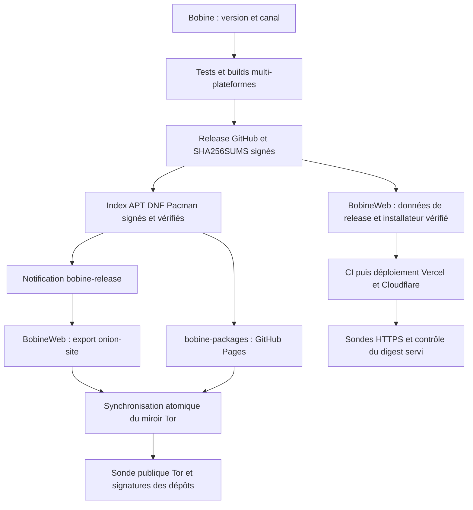

<p align="center">
  
</p>

# Bobine — Architecture technique & référence développeur

<p align="center">
  <a href="ARCHITECTURE.md">Français</a> · <a href="ARCHITECTURE.en.md">English</a>
</p>

> Référence technique. Pour une présentation orientée utilisateur (à quoi sert Bobine, installation guidée, prise en main), voir le **[README](../README.md)** (`README.fr.md` pour le français).

Diffusion, planification et pilotage de vidéos de cours en salle, sur mini PC dédié, poste de bureau ou tablette. Serveur FastAPI mono-processus + SQLite, kiosque Chromium X11, interface d'administration et télécommande mobile Next.js.

---

## Sommaire

1. [Stack et démarrage](#1-stack-et-démarrage)
2. [Architecture générale](#2-architecture-générale)
3. [Modèle de données & Persistance SQLite](#3-modèle-de-données--persistance-sqlite)
3bis. [Pipeline d'importation, Accélération Matérielle Multi-OS & Annulation Réactive](#3bis-pipeline-dimportation-accélération-matérielle-multi-os--annulation-réactive)
3ter. [Télémétrie Matérielle Universelle Multi-OS & Métriques d'Assiduité](#3ter-télémétrie-matérielle-universelle-multi-os--métriques-dassiduité)
4. [Canaux de diffusion & Gestionnaire de lecture](#4-canaux-de-diffusion--gestionnaire-de-lecture)
5. [Module Radio](#5-module-radio)
5bis. [Périphériques (audio, Bluetooth, Wi-Fi)](#5bis-périphériques-audio-bluetooth-wi-fi)
5ter. [Stockage externe](#5ter-stockage-externe-clés-usb-disques-cartes-sd-téléphones)
6. [Mode Audio Coach & Hub d'Ambiances Visuelles](#6-mode-audio-coach--hub-dambiances-visuelles)
7. [Script d'installation & Services systemd](#7-script-dinstallation--services-systemd)
8. [Référence API HTTP & WebSockets](#8-référence-api-http--websockets)
9. [Exploitation & Découverte Réseau (Wyse)](#9-exploitation--découverte-réseau-wyse)
10. [Matrice des interfaces & compatibilité multi-plateforme](#10-matrice-des-interfaces--compatibilité-multi-plateforme)
10bis. [Icônes par canal de version](#10bis-icônes-par-canal-de-version-stable-bêta-canary)
11. [Licence](#11-licence)

---

## 1. Stack et démarrage

### Stack technique

- **Backend** : Python 3.11+, [FastAPI](https://fastapi.tiangolo.com/) + `uvicorn` (`--workers 1`), [SQLAlchemy](https://www.sqlalchemy.org/), SQLite (`data/database.db`), `APScheduler` (planification), `watchdog` (surveillance des dossiers d'import), `ffmpeg` avec accélération matérielle multi-OS (`h264_mediacodec` sur Android, `h264_videotoolbox` sur macOS, `h264_vaapi` sur Linux, `h264_qsv` sur Windows, repli `libx264`). Conservation intégrale des flux 2K et 4K sans sous-échantillonnage.
- **Frontend** : [Next.js](https://nextjs.org/) 16 (App Router, export statique servi par le backend en production), React 19, TypeScript, CSS Vanilla (16 thèmes commutables à chaud via `:root[data-theme=…]`, dont « Charbon » / « Charbon Sombre », contrôlés par tests de contraste WCAG AA), PWA, WebSockets, Web Audio API.
- **Exploitation & Kiosque** : Debian 13 (Trixie), Chromium en mode kiosque (X11 / `xinit`), `systemd`, `avahi-daemon` (découverte mDNS).
- **Portabilité Android (`android/`)** : Kotlin + CPython embarqué via [Chaquopy](https://chaquopy.com/), `minSdk 34` / `targetSdk 36` (`compileSdk 37`). Double affichage matériel via `DisplayManager` et `Presentation` (écran tactile `/grid` + sortie HDMI `/cinema`), `ForegroundService` persistant, binaires NDK r28c (`ffmpeg`/`ffprobe`, alignement page 16 Ko).
- **Installation & outils** : `install.sh` (Bash idempotent, §7) ; assistant graphique (`assistant/`, Tauri 2 / Rust — voir [`assistant/README.md`](../assistant/README.md)) ; composants natifs Rust `devices/` et `media/`.

### Développements locaux

**Prérequis** : Node.js ≥ 20, Python ≥ 3.11.

```bash
# 1. Backend (FastAPI) — port 8001 en dev
cd backend && python3 -m venv .venv && source .venv/bin/activate
pip install -r requirements.txt
uvicorn app.main:app --reload --host 0.0.0.0 --port 8001

# 2. Frontend (Next.js)
cd frontend && npm install && npm run dev   # http://localhost:3000
```

> **Port de dev** : `next dev` sur `:3000` route ses appels API/WebSocket vers `localhost:8001` (`getApiUrl`/`getWsUrl`). Pour tester le rendu intégré sur une seule origine : `cd frontend && npm run build` puis lancer le backend sur `:8000` (qui sert `frontend/out` à `/`).

**Validation avant commit** :

```bash
cd backend && python -m pytest -q
cd frontend && npx tsc --noEmit && npm test
cd media && cargo fmt --check && cargo clippy --locked --all-targets -- -D warnings && cargo test --locked
cd assistant && cargo test --workspace
```

### Configuration (`config.toml`)

Ordre de priorité : (1) variables `BOBINE_*`, (2) `/etc/bobine/config.toml` (production), (3) `config.toml` à la racine du dépôt.

| Clé | Défaut | Rôle |
|---|---|---|
| `database.database_url` | `sqlite:///data/database.db` | URL de connexion SQLite |
| `media.media_dir` / `watch_dir` | `data/videos` / `data/watched` | Stockage des vidéos et dossier d'import automatique |
| `server.host` / `port` | `0.0.0.0:8000` | Écoute HTTP du backend (`port` préféré, voir ci-dessous) |
| `playback.wait_time_between_courses` | `0` | Délai d'inter-cours (s) |
| `playback.volume_default` | `100` | Volume par défaut (0-100) |

> **Fichiers temporaires** : `tempfile.tempdir` est forcé sur `data/tmp` (disque média) au lieu de `/tmp` (tmpfs RAM de ~3,8 Go sur mini PC).

### Port d'écoute et repli

Tous les lanceurs (`backend/run_backend.py`, `app/desktop/tray.py`, `bobine_bootstrap.py`, `install.sh`, `scripts/watchdog.sh`, Kotlin) passent par `backend/app/utils/port.py` :

- **Port préféré** : `settings.port` (8000 par défaut).
- **Repli (`resolve_port()`)** : si 8000 est occupé, essaie les 10 ports suivants puis un port éphémère de l'OS.
- **Mode strict (`BOBINE_PORT_STRICT=1`)** : désactive le repli (utilisé par `bobine-backend.service` sur l'appliance où la redirection nftables 80 → 8000 exige un port fixe).
- **Fichier d'exécution (`backend-runtime.json`)** : écrit atomiquement à la racine des données (`port`, `pid`, `preferred_port`, `fallback`), lu par la barre d'état desktop, Android (`BackendEndpoint`), `watchdog.sh`, `GET /api/settings` (`network.port`) et l'annonce mDNS.

---

## 2. Architecture générale

```
┌──────────────┐     HTTP / WebSockets     ┌─────────────────────────────────┐
│   Frontend   │ ------------------------> │         Backend FastAPI         │
│   Next.js    │ <------------------------ │    (uvicorn, mono-processus)    │
└──────────────┘                           └─────────────────────────────────┘
                                                            │
                                                            v
                                                   ┌─────────────────┐
                                                   │ SQLite (WAL db) │
                                                   └─────────────────┘
```

Le backend tourne en un seul processus `uvicorn` (`--workers 1`). L'état de lecture (position, playlist, planning) vit en mémoire et est diffusé via WebSocket sans bus externe.

### Arborescence backend (`backend/app/`)

- `main.py` : Entrée FastAPI, initialisation (`boot_state.py`), montage statique (`RevalidateStaticFiles`) et compression HTTP (`http_compression.py`).
- `playback_manager.py` : Moteur de lecture vidéo/audio coach multi-canal (`cable`, `network`), horloge serveur (`playback_clock.py`) et reprise sur interruption.
- `radio_manager.py` : Moteur indépendant pour les deux sorties radio (`radio_cable`, `radio_network`).
- `scheduler_manager.py` : Planification horaire `APScheduler` et purge périodique des métriques/journaux.
- `models.py` & `database.py` : ORM SQLAlchemy et micro-migrations idempotentes (`_migrate_add_missing_columns`).
- `routers/` : Endpoints HTTP par domaine (`videos`, `backgrounds`, `playlists`, `audio`, `audio_playlists`, `schedule`, `playback`, `settings`, `logs`, `import_jobs`, `radio`, `radio_playlists`, `radio_announcements`, `devices`, `storage`, `chapters`, `metrics`, `updates`, `uploads`, `display`, `diagnostics`).
- `devices/` & `storage/` : Pilotes matériels multi-OS (Linux PipeWire/BlueZ/nmcli/udisks2, sidecar Rust Windows/macOS, pont Kotlin Android) et sécurité par PIN (§5bis, §5ter).

---

## 3. Modèle de données & Persistance SQLite

Schéma géré par **SQLAlchemy** (`Base.metadata.create_all()` au démarrage + micro-migrations dans `database.py` ; aucun Alembic actif au runtime).

### Entités principales

- `videos` / `backgrounds` : Métadonnées médias, pistes de sous-titres (`video_subtitles` en WebVTT) et chapitres (`video_chapters`).
- `playlists` / `playlist_items` & `audio_courses` / `audio_tracks` / `audio_playlists` : Listes de lecture vidéo et cours audio coach.
- `schedules` & `schedule_overrides` : Programmations hebdomadaires ou ponctuelles sur 4 voies (`cable`, `network`, `radio_cable`, `radio_network`).
- `playback_state` & `playback_sessions` : État persisté par canal et historique des séances diffusées (`completed = True` à ≥ 90 %).
- `course_ratings` & `system_metrics_logs` : Notes 5 étoiles des séances et télémétrie matérielle EAV (`watts`, `cpu`, `ram`, `temp_cpu`, etc.).
- `radio_tracks`, `radio_tags`, `radio_playlists`, `radio_announcements`, `radio_announcement_rules` : Bibliothèque musicale et règles de rappels vocaux.
- `settings` & `activity_log` : Paramètres clés/valeurs modifiables à chaud et journal d'événements.

### 3.1 Profil Android : compatibilité Pydantic v1 et surveillance de dossiers

- **Pydantic v1 (`1.10.26`) sur Android, Pydantic v2 ailleurs** : `pydantic-core` n'ayant pas de roue Android Chaquopy, le code partage `app/utils/_pydantic_compat.py` (`list_max_items`, `computed_field`, `orm_mode = True` + `from_attributes = True`). Sont interdits et bloqués par `backend/tests/test_pydantic_v1_compat.py` : `Field(max_length=…)` sur une liste et l'appel direct de `.model_dump()` / `.model_validate()`.
- **Surveillance de dossiers (`app/utils/watcher.py`)** : utilise `watchdog` sur desktop/appliance et retombe sur `_polling_observer.py` (scan toutes les 2 s) sur Android.
- **Vérification CI** : les jobs `backend-android-compat` (Python 3.11/3.13 avec Starlette 0.27) et `android-startup` (émulateur x86_64 API 35 via `scripts/ci/smoke-android-apk.sh`) valident ce contrat à chaque PR.

---

## 3bis. Pipeline d'importation, Accélération Matérielle Multi-OS & Annulation Réactive

Couvre les 4 flux d'ingestion : vidéos (`/api/videos/upload`), fonds (`/api/backgrounds/upload`), audio coach (`/api/audio/upload`) et radio (`/api/radio/upload`), ainsi que les téléversements par morceaux reprenables (`/api/uploads`, `staged_uploads.py`).

### 1. File d'attente centralisée & Télémétrie en temps réel (`import_jobs.py`)

Chaque import crée une tâche suivie (`uploading` → `normalizing` → `thumbnail` → `done` / `error` / `cancelled`). FFmpeg est lancé avec `-progress pipe:1 -nostats` ; `GET /api/import-jobs` expose le pourcentage, la vitesse (`speed`) et le temps restant (`eta_seconds`).

### 2. Accélération matérielle multi-OS intégrale (`video_utils.py`)

Pipeline automatique à 3 paliers (1. Matériel VRAM directe → 2. Hybride GPU → 3. Repli CPU `libx264 -preset veryfast`), avec intervalle de trames clés fixé à `-g 60` (~2 s) pour garantir un seek instantané :
- **Linux** : `h264_vaapi` via `/dev/dri/renderD*` (Intel QuickSync / AMD Mesa).
- **Android** : décodage `<codec>_mediacodec` et encodage `h264_mediacodec`.
- **macOS** : `h264_videotoolbox`.
- **Windows** : `h264_qsv`.

### 3. Règle d'or : Conservation intégrale de la qualité source (Zéro dégradation)

Aucun sous-échantillonnage des flux 2K (1440p) ou 4K (2160p). Débits cibles (`_get_target_bitrate`) : 4K = 28 Mbps (max 35), 2K = 14 Mbps (max 18), 1080p = 6 Mbps (max 8), 720p = 3,5 Mbps (max 4,5). Pour les navigateurs ne décodant pas HEVC/AV1, une variante H.264 8 bits ≤ 1080p est générée à la demande (`web_profile.py`, `?accept=`) sans toucher au fichier original.

### 4. Annulation réactive & Nettoyage atomique

`DELETE /api/import-jobs/{job_id}` appelle `cancel_job()`, envoie `SIGTERM` puis `SIGKILL` au sous-processus FFmpeg et purge immédiatement les fichiers partiels sans écriture en base. Au démarrage, les fichiers temporaires orphelins sont nettoyés.

### 5. Estimation de durée avant démarrage & file d'attente (`encode_speed_stats.py`)

Avant même le démarrage de FFmpeg, `estimated_seconds` et `queue_eta_seconds` sont calculés à partir de la moyenne mobile de vitesse persistée dans `settings` par couple `(encodeur, palier de résolution)`.

### 6. Composant audio natif (`bobine-media`, expérimental, désactivé par défaut)

Exécutable Rust (`media/`, JSON-RPC sur stdin/stdout, lecture seule, voir [`media/README.md`](../media/README.md)) lisant tags, durée et pochette des nouveaux fichiers MP3, FLAC, WAV, M4A, Ogg Vorbis, Opus et AIFF sans lancer `ffprobe`/`ffmpeg`. Activé via le réglage `media_native` ou `BOBINE_MEDIA_NATIVE=1` (`GET /api/settings/media-native`). Tout fichier hors périmètre retombe automatiquement sur `ffprobe`/`ffmpeg` + Pillow.

---

## 3ter. Télémétrie Matérielle Universelle Multi-OS & Métriques d'Assiduité

### 1. Supervision Matérielle Universelle (`hardware_info.py`)

Exposée par `GET /api/settings/system` sur les 5 profils (Linux, Wyse, Windows, macOS, Android) avec résolution des noms commerciaux :
- **CPU & GPU** : `/proc/cpuinfo` et sysfs DRM/`lspci` sous Linux, registre Windows et `Win32_VideoController` sous Windows, `sysctl` et `system_profiler` sous macOS, propriétés `ro.soc.model` et `/sys/class/kgsl/` sous Android.
- **RAM & Stockage** : capacité, fabricant, type (DDR4/DDR5/LPDDR5X), fréquence et modèle de SSD/UFS.
- **Puissance (W), Énergie (Wh) & Températures (°C)** : compteur RAPL (`intel-rapl`), sondes `hwmon`/`power_supply`, `AppleSmartBattery` ou profil énergétique SoC Android, avec intégration trapézoïdale en Wh (`cumulative_energy_wh`) et capteurs thermiques CPU/GPU.

### 2. Moteur de Métriques d'Assiduité, Télémétrie Système & Rétention (`/metrics`)

- **Deux vues dédiées** : `/metrics/courses` (satisfaction /5, taux de complétion, durée diffusée, histogramme 24 h, palmarès des cours) et `/metrics/system` (cartes temps réel + tiroir d'historique SVG `TelemetryHistoryDrawer.tsx` sur 1 h, 6 h, 24 h et 7 j).
- **Rétention (`logs_retention_days`)** : purge automatique des journaux et métriques au-delà du délai configuré (défaut : 7 jours).

---

## 4. Canaux de diffusion & Gestionnaire de lecture

Deux canaux vidéo indépendants (`cable` sur sortie physique HDMI, `network` sur navigateurs distants) et deux sorties radio (`radio_cable`, `radio_network`).
- **Sortie câblée (`/api/settings/display-output`)** : affiche `/kiosk`, `/cinema` ou `/radio?channel=cable`. Le pupitre `/grid` pilote exclusivement le canal câblé.
- **Contrôles universels (`useKioskRemote`)** : télécommandes USB/Bluetooth HID, manettes de jeu (HTML5 Gamepad API), souris et tactile avec navigation spatiale 2D (`moveDomFocus2D`).

### Reprise après interruption (Règle de résilience)

Lorsqu'un cours planifié démarre pendant une séance manuelle, `playback_manager` sauvegarde le média et sa position exacte dans `playback_state` et propose la reprise à la seconde près en fin de créneau.

### Récupération et fluidité de lecture (`/kiosk`, `/cinema`)

Protections coordonnées : (1) `seekWhenReady()` fige l'horloge audio en pause jusqu'à l'événement `seeked` (timeout 1,2 s) ; (2) garde anti-réentrance tant que `el.seeking` est vrai ; (3) grâce de 3,5 s après seek sur les kiosques miroirs ; (4) détection douce de gel (> 7,5 s) relançant `.play()` sans saccade ; (5) anti-rebond (1,5 s) sur `/grid`.

### Identité de canal et horloge de lecture serveur (4.0)

- **Identité (`frontend/src/lib/displayChannel.ts`)** : `?channel=cable|network` est prioritaire et conservé lors des redirections `/kiosk` ↔ `/cinema`.
- **Horloge serveur (`playback_clock.py`)** : diffuse une ancre `clock = { pos, at_ms, rate, running, epoch }` avec heartbeat à 1 Hz. Les écrans (`useVideoClockFollower.ts`) estiment leur décalage via `time_sync` et corrigent toute dérive > 80 ms par ajustement doux de `playbackRate` (±5 %) sans réinitialiser le décodeur matériel.

### Projection HDMI prête à l'emploi (4.0)

Chaque plateforme remonte le nombre d'écrans externes connectés (`PUT /api/display/state`) ; le backend bascule automatiquement entre `dual_screen` (pupitre `/grid` + projecteur `/cinema`) et `headless` (sauf forçage manuel dans `display_mode_setting`).

| Profil | Détection | Action |
|---|---|---|
| **Android** | `DisplayListener` | `Presentation` native sur `/cinema/?channel=cable` |
| **Windows / Linux / macOS** | `EnumDisplayMonitors` / `xrandr` / `system_profiler` (`displays.py`) | Binaire natif `bobine-projector` (`projector/`, WebView2 / WebKitGTK / WKWebView) ou fenêtre navigateur kiosque dédiée |
| **Appliance Wyse** | Règle udev DRM → `bobine-display-hotplug` | `try-restart bobine-kiosk` au changement de sortie |

### Double Décodeur Vidéo A/B sans coupure (`/cinema`) & Notation 5 Étoiles

- **Moteur A/B Deck** : deux éléments `<video>` permanents (`deckARef`, `deckBRef`) préchargent le cours suivant ou la boucle d'attente en arrière-plan et enchaînent par fondu CSS (`0.4s`) dès `canplay`, éliminant tout écran noir.
- **Notation 5 étoiles** : proposée à ≥ 95 % d'un cours sur `/grid` (mode double écran) ou `/cinema` (mode headless) avec auto-fermeture à 300 s.

### Studio Modal de Cours sans défilement (`/library`) & Sous-titres Synchronisés

- **Édition de cours (`/library`)** : modale 2 colonnes sans défilement vertical avec lecteur 16:9, vignette, chapitres (`video_chapters`, import/export JSON/VTT/texte ou extraction FFprobe via `/api/videos/{id}/chapters`) et sous-titres `.srt`/`.vtt` convertis en WebVTT (`app/utils/subtitles.py`) et sélectionnables à chaud (`set_subtitle`).
- **Adresse LAN (`app/utils/network.py`)** : `primary_lan_ip()` écarte les interfaces virtuelles (VPN, conteneurs) au profit du Wi-Fi ou de l'Ethernet physique.

---

## 5. Module Radio

Sous-système musical indépendant (`radio_manager.py`, tables `radio_*`) avec **deux sorties autonomes** : `/radio?channel=cable` (sortie câblée) et `/radio?channel=network` (alias `/radio`).
- **Traitement audio Web Audio API (`lib/radioSoundGraph.ts`)** : crossfade entre pistes, égaliseur 5 bandes, renfort des basses, loudness, limiteur anti-saturation et 3 préréglages persistés par sortie (`GET/PUT /api/radio/sound?channel=`).
- **Rappels vocaux (`/radio-announcements`)** : normalisés à `-10 LUFS` (`ffmpeg loudnorm` EBU R128) à l'import, déclenchés toutes les N pistes, toutes les X minutes, à heure fixe ou manuellement, avec atténuation (« ducking ») de la musique.
- **Continuité 24/7** : joue la playlist par défaut de la sortie ou, à défaut, toute la bibliothèque en lecture aléatoire continue.

---

## 5bis. Périphériques (audio, Bluetooth, Wi-Fi)

Onglet `/devices` (**désactivé par défaut**) :
- **Pilotes (`backend/app/devices/`)** : `linux.py` (PipeWire `pw-dump`/`wpctl`, BlueZ D-Bus, NetworkManager `nmcli`), `sidecar.py` + crate Rust `devices/` (`bobine-devices` sur Windows/macOS, expérimental sous `BOBINE_DEVICES_EXPERIMENTAL=1`), `android.py` + `DeviceBridge.kt`.
- **Sécurité & Appairage (`security.py`)** : l'écran local (`127.0.0.1`) est de confiance ; tout appareil distant doit saisir un **PIN à 6 chiffres** (scrypt + cookie `HttpOnly; SameSite=Strict`) ou, lors de la première configuration d'un écran sans navigateur (Android TV), réclamer le **code d'appairage à usage unique** affiché sur l'écran local (`POST /api/devices/pairing/{generate,verify,claim}`). Tout changement de Wi-Fi arme un retour automatique à l'ancien réseau sous 60 s sans confirmation (`POST /api/devices/wifi/confirm`).
- **Carte orbitale & Table de mixage** : `GET /api/devices/topology` expose la topologie des sorties audio, Bluetooth, Wi-Fi, Ethernet et écrans connectés ; l'onglet inclut également le graphe de routage et la table de mixage des deux sorties radio.
- **Jetons de verre et contraste (`globals.css`)** : surfaces contrôlées par `--blur-*`, `--glass-*` et gouverneur adaptatif `useGlassGovernor.ts` ; vérifiés par `frontend/tests/glassTokens.test.ts` et `themeContrast.test.ts`.

---

## 5ter. Stockage externe (clés USB, disques, cartes SD, téléphones)

Page `/storage` (Linux desktop et appliance ; conseiller de format `fsadvisor.py` disponible partout), protégée par le même PIN que `/devices` :
- **Détection et montage sans privilèges (`backend/app/storage/`)** : inventaire `lsblk` + signaux D-Bus `udisks2`, montage via `udisksctl` (polkit, lecture seule par défaut `noatime,nodiratime,noexec`), exclusion stricte des disques système ou internes.
- **Deux modes** : *Importer* (copie vérifiée SHA-256 vers le stockage interne) ou *Utiliser comme extension* (indexation directe par UUID du système de fichiers avec remappage automatique au rebranchement).
- **Préparation de support** : assistant de formatage rapide sous Linux (GPT + exFAT, ext4, FAT32 ou NTFS) exigeant un PIN configuré et la saisie du nom du volume.

---

## 6. Mode Audio Coach & Hub d'Ambiances Visuelles

- **Console Régie Coach (`/coach`)** : interface double colonne sur tablette/ordinateur (contrôles tactiles, minuteur et playlist à gauche ; moniteur de scène 16:9 et palette d'ambiances visuelles 16:9 commutable en 1 clic à droite). Redirection automatique de `/dashboard-cable` vers `/coach` lorsque le mode Coach est actif.
- **Hub d'Ambiances (`/backgrounds`)** : gestion des boucles vidéo 16:9 avec aperçu au survol, diffusion directe Câblé/Réseau et choix du fond par défaut (`default_coach_background_id`).

---

## 7. Script d'installation & Services systemd

L'installation de l'appliance dédiée sur Debian 13 (Trixie) s'effectue via `install.sh` :

```bash
sudo ./install.sh
# Ou en une commande (amorçage automatique dans ~/Bobine) :
curl -fsSL https://bobine.fit/install.sh | bash
```

### Options d'installation (`sudo ./install.sh --help`)

| Option | Description |
|---|---|
| `--no-kiosk` | Installe le backend seul (sans Chromium X11 / audio) |
| `--dry-run` / `--check` | Prévisualisation sans modification / diagnostic de l'installation |
| `--skip-packages` / `--skip-build` | Saute la réinstallation `apt` / la compilation Next.js |
| `--as-user LOGIN` | Compte cible lorsque lancé en root direct sur un Debian minimal sans `sudo` |
| `--channel=stable\|beta\|canary` | Canal de mise à jour (défaut : `stable`) |
| `--progress=json` | Flux JSON sur le descripteur `fd 3` pour l'assistant graphique Tauri |
| `--uninstall [--purge] [--purge-data]` | Désinstallation propre (et suppression des médias avec `--purge-data`) |

`install.sh` détecte dynamiquement le GPU (Intel VA-API, AMD Mesa, ou repli logiciel), installe PipeWire/WirePlumber, vérifie `aplay -l` et `vainfo` (étape `capabilities`), règle le gouverneur CPU sur `performance` et plafonne `journald` à 200 Mo.

### Services Systemd créés

- `bobine-backend.service` : Uvicorn mono-processus sur le port 8000 (`BOBINE_PORT_STRICT=1`, `Restart=always`).
- `bobine-kiosk.service` : Kiosque Chromium plein écran sous X11 (`xinit`, `Restart=always`).
- `bobine-audio-guard.service` : Coupe les sorties audio au démarrage/arrêt hors session kiosque.
- `bobine-watchdog.timer` + `.service` : Sonde `GET /api/health` toutes les 30 s (`scripts/watchdog.sh`) et relance tout composant gelé.
- `bobine-redirect.service` & `bobine-cpu-governor.service` : Redirection nftables `80 → 8000` et profil CPU `performance`.

### Assistant d'installation graphique

Application de bureau autonome (`assistant/`, **Tauri 2 / Rust**) : balaye les sous-réseaux locaux (`/24` à `/22`), identifie les machines, s'y connecte en SSH (mot de passe ou clé privée), audite le matériel et exécute `install.sh --progress=json` avec suivi en direct (voir [`assistant/README.md`](../assistant/README.md)).

### Canal de mise à jour (Stable / Bêta / Canary)

Trois canaux configurables à l'installation ou dans *Réglages → Mises à jour* (`update_channel`) :
- **Stable** (`Vx.y.z`) : interroge `/releases/latest` (exclut toute pre-release).
- **Bêta** (`beta`) : tag mobile republié manuellement par lots validés.
- **Canary** (`canary`) : tag mobile republié automatiquement à chaque commit sur `main` (noms d'artefacts fixes suffixés `-beta` / `-canary`).

#### Robustesse du pipeline de mise à jour

- **Vérification & Téléchargement** : mise en cache `ETag`, téléchargement en `.part` avec 3 tentatives, vérification obligatoire de l'empreinte SHA-256 (`SHA256SUMS`) avant renommage atomique, et retour en Stable autorisé depuis Bêta/Canary (`is_downgrade: true`).
- **Isolation & Redémarrage** : nettoyage de `LD_LIBRARY_PATH` (`clean_subprocess_env()`) avant d'appeler `systemctl`/`dpkg`/`git`, redémarrage détaché non bloquant (`restart_services()`), verrou TCP d'instance unique dans `tray.py` et confirmation d'application au redémarrage suivant via `boot_state.py`.

### Autorisation sudo restreinte & désinstallation depuis l'interface

`/etc/sudoers.d/bobine` n'autorise sans mot de passe que le redémarrage des services (bouton *Synchronisation des écrans*) et l'enveloppe `/usr/local/sbin/bobine-uninstall` (bouton *Désinstaller* dans la *Zone de danger*).

---

## 8. Référence API HTTP & WebSockets

### Endpoints HTTP (`/api`)

| Domaine | Préfixe | Description |
|---|---|---|
| **Vidéos, Sous-titres & Chapitres** | `/api/videos` | CRUD vidéos, `/videos/programs`, `/videos/{id}/subtitles` (`.srt`/`.vtt`) et `/videos/{id}/chapters` |
| **Playlists & Fonds** | `/api/playlists`, `/api/backgrounds` | Gestion des playlists vidéo et des boucles visuelles 16:9 |
| **Audio Coach** | `/api/audio`, `/api/audio-playlists` | Cours audio et playlists mixtes avec fond visuel associé |
| **Planning & Lecture** | `/api/schedule`, `/api/playback`, `/api/display` | Programmation horaire, contrôle de lecture (`play`, `pause`, `seek`, `stop`) et état des écrans externes (`/display/state`) |
| **Radio** | `/api/radio` | Bibliothèque musicale, playlists, état et égaliseur par sortie (`radio_cable`, `radio_network`), annonces et règles |
| **Imports & Téléversements** | `/api/import-jobs`, `/api/uploads`, `/api/diagnostics` | File d'importation FFmpeg, téléversement par morceaux reprenable et diagnostic d'import |
| **Périphériques & Stockage** | `/api/devices`, `/api/storage` | Topologie, audio/table de mixage, Bluetooth, Wi-Fi, appairage par PIN/code et supports USB/SD externes |
| **Paramètres, Mises à jour & Métriques** | `/api/settings`, `/api/updates`, `/api/metrics`, `/api/logs`, `/api/health` | Configuration, sauvegarde/restauration ZIP, vérification/application des mises à jour, statistiques d'assiduité, télémétrie matérielle et santé |

### WebSockets

`/ws/playback` diffuse en temps réel l'état de chaque canal (`cable`, `network`, `radio_cable`, `radio_network`) avec l'ancre d'horloge `clock`, gère l'abonnement ciblé (`subscribe`), la synchronisation temporelle (`time_sync`), et notifie les changements de bibliothèque (`library_change`) et de périphériques (`devices_changed`).

---

## 9. Exploitation & Découverte Réseau (Wyse)

### Découverte mDNS embarquée (`bobine.local`)

`backend/app/utils/mdns.py` annonce `bobine.local` via `zeroconf` sur tous les profils dépourvus d'`avahi-daemon` actif, avec ré-annonce périodique (5 min), suivi des changements d'IP DHCP, maintien du `MulticastLock` sous Android et exposition de l'état réel dans `GET /api/settings` (`network.mdns_status`).

### Protocole de Découverte Réseau (Si l'IP change)

```bash
curl -s --connect-timeout 2 http://bobine.local:8000/api/settings
# Ou scan du sous-réseau local :
SUBNET=$(ip route | grep default | awk '{print $3}' | cut -d. -f1-3).0/24
nmap -p 8000 --open "$SUBNET" -oG - | grep "8000/open"
```

### Commandes d'Exploitation à Distance (SSH)

```bash
ssh fanta@<WYSE_IP> "systemctl status bobine-backend bobine-kiosk"
```

### Déploiement sur la Wyse

La Wyse de production ne clonant pas directement depuis GitHub, les mises à jour locales hors réseau se poussent par `rsync` (en excluant `.git/`, `data/`, `.venv/`, `node_modules/`), suivies de `sudo ./install.sh --skip-packages -y` et du redémarrage de `bobine-backend.service` et `bobine-kiosk.service`.

---

## 10. Matrice des interfaces & compatibilité multi-plateforme

### 10.1 Cartographie des 23 routes de l'interface (+ `/` redirigeant vers `/dashboard-cable`)

| Catégorie | Route(s) | Rôle principal |
|---|---|---|
| **Diffusion & Salle** | `/kiosk`, `/cinema`, `/grid` | Borne automatique plein écran (`/kiosk`), vitrine à la demande à double décodeur A/B (`/cinema`), et pupitre tactile coach pilotant la sortie HDMI (`/grid`). |
| **Régies & Coach** | `/dashboard-cable`, `/dashboard-network`, `/coach` | Tableaux de bord de diffusion Câblé/Réseau et console Audio Coach double colonne avec retour vidéo 16:9 (`/coach`). |
| **Bibliothèques & Planning** | `/library`, `/playlists`, `/backgrounds`, `/audio`, `/audio-playlists`, `/schedule` | Gestion des vidéos, sous-titres, chapitres, playlists, boucles d'ambiance, cours audio et grille horaire hebdomadaire. |
| **Radio 24/7** | `/radio`, `/radio-remote`, `/radio-library`, `/radio-announcements` | Écran radio TV (`/radio?channel=cable\|network`), télécommande web avec égaliseur, bibliothèque musicale et rappels vocaux. |
| **Administration & Système** | `/settings`, `/metrics` (`/courses`, `/system`), `/devices`, `/storage`, `/logs` | Paramètres et 16 thèmes, statistiques d'assiduité et télémétrie matérielle, périphériques audio/BT/Wi-Fi, stockage USB et journaux. |

### 10.2 Intégration et montage par profil de déploiement

| Profil | Cible & Format | Emplacement frontend servi | Particularités d'exécution |
|---|---|---|---|
| **Appliance sans écran** | Debian 13 (`install.sh`) | `frontend/out/` | Kiosque Chromium X11 + administration web LAN |
| **Windows Bureau** | Windows 10/11 `x86_64` & `ARM64` (`.exe`) | `%ProgramFiles%\Bobine\frontend\out\` | Icône systray, pare-feu lié à `BobineBackend.exe`, projecteur natif WebView2 |
| **macOS Bureau** | macOS Apple Silicon M1–M4 (`.dmg`) | `Bobine.app/Contents/Resources/frontend/out/` | Barre des menus, LaunchAgent, projecteur natif WKWebView |
| **Linux Bureau** | `.deb`, `.rpm`, `.pkg.tar.zst` (`x86_64` & `arm64`, **glibc 2.38+**) | `/usr/lib/bobine/frontend/out/` | Systray XDG, projecteur WebKitGTK, montage USB polkit |
| **Android & Android TV** | Tablettes ARM64 (`Bobine-*.apk`, Python 3.13) & TV ARM 32/64 bits (`Bobine-TV-*.apk`, Python 3.11) | `pyStage/backend/frontend_out/` | Base SQLite en stockage interne `filesDir` (f2fs), médias en stockage externe, détection via `is_android()` |
| **Assistant GUI** | Linux `x86_64` & `arm64` (`bobine-assistant`) | `assistant/ui/` | Application native Tauri 2 / Rust pour scan LAN et déploiement SSH |

### 10.3 Compatibilité navigateurs (Firefox / Gecko)

 Toutes les interfaces d'administration et de lecture ciblent **Mozilla Firefox** (courant et ESR, bureau et Android) au même titre que Chrome, Edge, Safari, Brave et Tor Browser. Règle : détection de fonctionnalités uniquement (jamais de `userAgent`), flux conformes RFC 9110 (`Range`, `If-Range`, `ETag`), et banc de test reproductible dans [`scripts/browser-bench/`](../scripts/browser-bench/README.md).

<br clear="left"/>

---

## 10bis. Icônes par canal de version (Stable, Bêta, Canary)

Chaque canal possède son propre ruban (argent, bleu, or), détaillé dans [`Assets/Images/channel-icons/README.md`](../Assets/Images/channel-icons/README.md) :
- **Canal du build** (dérivé de `VERSION`) : icônes d'application Android/TV, Windows, macOS et paquets Linux.
- **Canal choisi** (`update_channel`) : icône de barre système (`channel_icon.py`), logo/favicon web et splash Android.
Source unique : `Assets/Images/channel-icons/` et `scripts/generate_channel_icons.py` (vérifiés par `test_channel_icons_wiring.py`).

---

## 11. Licence

Bobine est distribué sous licence **GNU AGPL-3.0** (voir [`LICENSE`](../LICENSE)).

### Préparation des supports amovibles

Sous Linux, la page `/storage` permet le formatage rapide (GPT + exFAT, ext4, FAT32 ou NTFS) des seuls supports amovibles identifiés par `udisks2`, après saisie du nom du volume et du PIN d'administration. Une règle polkit dédiée délègue ces opérations au compte choisi à l'installation (`configure-storage-access`).

### Routage et mixage des sorties radio

L'onglet `/devices` fournit un graphe de routage et une table de mixage Web Audio pour `radio_cable` et `radio_network` (gains Musique/Rappels/Master, sourdines, solos, égaliseurs et liaison PipeWire sur Linux).

### Vérification de la publication des dépôts Linux

Le job `publish-linux-packages` génère, signe et vérifie les 18 combinaisons APT/DNF/Pacman × Stable/Bêta/Canary × `x86_64`/`arm64` (`scripts/ci/prepare-package-repository.sh`) avant publication sur `packages.bobine.fit`. Un workflow hebdomadaire (`refresh-package-repositories.yml`) rafraîchit les signatures APT et une sonde quotidienne (`probe-package-repositories.yml`) contrôle leur validité.

### Empreintes signées des fichiers de release

Chaque release publie `SHA256SUMS` et sa signature détachée `SHA256SUMS.asc` (`sign-release-checksums.sh`, contrôlés par `verify-release-assets.sh`). Vérification : `gpg --verify SHA256SUMS.asc SHA256SUMS && sha256sum -c --ignore-missing SHA256SUMS`.

### Flux de publication du logiciel et des sites



Les versions des outils de compilation et la procédure de qualification sont décrites dans [`BUILD_TOOLCHAINS.md`](BUILD_TOOLCHAINS.md) ; la configuration de publication Google Play figure dans [`android-google-play.md`](android-google-play.md).
