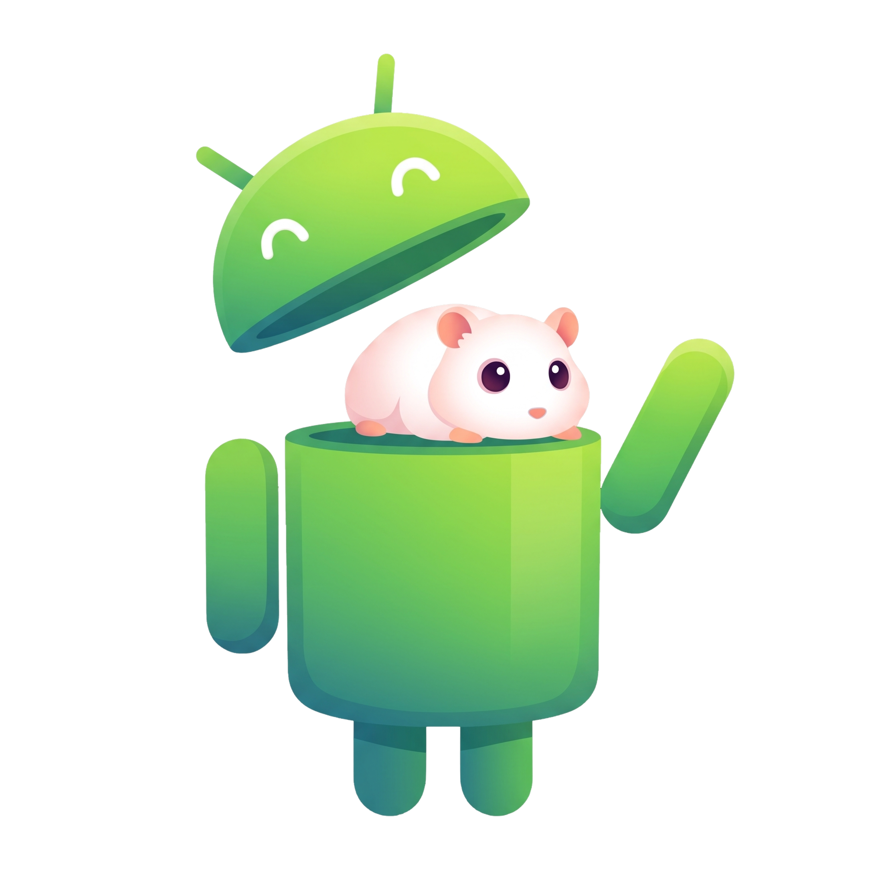

  

<h1 align="center">Bobine for Android — Distribution and Google Play publishing</h1>

  <a href="android-google-play.md">Français</a> · <a href="android-google-play.en.md">English</a>

This document explains how the Bobine Android applications are built, signed, distributed and
published on Google Play. It is written for project maintainers; it is not a user guide (see the
[README](../README.md) for end-user installation).

## Contents

1. [Overview](#1-overview)
2. [Prerequisites](#2-prerequisites)
3. [Building the bundles of a Stable release](#3-building-the-bundles-of-a-stable-release)
   - [The Google Play build](#the-google-play-build)
4. [Version numbering](#4-version-numbering)
5. [Signing](#5-signing)
6. [Publishing on Google Play](#6-publishing-on-google-play)
7. [Points to check in the Play Console](#7-points-to-check-in-the-play-console)
8. [Updates on the user side](#8-updates-on-the-user-side)
9. [Troubleshooting](#9-troubleshooting)

---

## 1. Overview

Bobine ships **two Android applications** from a single code base. They come from two build variants
(*flavors*) and are told apart by their application ID, so they can coexist on the same device and each
has its own Google Play listing.

| Logo | Application | ID | Target devices | Minimum Android | Architectures | Direct install | Google Play |
|:---:|---|---|---|:---:|---|---|---|
|     | **Bobine** (phone and tablet) | `com.bobine.app` | Phones, tablets (Snapdragon 8 Gen 2/3, Dimensity, Tensor), Google Book laptops (Aluminium OS) | 14 (API 34) | `arm64-v8a` | [Bobine-5.0.5.apk](https://github.com/FantasmaGlad/Bobine/releases/download/V5.0.5/Bobine-5.0.5.apk) | Bobine-5.0.5.aab (local, not published) |
|     | **Bobine TV** (Android TV and Google TV) | `com.bobine.app.tv` | Android TV / Google TV boxes and TVs, D-pad remote | 14 (API 34) | `armeabi-v7a`, `arm64-v8a` | [Bobine-TV-5.0.5.apk](https://github.com/FantasmaGlad/Bobine/releases/download/V5.0.5/Bobine-TV-5.0.5.apk) | Bobine-TV-5.0.5.aab (local, not published) |

  

> **APK vs AAB.** An **APK** installs directly on a device (download page, ADB). An **AAB**
> (*Android App Bundle*) is the **upload** format required by Google Play: it cannot be installed as
> is and is only meant to be uploaded to the console. Google Play then generates the APKs suited to
> each device.

Each application embeds its own Bobine server (CPython and FastAPI through Chaquopy) running in a
foreground service: no remote server is required.

## 2. Prerequisites

| Item | Detail |
|---|---|
| Google Play Console account | Developer account with both app listings created (`com.bobine.app` and `com.bobine.app.tv`). |
| Upload key | PKCS12 keystore (alias `bobine`). Kept out of the repository and backed up away from the build machine. |
| GitHub Actions secrets | `ANDROID_KEYSTORE_BASE64`, `ANDROID_KEYSTORE_PASSWORD`, `ANDROID_KEY_ALIAS`, `ANDROID_KEY_PASSWORD`. |
| Optional secret | `PLAY_SERVICE_ACCOUNT_JSON`: key of a Google Cloud service account authorised in the Play Console, for automatic upload. |
| Stable release | An existing `Vx.y.z` tag (Beta and Canary releases are never published on Google Play). |

> **Back up the key.** Without the upload key, no future update can be signed for the existing
> listing. Keep the keystore and its password in an encrypted vault, in two separate places. Never add
> them to the repository.

## 3. Building the bundles of a Stable release

The [`play-aab.yml`](../.github/workflows/play-aab.yml) workflow (**Google Play (AAB)**) is started
manually from GitHub.

1. Open the **Actions** tab, choose **Google Play (AAB)**, then **Run workflow**.
2. Fill in the parameters:

   | Parameter | Value | Purpose |
   |---|---|---|
   | `tag` | `V5.0.5` (required) | Stable version to build. Without `source_ref`, the code is that of this exact tag. |
   | `source_ref` | empty, or `main` | Branch or tag to build. Empty: the tag itself. The source `VERSION` file must match the requested tag; `main` is valid only when its version matches. |
   | `upload_to_play` | `false` (default) / `true` | Explicitly enables upload; also requires `PLAY_SERVICE_ACCOUNT_JSON`. |
   | `play_track` | `internal`, `alpha`, `beta`, `production` | Destination track, used **only** if `upload_to_play=true` and `PLAY_SERVICE_ACCOUNT_JSON` is configured. |

3. When the run ends, get the files from the `bobine-play-aab-<version>` artifact (they are never
   attached to the GitHub release):

   | File | Application |
   |---|---|
   | `Bobine-<version>.aab` | `com.bobine.app` |
   | `Bobine-TV-<version>.aab` | `com.bobine.app.tv` |
   | `Bobine-<version>-play.apk` | `com.bobine.app` (APK equivalent to the bundle) |
   | `Bobine-TV-<version>-play.apk` | `com.bobine.app.tv` (APK equivalent to the bundle) |

The workflow rejects a Beta or Canary tag, strictly checks each bundle's signature (`jarsigner`), rejects unsigned or duplicate entries and checks the
presence of the manifest, verifies APK signatures and 16 KB alignment (the archive, then the ELF segments of every native library: Python, ffmpeg, ffprobe and the audio component), then checks that the Play APKs do not contain the `REQUEST_INSTALL_PACKAGES` permission, checks the native ABIs (`arm64-v8a` for Bobine, `armeabi-v7a` and `arm64-v8a` for Bobine TV) and that the native audio component `libbobine_media.so` is present in each (built by `scripts/ci/build-media-android.sh`), then prints the `versionName` and `versionCode` in the run summary. The component is off by default in the app (Settings → Native audio component); its presence in the packages says nothing about its behaviour on a real device, none having been measured.

### Google Play files of version 5.0.5

| Logo | Application | ID | Devices | Format | Size | Download |
|:---:|---|---|---|---|---:|---|
|     | **Bobine** | `com.bobine.app` | Phones, tablets, Google Book | `.aab` bundle (Google Play upload) | ~49 MB | Bobine-5.0.5.aab (local, not published) |
|     | **Bobine** | `com.bobine.app` | Phones, tablets, Google Book | Play APK (testing and direct install) | — | Bobine-5.0.5-play.apk (local, not published) |
|     | **Bobine TV** | `com.bobine.app.tv` | Android TV, Google TV | `.aab` bundle (Google Play upload) | ~71 MB | Bobine-TV-5.0.5.aab (local, not published) |
|     | **Bobine TV** | `com.bobine.app.tv` | Android TV, Google TV | Play APK (testing and direct install) | — | Bobine-TV-5.0.5-play.apk (local, not published) |

## The Google Play build

Google Play forbids an app distributed through the store from updating itself by any means other than
the Play Store. The `.aab` bundles and the `-play.apk` files are therefore built with a dedicated
variant (`play`, defined in `android/app/build.gradle.kts`):

| Item | GitHub APK (`release`) | Google Play build (`play`) |
|---|---|---|
| `REQUEST_INSTALL_PACKAGES` permission | Present | **Removed** (`android/app/src/play/AndroidManifest.xml`) |
| Built-in update (Settings > Updates) | Active, from GitHub releases | **Follows the Google Play process**: update status, “Update via Google Play”, “Restart to install”, “Open Google Play”; no APK is ever downloaded or installed |
| Requests to GitHub for updates | Yes | None |
| Signature | Upload key | Upload key (Google re-signs for distribution) |

The `-play.apk` is the same build as the bundle: it lets you test on a device what Google Play users
will receive. For a regular install outside Play, use the release APK (`Bobine-<version>.apk`), which
keeps the built-in update.

## 4. Version numbering

- **`versionName`**: the tag number without the `V` (`V5.0.2` gives `5.0.2`).
- **`versionCode`**: the number of commits of the selected source (the tag by default). It grows with every release, which lets Google
  Play accept successive updates, and it follows the same rule as the APKs.

Google Play rejects a bundle whose `versionCode` is not strictly greater than the one already
published on the track. A published Stable tag stays immutable: prepare a new version and a new
tag for an update, then rebuild the bundles.

## 5. Signing

The bundles are signed with the **upload key** (the four `ANDROID_KEY*` secrets). Enable **Play App
Signing** at the first publication: Google keeps the distribution key, and only the upload key is
then required for each release. If the upload key is lost, the console lets you register a new one
after identity verification.

## 6. Publishing on Google Play

### Manual upload

1. In the Google Play Console, choose the application.
2. **Internal testing** (recommended for a first upload) or **Production**, then **Create new release**.
3. Upload the matching `.aab`, fill in the release notes, save and start the review.
4. Repeat for the second application.

### Automatic upload

1. Create a Google Cloud service account and authorise it in the Play Console (release access).
2. Store its JSON key in the `PLAY_SERVICE_ACCOUNT_JSON` GitHub secret.
3. Run the workflow with `upload_to_play=true` and choose the track (`play_track`).

The bundles are then uploaded as a **draft**: the final release remains a manual confirmation in the
console.

## 7. Points to check in the Play Console

Google Play reviews sensitive permissions and how apps update themselves. The following points should
be handled before going to production; they do not prejudge the outcome of the review.

| Topic | Permission or feature | To prepare |
|---|---|---|
| Foreground service | `FOREGROUND_SERVICE`, `FOREGROUND_SERVICE_SPECIAL_USE` | Declare the usage type and justify it: the Bobine server must stay alive during classes. |
| Device startup | `RECEIVE_BOOT_COMPLETED` | Optional feature, enabled by the user in Settings > Device startup. |
| Display over other apps | `SYSTEM_ALERT_WINDOW` | Justify opening the screen at startup. |
| Battery optimisation | `REQUEST_IGNORE_BATTERY_OPTIMIZATIONS` | Justify: continuous playback in the studio. |
| App installation | `REQUEST_INSTALL_PACKAGES` | Removed from the Google Play build (see [The Google Play build](#the-google-play-build)): no declaration to fill in for this permission. |
| Data and privacy | No telemetry, offline operation | "Data safety" form: no collection, no sharing. |

## 8. Updates on the user side

An app installed from Google Play updates through the Play Store; one installed from a GitHub APK
updates from Bobine's Settings. The two installations are **not interchangeable**: the signature
differs (Google's distribution key versus the upload key). To switch from one to the other, back up the
data (Settings > Backup), uninstall, then reinstall.

**Channels**: the Google Play app is locked to the Stable channel (the publishing workflow refuses any `-beta` or `-canary` version). The channel selector is hidden in Settings, the server refuses any other channel and every icon stays the Stable one. The Beta and Canary channels only exist for APKs downloaded from GitHub, which offer the channel they came from by default.

## 9. Troubleshooting

| Symptom | Likely cause | Action |
|---|---|---|
| The console rejects the bundle ("version code already used") | `versionCode` not greater than the one already published | Rebuild from a more recent tag. |
| The workflow stops on the tag format | Beta, Canary or malformed tag | Use a Stable `Vx.y.z` tag. |
| Build skipped with a warning | `ANDROID_KEYSTORE_*` secrets missing | Add the secrets (section 2). |
| Nothing sent to Play although the workflow succeeded | `upload_to_play=false` or `PLAY_SERVICE_ACCOUNT_JSON` not configured | Manual upload (section 6) or add the secret. |
| The bundle will not install on the device | An `.aab` is not installable | Use the APK, or upload the bundle to Play. |

## Related documents

- [Release notes 5.0.2](releases/V5.0.2.md)
- [Technical architecture](ARCHITECTURE.en.md) (Android section)
- [README](../README.md)
