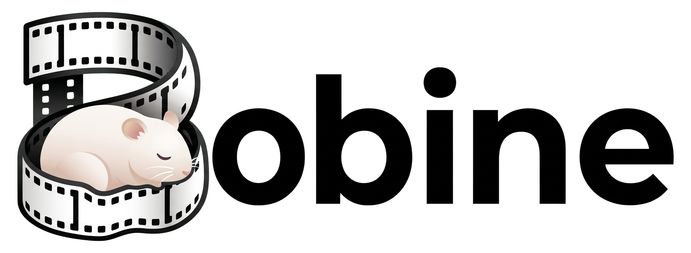

# Bobine V5.3.0 — Visuels, aperçu de la timeline et interface revue

  

La version **5.3.0** succède à **5.2.2**. Elle a été vérifiée par la suite de tests et dans un navigateur ; elle n'a pas fait l'objet d'une validation complète sur matériel réel.

## Visuels
- **Espace Visuels** (Bibliothèque > Visuels) : images, GIF et vidéos courtes à diffuser, distincts des fonds animés du coach ; import par bouton, glisser-déposer, archive ou dossier surveillé.
- **Sortie « Visuel »** pour les canaux câblé et réseau : la boucle s'édite directement dans le tableau de bord du canal (ordre, durée de chaque image, vidéo entière ou durée choisie), avec import sur place. Les lancements de cours sont verrouillés tant que le canal diffuse un visuel.
- Lecteur des visuels : chaque élément est décodé avant d'apparaître, fondu de 200 ms, élément illisible sauté sans trou.
- Formats : PNG, JPEG, WebP et GIF tels quels ; AVIF, HEIC, BMP, TIFF, APNG, JPEG 2000 et autres convertis en WebP à l'import ; vidéos WMV, FLV, MPEG, TS, 3GP, OGV converties en MP4. HEIC demande ffmpeg 7.1 ou plus récent sur ordinateur.
- `bobine visuals` (liste, import, renommage, suppression) et `bobine signage` (boucle d'un canal).

## Lecture
- Barre de saut du kiosque à sa grande taille d'origine ; titre du chapitre et **aperçu image du moment visé** au-dessus de la barre, au kiosque comme au cinéma.
- **Double appui sur gauche ou droite** : chapitre précédent ou suivant. Appui long : saut accéléré.
- Écran de pause plein écran commun au kiosque et au cinéma, sans barre de progression.
- Prochain cours avec miniature, durée et aperçu ; cinéma : liste des cours en languette, retour en haut sans blocage.

## Interface
- Transitions de page sans coupure ; sous-vues des pages dans l'adresse (`?vue=`).
- **Périphériques** : deux vues, Appareils (sorties audio et Bluetooth) et Son (sortie, volume, rappels et égaliseur de chaque radio, égaliseur des vidéos).
- Rappels de la radio : onglets Rappels et Règles dans la barre commune, règle en une ligne.
- Réglages : onglets sur plusieurs lignes au lieu d'être coupés, page Entrées avec capture de touche, zone de danger en deux blocs.
- Bouton « Ouvrir l'écran » commun aux deux canaux ; favicon, nom et raccourcis du clic droit selon le canal de mise à jour.

## Fiabilité
- Une conversion vidéo qui ne produit aucune image est refusée au lieu d'importer un fichier illisible.
- Avis RUSTSEC-2026-0594 corrigé (`cookie` 0.18.3) ; contrôle de l'hôte et en-têtes de sécurité sur toute réponse ; entrées et sous-processus bornés.

---

Les notes complètes des versions précédentes restent disponibles dans les [versions](https://github.com/FantasmaGlad/Bobine/releases).
