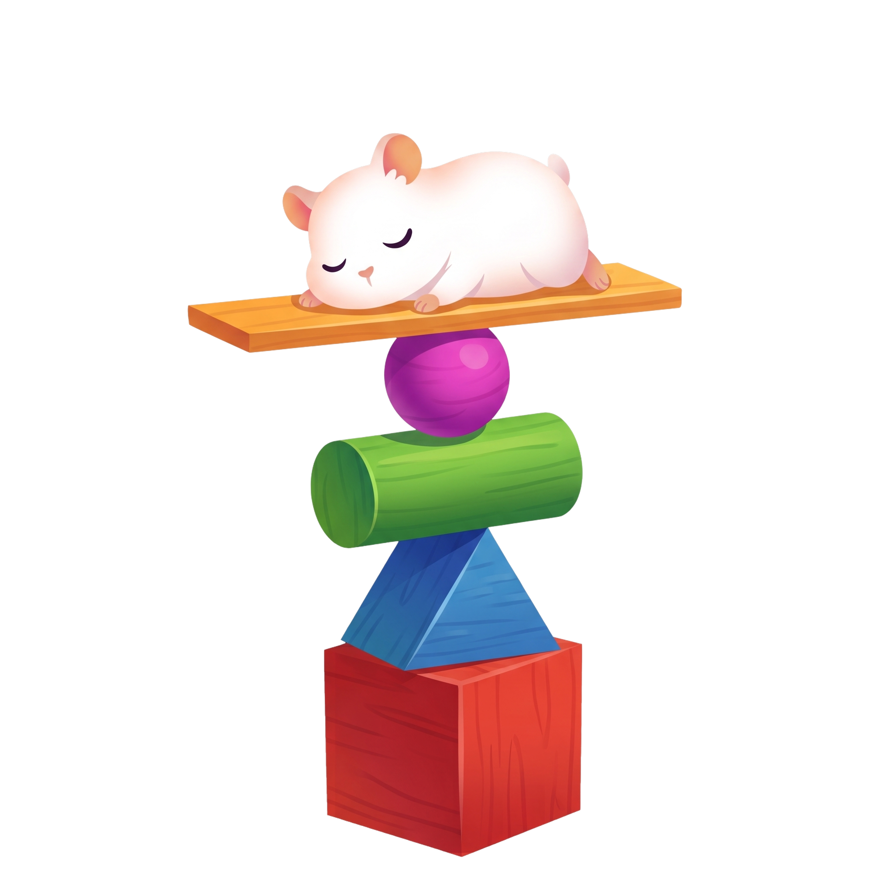

  

  

# Bobine — Bêta (lot curé)

> **Canal Bêta (accès anticipé).** Lots de fonctionnalités et correctifs curés et publiés manuellement **en place** sur le tag mobile `beta` (jamais un nouveau tag par itération) — plus testé que Canary, moins que Stable. Une version stable équivalente ou plus récente la remplace toujours automatiquement.

Réservée aux utilisateurs ayant activé le canal Bêta (Réglages → Mises à jour). Pour suivre chaque commit de main sans attendre un lot, voir le [canal Canary](https://github.com/FantasmaGlad/Bobine/releases/tag/canary).

**Basé sur** commit `__COMMIT__` · version à venir `__VERSION__`

---

